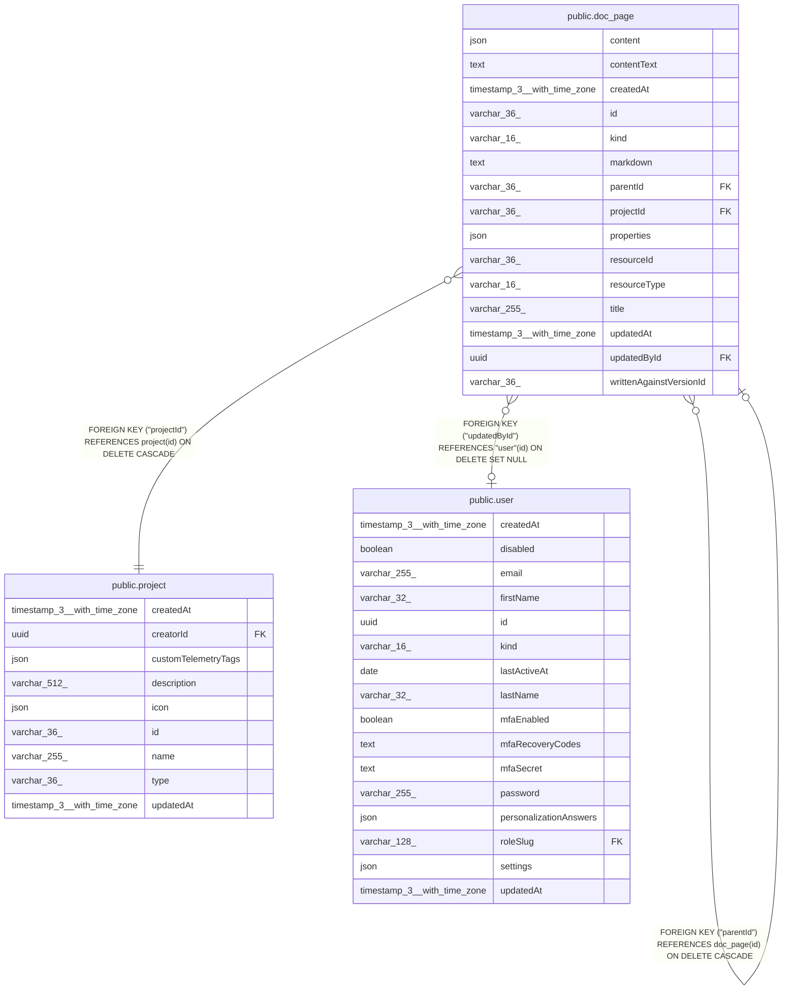

# public.doc_page

## Columns

| Name | Type | Default | Nullable | Children | Parents | Comment |
| ---- | ---- | ------- | -------- | -------- | ------- | ------- |
| content | json |  | true |  |  | Tiptap editor document. Null until the first save |
| contentText | text |  | false |  |  | Plain text for search |
| createdAt | timestamp(3) with time zone | CURRENT_TIMESTAMP(3) | false |  |  |  |
| id | varchar(36) |  | false | [public.doc_page](public.doc_page.md) |  |  |
| kind | varchar(16) |  | true |  |  | Template of the page, from the trigger nodes. Null on child pages |
| markdown | text |  | true |  |  | LLM output that waits for the editor to convert it |
| parentId | varchar(36) |  | true |  | [public.doc_page](public.doc_page.md) | Parent page. Set only on child pages |
| projectId | varchar(36) |  | false |  | [public.project](public.project.md) |  |
| properties | json |  | true |  |  | Facts from the published workflow or agent, such as triggers, URLs and model. Null on child pages |
| resourceId | varchar(36) |  | true |  |  | Id of the workflow or agent. Null on child pages |
| resourceType | varchar(16) |  | true |  |  | Type of the documented resource. Null on child pages |
| title | varchar(255) |  | false |  |  |  |
| updatedAt | timestamp(3) with time zone | CURRENT_TIMESTAMP(3) | false |  |  |  |
| updatedById | uuid |  | true |  | [public.user](public.user.md) |  |
| writtenAgainstVersionId | varchar(36) |  | true |  |  | Published version id of the resource when the page was generated |

## Constraints

| Name | Type | Definition |
| ---- | ---- | ---------- |
| CHK_doc_page_kind | CHECK | CHECK (((kind)::text = ANY ((ARRAY['api'::character varying, 'schedule'::character varying, 'event'::character varying, 'agent'::character varying])::text[]))) |
| CHK_doc_page_resourceType | CHECK | CHECK ((("resourceType")::text = ANY ((ARRAY['workflow'::character varying, 'agent'::character varying, 'project'::character varying])::text[]))) |
| FK_2cc7479939efa30ee8f84f008b1 | FOREIGN KEY | FOREIGN KEY ("parentId") REFERENCES doc_page(id) ON DELETE CASCADE |
| FK_57d75493c80a2cc512480d17937 | FOREIGN KEY | FOREIGN KEY ("projectId") REFERENCES project(id) ON DELETE CASCADE |
| FK_e1d897d1f9c55b1782b37fb7aab | FOREIGN KEY | FOREIGN KEY ("updatedById") REFERENCES "user"(id) ON DELETE SET NULL |
| PK_58fd0fa2126cd86d4d3475c0bf6 | PRIMARY KEY | PRIMARY KEY (id) |
| doc_page_contentText_not_null | n | NOT NULL "contentText" |
| doc_page_createdAt_not_null | n | NOT NULL "createdAt" |
| doc_page_id_not_null | n | NOT NULL id |
| doc_page_projectId_not_null | n | NOT NULL "projectId" |
| doc_page_title_not_null | n | NOT NULL title |
| doc_page_updatedAt_not_null | n | NOT NULL "updatedAt" |

## Indexes

| Name | Definition |
| ---- | ---------- |
| IDX_2cc7479939efa30ee8f84f008b | CREATE INDEX "IDX_2cc7479939efa30ee8f84f008b" ON public.doc_page USING btree ("parentId") |
| IDX_57d75493c80a2cc512480d1793 | CREATE INDEX "IDX_57d75493c80a2cc512480d1793" ON public.doc_page USING btree ("projectId") |
| IDX_doc_page_resourceType_resourceId | CREATE UNIQUE INDEX "IDX_doc_page_resourceType_resourceId" ON public.doc_page USING btree ("resourceType", "resourceId") WHERE ("resourceId" IS NOT NULL) |
| PK_58fd0fa2126cd86d4d3475c0bf6 | CREATE UNIQUE INDEX "PK_58fd0fa2126cd86d4d3475c0bf6" ON public.doc_page USING btree (id) |

## Relations

---

> Generated by [tbls](https://github.com/k1LoW/tbls)
