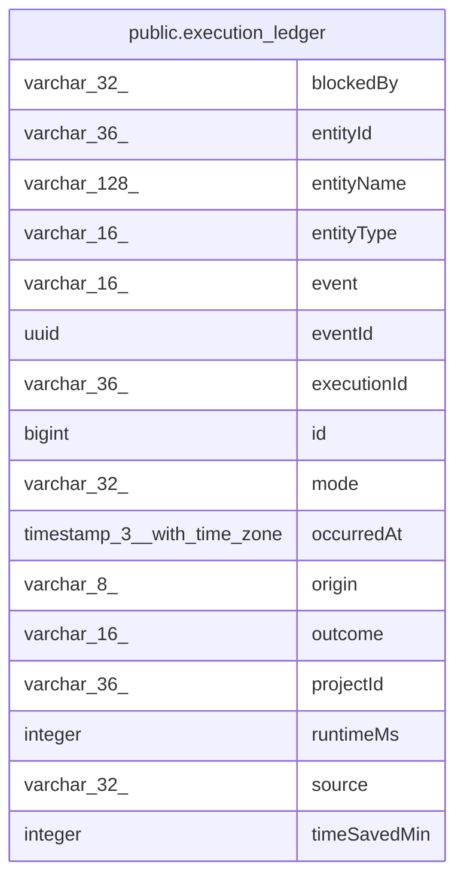

# public.execution_ledger

## Columns

| Name | Type | Default | Nullable | Children | Parents | Comment |
| ---- | ---- | ------- | -------- | -------- | ------- | ------- |
| blockedBy | varchar(32) | 'none'::character varying | false |  |  | Why a blocked run stopped. startFailed: any other failure before the first node |
| entityId | varchar(36) |  | false |  |  | Workflow ID or agent ID. No foreign key: rows outlive the entity |
| entityName | varchar(128) |  | false |  |  | Name of the workflow or agent at the time of the event |
| entityType | varchar(16) |  | false |  |  | workflow: a workflow run; agent: an agent message |
| event | varchar(16) |  | false |  |  | started: the run got its execution row; ended: the run stopped |
| eventId | uuid |  | false |  |  | UUIDv7 set by the writer. The engine v2 pull deduplicates on it |
| executionId | varchar(36) |  | false |  |  | Execution ID, or the agent message ID for agent rows |
| id | bigint |  | false |  |  | Fold order; IDs are not reused |
| mode | varchar(32) |  | false |  |  | Raw execution mode, such as trigger or webhook. Not constrained |
| occurredAt | timestamp(3) with time zone |  | false |  |  | When the run started or ended |
| origin | varchar(8) |  | false |  |  | v1: written by this instance; v2: pulled from the engine v2 data plane |
| outcome | varchar(16) |  | false |  |  | none for started rows. blocked: the run stopped before its first node |
| projectId | varchar(36) |  | false |  |  | Project at the time of the event. No foreign key: rows outlive the project |
| runtimeMs | integer | 0 | false |  |  | Run time in milliseconds. 0 for started rows |
| source | varchar(32) | 'none'::character varying | false |  |  | Raw execution source, such as instance_ai. none when unset. Not constrained |
| timeSavedMin | integer | 0 | false |  |  | Time saved in minutes. 0 for started rows |

## Constraints

| Name | Type | Definition |
| ---- | ---- | ---------- |
| CHK_execution_ledger_blockedBy | CHECK | CHECK ((("blockedBy")::text = ANY ((ARRAY['none'::character varying, 'policy'::character varying, 'credentialAccess'::character varying, 'invalidWorkflow'::character varying, 'contextHook'::character varying, 'startFailed'::character varying])::text[]))) |
| CHK_execution_ledger_blocked_reason | CHECK | CHECK (((((outcome)::text = 'blocked'::text) AND (("blockedBy")::text <> 'none'::text)) OR (((outcome)::text <> 'blocked'::text) AND (("blockedBy")::text = 'none'::text)))) |
| CHK_execution_ledger_entityType | CHECK | CHECK ((("entityType")::text = ANY ((ARRAY['workflow'::character varying, 'agent'::character varying])::text[]))) |
| CHK_execution_ledger_event | CHECK | CHECK (((event)::text = ANY ((ARRAY['started'::character varying, 'ended'::character varying])::text[]))) |
| CHK_execution_ledger_origin | CHECK | CHECK (((origin)::text = ANY ((ARRAY['v1'::character varying, 'v2'::character varying])::text[]))) |
| CHK_execution_ledger_outcome | CHECK | CHECK (((outcome)::text = ANY ((ARRAY['none'::character varying, 'success'::character varying, 'error'::character varying, 'crashed'::character varying, 'canceled'::character varying, 'blocked'::character varying])::text[]))) |
| CHK_execution_ledger_started_outcome | CHECK | CHECK (((((event)::text = 'started'::text) AND ((outcome)::text = 'none'::text)) OR (((event)::text = 'ended'::text) AND ((outcome)::text <> 'none'::text)))) |
| PK_12eefe1344267a5eb2047111535 | PRIMARY KEY | PRIMARY KEY (id) |
| execution_ledger_blockedBy_not_null | n | NOT NULL "blockedBy" |
| execution_ledger_entityId_not_null | n | NOT NULL "entityId" |
| execution_ledger_entityName_not_null | n | NOT NULL "entityName" |
| execution_ledger_entityType_not_null | n | NOT NULL "entityType" |
| execution_ledger_eventId_not_null | n | NOT NULL "eventId" |
| execution_ledger_event_not_null | n | NOT NULL event |
| execution_ledger_executionId_not_null | n | NOT NULL "executionId" |
| execution_ledger_id_not_null | n | NOT NULL id |
| execution_ledger_mode_not_null | n | NOT NULL mode |
| execution_ledger_occurredAt_not_null | n | NOT NULL "occurredAt" |
| execution_ledger_origin_not_null | n | NOT NULL origin |
| execution_ledger_outcome_not_null | n | NOT NULL outcome |
| execution_ledger_projectId_not_null | n | NOT NULL "projectId" |
| execution_ledger_runtimeMs_not_null | n | NOT NULL "runtimeMs" |
| execution_ledger_source_not_null | n | NOT NULL source |
| execution_ledger_timeSavedMin_not_null | n | NOT NULL "timeSavedMin" |

## Indexes

| Name | Definition |
| ---- | ---------- |
| PK_12eefe1344267a5eb2047111535 | CREATE UNIQUE INDEX "PK_12eefe1344267a5eb2047111535" ON public.execution_ledger USING btree (id) |

## Relations

---

> Generated by [tbls](https://github.com/k1LoW/tbls)
