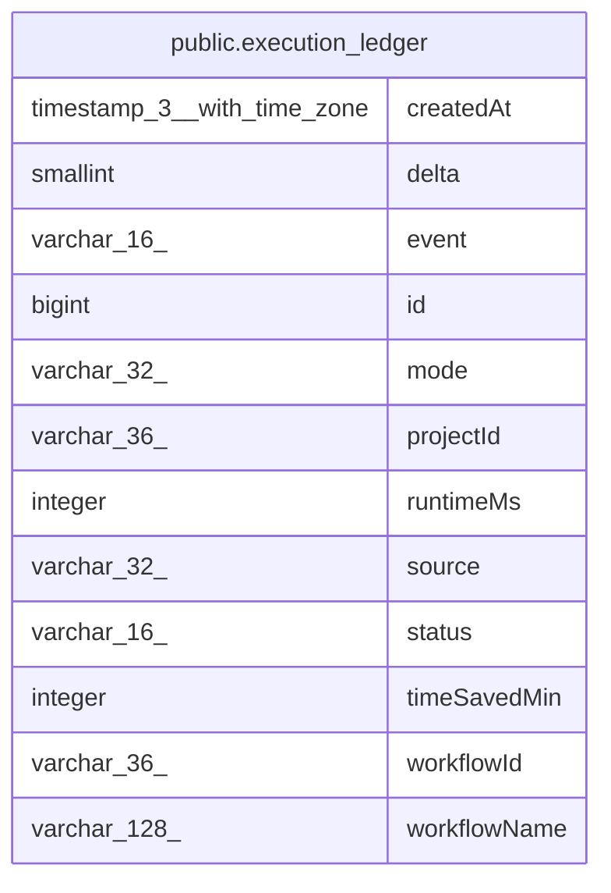

# public.execution_ledger

## Columns

| Name | Type | Default | Nullable | Children | Parents | Comment |
| ---- | ---- | ------- | -------- | -------- | ------- | ------- |
| createdAt | timestamp(3) with time zone | CURRENT_TIMESTAMP | false |  |  |  |
| delta | smallint | 1 | false |  |  | +1 for an event, -1 to compensate a refused admission |
| event | varchar(16) |  | false |  |  | started: counted at admission; finished: completed run outcome |
| id | bigint |  | false |  |  |  |
| mode | varchar(32) |  | false |  |  |  |
| projectId | varchar(36) |  | true |  |  |  |
| runtimeMs | integer |  | true |  |  |  |
| source | varchar(32) |  | true |  |  |  |
| status | varchar(16) |  | true |  |  |  |
| timeSavedMin | integer |  | true |  |  |  |
| workflowId | varchar(36) |  | false |  |  |  |
| workflowName | varchar(128) |  | true |  |  |  |

## Constraints

| Name | Type | Definition |
| ---- | ---- | ---------- |
| execution_ledger_createdAt_not_null | n | NOT NULL "createdAt" |
| execution_ledger_delta_not_null | n | NOT NULL delta |
| execution_ledger_event_check | CHECK | CHECK (((event)::text = ANY ((ARRAY['started'::character varying, 'finished'::character varying])::text[]))) |
| execution_ledger_event_not_null | n | NOT NULL event |
| execution_ledger_id_not_null | n | NOT NULL id |
| execution_ledger_mode_not_null | n | NOT NULL mode |
| execution_ledger_pkey | PRIMARY KEY | PRIMARY KEY (id) |
| execution_ledger_workflowId_not_null | n | NOT NULL "workflowId" |

## Indexes

| Name | Definition |
| ---- | ---------- |
| execution_ledger_pkey | CREATE UNIQUE INDEX execution_ledger_pkey ON public.execution_ledger USING btree (id) |

## Relations

---

> Generated by [tbls](https://github.com/k1LoW/tbls)
