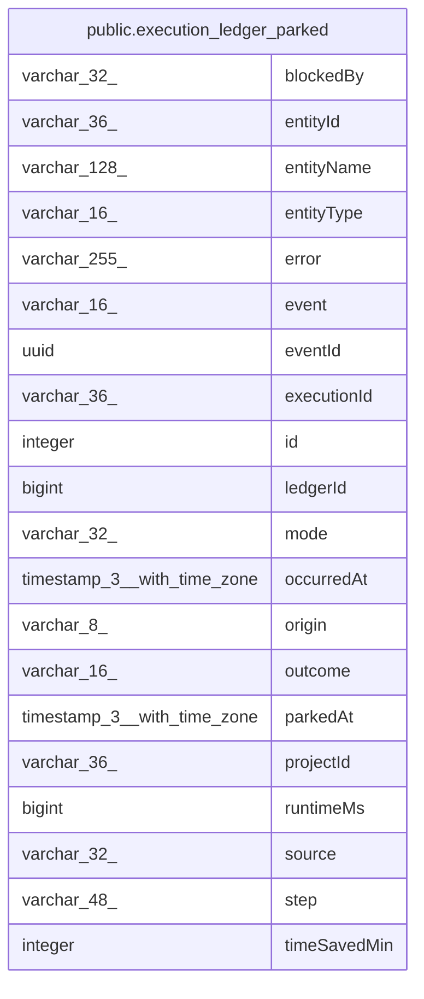

# public.execution_ledger_parked

## Columns

| Name | Type | Default | Nullable | Children | Parents | Comment |
| ---- | ---- | ------- | -------- | -------- | ------- | ------- |
| blockedBy | varchar(32) |  | false |  |  | Copied from the ledger row. Not constrained, so an unknown value fits |
| entityId | varchar(36) |  | false |  |  | Workflow ID or agent ID. No foreign key: rows outlive the entity |
| entityName | varchar(128) |  | false |  |  | Copied from the ledger row |
| entityType | varchar(16) |  | false |  |  | Copied from the ledger row. Not constrained, so an unknown value fits |
| error | varchar(255) |  | false |  |  | Message of the failure that parked the row. Truncated |
| event | varchar(16) |  | false |  |  | Copied from the ledger row. Not constrained, so an unknown value fits |
| eventId | uuid |  | false |  |  | Copied from the ledger row |
| executionId | varchar(36) |  | false |  |  | Copied from the ledger row |
| id | integer |  | false |  |  | Row key only. It has no meaning |
| ledgerId | bigint |  | false |  |  | ID that the row had in execution_ledger. Replay order |
| mode | varchar(32) |  | false |  |  | Copied from the ledger row. Not constrained, so an unknown value fits |
| occurredAt | timestamp(3) with time zone |  | false |  |  | Copied from the ledger row |
| origin | varchar(8) |  | false |  |  | Copied from the ledger row. Not constrained, so an unknown value fits |
| outcome | varchar(16) |  | false |  |  | Copied from the ledger row. Not constrained, so an unknown value fits |
| parkedAt | timestamp(3) with time zone |  | false |  |  | When the fold parked the row |
| projectId | varchar(36) |  | true |  |  | Project at the time of the event. No foreign key: rows outlive the project. Null when the workflow has no owner project |
| runtimeMs | bigint |  | false |  |  | Run time in milliseconds |
| source | varchar(32) |  | false |  |  | Copied from the ledger row. Not constrained, so an unknown value fits |
| step | varchar(48) |  | false |  |  | Name of the fold step that must still read the row. _unreadable: no step could read it |
| timeSavedMin | integer |  | false |  |  | Time saved in minutes |

## Constraints

| Name | Type | Definition |
| ---- | ---- | ---------- |
| PK_49e8931f08fd1d9236ac080e828 | PRIMARY KEY | PRIMARY KEY (id) |
| execution_ledger_parked_blockedBy_not_null | n | NOT NULL "blockedBy" |
| execution_ledger_parked_entityId_not_null | n | NOT NULL "entityId" |
| execution_ledger_parked_entityName_not_null | n | NOT NULL "entityName" |
| execution_ledger_parked_entityType_not_null | n | NOT NULL "entityType" |
| execution_ledger_parked_error_not_null | n | NOT NULL error |
| execution_ledger_parked_eventId_not_null | n | NOT NULL "eventId" |
| execution_ledger_parked_event_not_null | n | NOT NULL event |
| execution_ledger_parked_executionId_not_null | n | NOT NULL "executionId" |
| execution_ledger_parked_id_not_null | n | NOT NULL id |
| execution_ledger_parked_ledgerId_not_null | n | NOT NULL "ledgerId" |
| execution_ledger_parked_mode_not_null | n | NOT NULL mode |
| execution_ledger_parked_occurredAt_not_null | n | NOT NULL "occurredAt" |
| execution_ledger_parked_origin_not_null | n | NOT NULL origin |
| execution_ledger_parked_outcome_not_null | n | NOT NULL outcome |
| execution_ledger_parked_parkedAt_not_null | n | NOT NULL "parkedAt" |
| execution_ledger_parked_runtimeMs_not_null | n | NOT NULL "runtimeMs" |
| execution_ledger_parked_source_not_null | n | NOT NULL source |
| execution_ledger_parked_step_not_null | n | NOT NULL step |
| execution_ledger_parked_timeSavedMin_not_null | n | NOT NULL "timeSavedMin" |

## Indexes

| Name | Definition |
| ---- | ---------- |
| IDX_9d90aef512ab0433f8d442fe13 | CREATE UNIQUE INDEX "IDX_9d90aef512ab0433f8d442fe13" ON public.execution_ledger_parked USING btree (step, "ledgerId") |
| PK_49e8931f08fd1d9236ac080e828 | CREATE UNIQUE INDEX "PK_49e8931f08fd1d9236ac080e828" ON public.execution_ledger_parked USING btree (id) |

## Relations

---

> Generated by [tbls](https://github.com/k1LoW/tbls)
