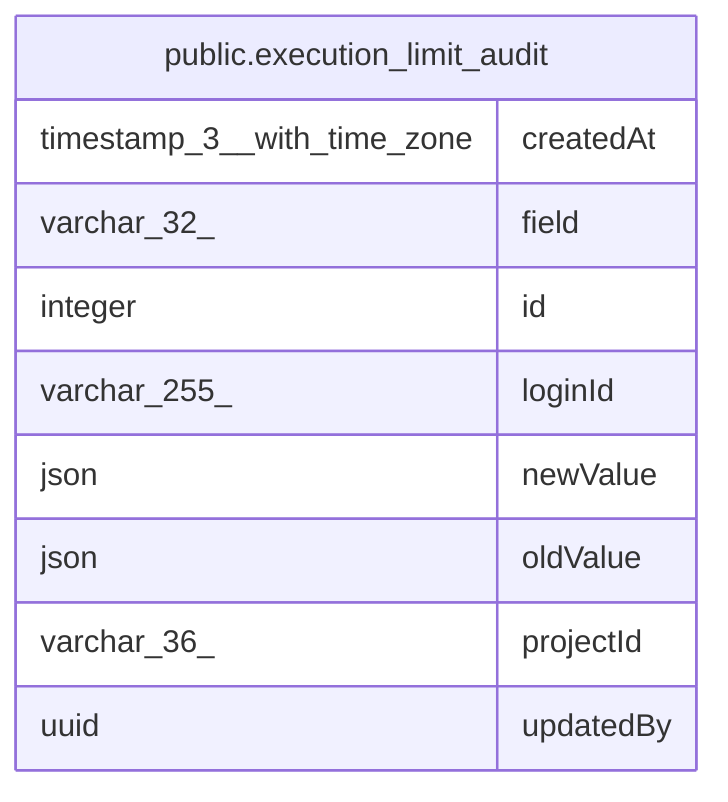

# public.execution_limit_audit

## Columns

| Name | Type | Default | Nullable | Children | Parents | Comment |
| ---- | ---- | ------- | -------- | -------- | ------- | ------- |
| createdAt | timestamp(3) with time zone | CURRENT_TIMESTAMP(3) | false |  |  |  |
| field | varchar(32) |  | false |  |  | What changed. periodUnit, instanceMaxExecutions and defaultProjectMaxExecutions are the instance settings in features.executionLimits. projectMaxExecutions is the limit of the project in projectId |
| id | integer |  | false |  |  |  |
| loginId | varchar(255) |  | true |  |  | Login that a service account used to make the change. NULL for a person and for a change that n8n made. No foreign key, so the row stays when the login is deleted |
| newValue | json |  | true |  |  | Value after the change: a period unit or a maximum number of executions. NULL for no limit |
| oldValue | json |  | true |  |  | Value before the change: a period unit or a maximum number of executions. NULL for no limit |
| projectId | varchar(36) |  | true |  |  | Project whose execution limit changed. NULL for a change to the instance settings. No foreign key, so the row stays when the project is deleted |
| updatedBy | uuid |  | true |  |  | User who made the change. NULL for a change that n8n made. No foreign key, so the row stays when the user is deleted |

## Constraints

| Name | Type | Definition |
| ---- | ---- | ---------- |
| CHK_execution_limit_audit_field | CHECK | CHECK (((field)::text = ANY ((ARRAY['periodUnit'::character varying, 'instanceMaxExecutions'::character varying, 'defaultProjectMaxExecutions'::character varying, 'projectMaxExecutions'::character varying])::text[]))) |
| CHK_execution_limit_audit_project_field | CHECK | CHECK (((((field)::text = 'projectMaxExecutions'::text) AND ("projectId" IS NOT NULL)) OR (((field)::text <> 'projectMaxExecutions'::text) AND ("projectId" IS NULL)))) |
| PK_eaff1c6bc11b40a5e2310811cc6 | PRIMARY KEY | PRIMARY KEY (id) |
| execution_limit_audit_createdAt_not_null | n | NOT NULL "createdAt" |
| execution_limit_audit_field_not_null | n | NOT NULL field |
| execution_limit_audit_id_not_null | n | NOT NULL id |

## Indexes

| Name | Definition |
| ---- | ---------- |
| PK_eaff1c6bc11b40a5e2310811cc6 | CREATE UNIQUE INDEX "PK_eaff1c6bc11b40a5e2310811cc6" ON public.execution_limit_audit USING btree (id) |

## Relations

---

> Generated by [tbls](https://github.com/k1LoW/tbls)
