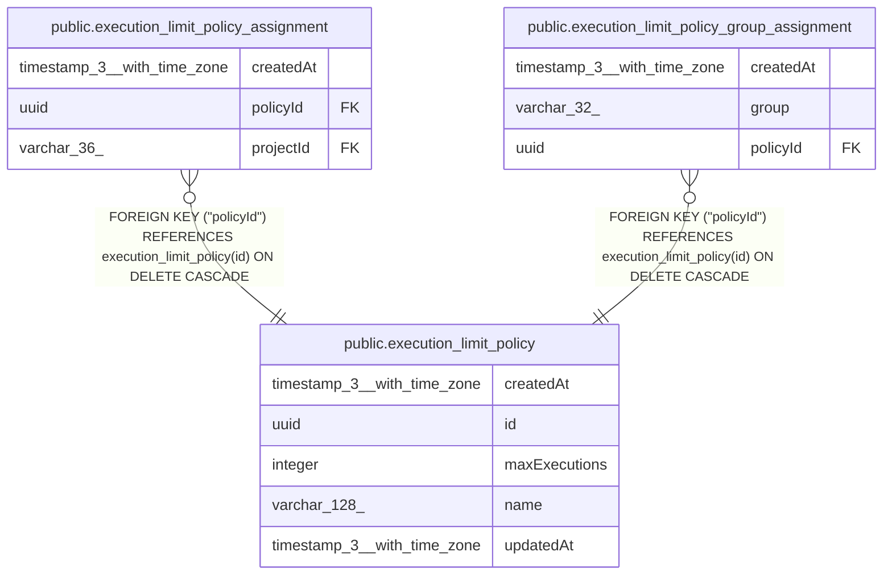

# public.execution_limit_policy

## Columns

| Name | Type | Default | Nullable | Children | Parents | Comment |
| ---- | ---- | ------- | -------- | -------- | ------- | ------- |
| createdAt | timestamp(3) with time zone | CURRENT_TIMESTAMP(3) | false |  |  |  |
| id | uuid |  | false | [public.execution_limit_policy_assignment](public.execution_limit_policy_assignment.md) [public.execution_limit_policy_group_assignment](public.execution_limit_policy_group_assignment.md) |  | UUIDv7, made by the application |
| maxExecutions | integer |  | false |  |  | Maximum number of executions for each project of the policy in one period. The instance setting features.executionLimits sets the period |
| name | varchar(128) |  | false |  |  |  |
| updatedAt | timestamp(3) with time zone | CURRENT_TIMESTAMP(3) | false |  |  |  |

## Constraints

| Name | Type | Definition |
| ---- | ---- | ---------- |
| CHK_execution_limit_policy_max_executions_positive | CHECK | CHECK (("maxExecutions" > 0)) |
| PK_3e36a097ff1f4f081cd95e56032 | PRIMARY KEY | PRIMARY KEY (id) |
| execution_limit_policy_createdAt_not_null | n | NOT NULL "createdAt" |
| execution_limit_policy_id_not_null | n | NOT NULL id |
| execution_limit_policy_maxExecutions_not_null | n | NOT NULL "maxExecutions" |
| execution_limit_policy_name_not_null | n | NOT NULL name |
| execution_limit_policy_updatedAt_not_null | n | NOT NULL "updatedAt" |

## Indexes

| Name | Definition |
| ---- | ---------- |
| IDX_0371d0006540d54e0bf3b66041 | CREATE UNIQUE INDEX "IDX_0371d0006540d54e0bf3b66041" ON public.execution_limit_policy USING btree (name) |
| PK_3e36a097ff1f4f081cd95e56032 | CREATE UNIQUE INDEX "PK_3e36a097ff1f4f081cd95e56032" ON public.execution_limit_policy USING btree (id) |

## Relations

---

> Generated by [tbls](https://github.com/k1LoW/tbls)
