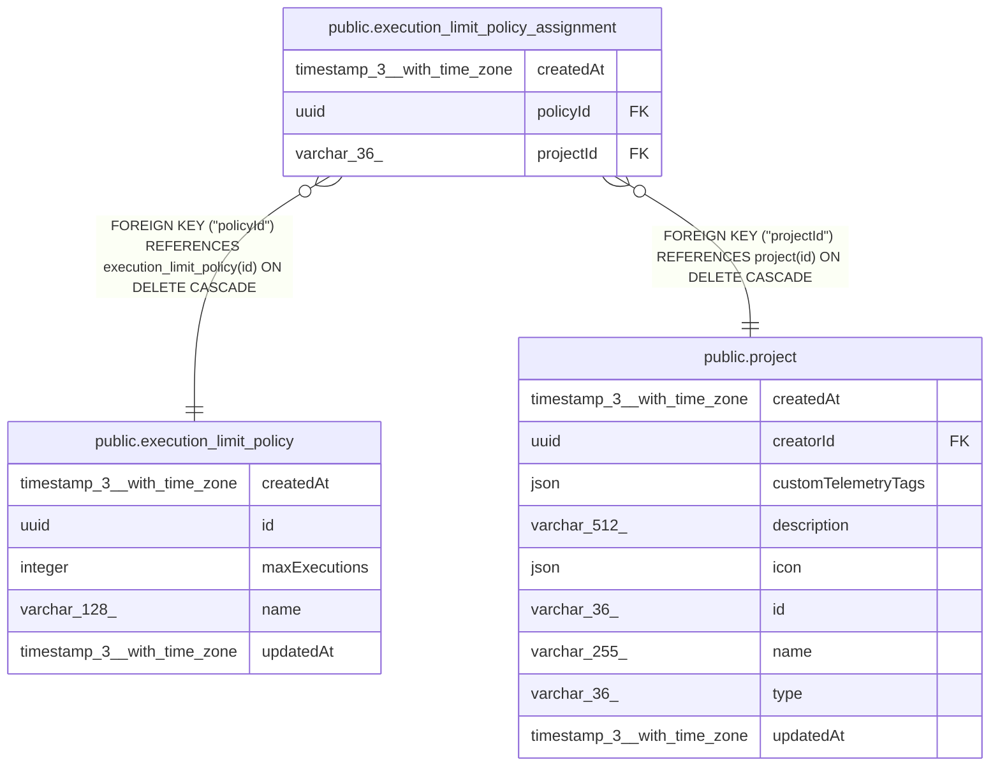

# public.execution_limit_policy_assignment

## Columns

| Name | Type | Default | Nullable | Children | Parents | Comment |
| ---- | ---- | ------- | -------- | -------- | ------- | ------- |
| createdAt | timestamp(3) with time zone | CURRENT_TIMESTAMP(3) | false |  |  |  |
| policyId | uuid |  | false |  | [public.execution_limit_policy](public.execution_limit_policy.md) |  |
| projectId | varchar(36) |  | false |  | [public.project](public.project.md) |  |

## Constraints

| Name | Type | Definition |
| ---- | ---- | ---------- |
| FK_8e78454e151e273b43307b7c3ef | FOREIGN KEY | FOREIGN KEY ("projectId") REFERENCES project(id) ON DELETE CASCADE |
| FK_a2068a7e0137ebddc1258078e38 | FOREIGN KEY | FOREIGN KEY ("policyId") REFERENCES execution_limit_policy(id) ON DELETE CASCADE |
| PK_b1e6cac406e508f31ba538ef4d1 | PRIMARY KEY | PRIMARY KEY ("policyId", "projectId") |
| execution_limit_policy_assignment_createdAt_not_null | n | NOT NULL "createdAt" |
| execution_limit_policy_assignment_policyId_not_null | n | NOT NULL "policyId" |
| execution_limit_policy_assignment_projectId_not_null | n | NOT NULL "projectId" |

## Indexes

| Name | Definition |
| ---- | ---------- |
| IDX_8e78454e151e273b43307b7c3e | CREATE INDEX "IDX_8e78454e151e273b43307b7c3e" ON public.execution_limit_policy_assignment USING btree ("projectId") |
| PK_b1e6cac406e508f31ba538ef4d1 | CREATE UNIQUE INDEX "PK_b1e6cac406e508f31ba538ef4d1" ON public.execution_limit_policy_assignment USING btree ("policyId", "projectId") |

## Relations

---

> Generated by [tbls](https://github.com/k1LoW/tbls)
