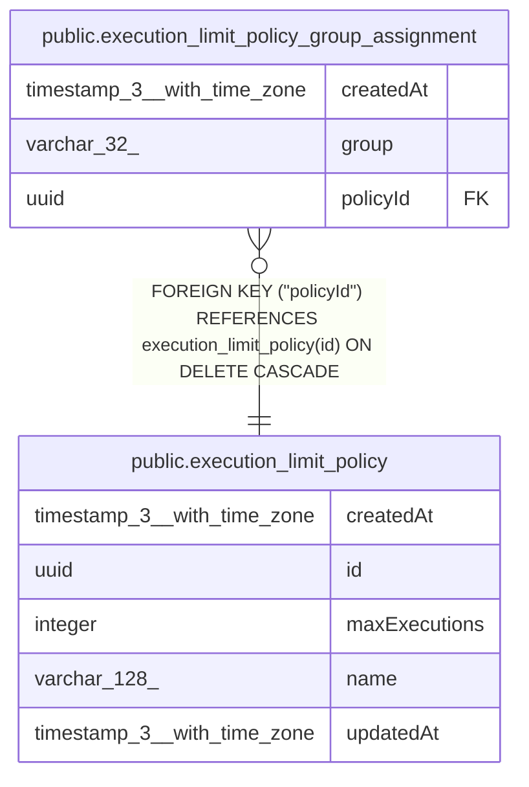

# public.execution_limit_policy_group_assignment

## Columns

| Name | Type | Default | Nullable | Children | Parents | Comment |
| ---- | ---- | ------- | -------- | -------- | ------- | ------- |
| createdAt | timestamp(3) with time zone | CURRENT_TIMESTAMP(3) | false |  |  |  |
| group | varchar(32) |  | false |  |  | Projects that get the policy. newProjects is each new team project. personalProjects is each personal project |
| policyId | uuid |  | false |  | [public.execution_limit_policy](public.execution_limit_policy.md) |  |

## Constraints

| Name | Type | Definition |
| ---- | ---- | ---------- |
| CHK_execution_limit_policy_group_assignment_group | CHECK | CHECK ((("group")::text = ANY ((ARRAY['newProjects'::character varying, 'personalProjects'::character varying])::text[]))) |
| FK_7686f6858074a52c9ce4a8cebe2 | FOREIGN KEY | FOREIGN KEY ("policyId") REFERENCES execution_limit_policy(id) ON DELETE CASCADE |
| PK_391dd8680b4f036bb1ebae848e9 | PRIMARY KEY | PRIMARY KEY ("policyId", "group") |
| execution_limit_policy_group_assignment_createdAt_not_null | n | NOT NULL "createdAt" |
| execution_limit_policy_group_assignment_group_not_null | n | NOT NULL "group" |
| execution_limit_policy_group_assignment_policyId_not_null | n | NOT NULL "policyId" |

## Indexes

| Name | Definition |
| ---- | ---------- |
| PK_391dd8680b4f036bb1ebae848e9 | CREATE UNIQUE INDEX "PK_391dd8680b4f036bb1ebae848e9" ON public.execution_limit_policy_group_assignment USING btree ("policyId", "group") |

## Relations

---

> Generated by [tbls](https://github.com/k1LoW/tbls)
