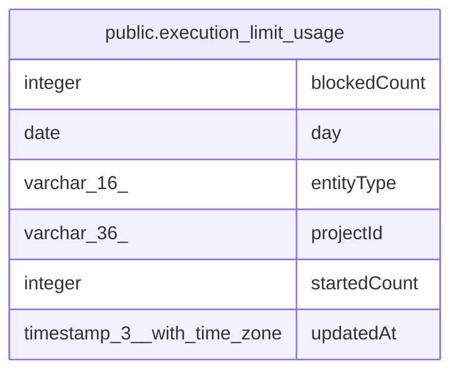

# public.execution_limit_usage

## Columns

| Name | Type | Default | Nullable | Children | Parents | Comment |
| ---- | ---- | ------- | -------- | -------- | ------- | ------- |
| blockedCount | integer | 0 | false |  |  | Runs that stopped before their first node. Usage is startedCount minus blockedCount |
| day | date |  | false |  |  | UTC day of the counted ledger row |
| entityType | varchar(16) |  | false |  |  | workflow: workflow runs; agent: agent messages |
| projectId | varchar(36) |  | false |  |  | Project at the time of the run. No foreign key: rows outlive the project |
| startedCount | integer | 0 | false |  |  | Runs that started on this day |
| updatedAt | timestamp(3) with time zone | CURRENT_TIMESTAMP(3) | false |  |  | Time of the last fold that changed the row |

## Constraints

| Name | Type | Definition |
| ---- | ---- | ---------- |
| CHK_execution_limit_usage_counts_non_negative | CHECK | CHECK ((("startedCount" >= 0) AND ("blockedCount" >= 0))) |
| CHK_execution_limit_usage_entityType | CHECK | CHECK ((("entityType")::text = ANY ((ARRAY['workflow'::character varying, 'agent'::character varying])::text[]))) |
| PK_d2580db820ef0203e281e639e07 | PRIMARY KEY | PRIMARY KEY ("projectId", day, "entityType") |
| execution_limit_usage_blockedCount_not_null | n | NOT NULL "blockedCount" |
| execution_limit_usage_day_not_null | n | NOT NULL day |
| execution_limit_usage_entityType_not_null | n | NOT NULL "entityType" |
| execution_limit_usage_projectId_not_null | n | NOT NULL "projectId" |
| execution_limit_usage_startedCount_not_null | n | NOT NULL "startedCount" |
| execution_limit_usage_updatedAt_not_null | n | NOT NULL "updatedAt" |

## Indexes

| Name | Definition |
| ---- | ---------- |
| IDX_execution_limit_usage_day | CREATE INDEX "IDX_execution_limit_usage_day" ON public.execution_limit_usage USING btree (day) |
| PK_d2580db820ef0203e281e639e07 | CREATE UNIQUE INDEX "PK_d2580db820ef0203e281e639e07" ON public.execution_limit_usage USING btree ("projectId", day, "entityType") |

## Relations

---

> Generated by [tbls](https://github.com/k1LoW/tbls)
