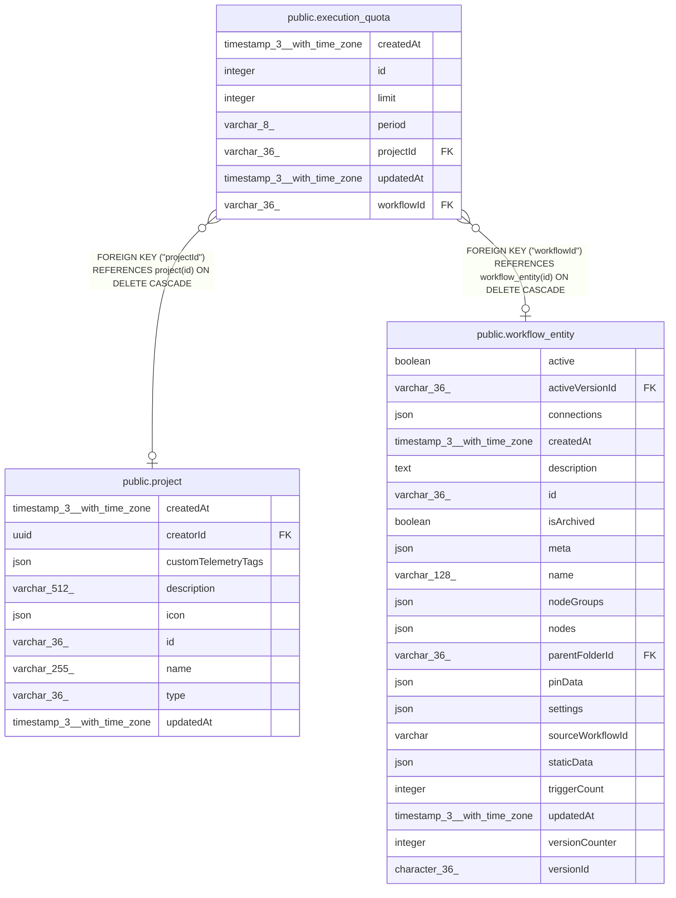

# public.execution_quota

## Columns

| Name | Type | Default | Nullable | Children | Parents | Comment |
| ---- | ---- | ------- | -------- | -------- | ------- | ------- |
| createdAt | timestamp(3) with time zone | CURRENT_TIMESTAMP | false |  |  |  |
| id | integer |  | false |  |  |  |
| limit | integer |  | false |  |  |  |
| period | varchar(8) |  | false |  |  |  |
| projectId | varchar(36) |  | true |  | [public.project](public.project.md) |  |
| updatedAt | timestamp(3) with time zone | CURRENT_TIMESTAMP | false |  |  |  |
| workflowId | varchar(36) |  | true |  | [public.workflow_entity](public.workflow_entity.md) |  |

## Constraints

| Name | Type | Definition |
| ---- | ---- | ---------- |
| execution_quota_check | CHECK | CHECK ((("workflowId" IS NULL) <> ("projectId" IS NULL))) |
| execution_quota_createdAt_not_null | n | NOT NULL "createdAt" |
| execution_quota_id_not_null | n | NOT NULL id |
| execution_quota_limit_check | CHECK | CHECK (("limit" >= 0)) |
| execution_quota_limit_not_null | n | NOT NULL "limit" |
| execution_quota_period_check | CHECK | CHECK (((period)::text = ANY ((ARRAY['day'::character varying, 'month'::character varying])::text[]))) |
| execution_quota_period_not_null | n | NOT NULL period |
| execution_quota_pkey | PRIMARY KEY | PRIMARY KEY (id) |
| execution_quota_projectId_fkey | FOREIGN KEY | FOREIGN KEY ("projectId") REFERENCES project(id) ON DELETE CASCADE |
| execution_quota_updatedAt_not_null | n | NOT NULL "updatedAt" |
| execution_quota_workflowId_fkey | FOREIGN KEY | FOREIGN KEY ("workflowId") REFERENCES workflow_entity(id) ON DELETE CASCADE |

## Indexes

| Name | Definition |
| ---- | ---------- |
| IDX_execution_quota_project | CREATE UNIQUE INDEX "IDX_execution_quota_project" ON public.execution_quota USING btree ("projectId") WHERE ("projectId" IS NOT NULL) |
| IDX_execution_quota_workflow | CREATE UNIQUE INDEX "IDX_execution_quota_workflow" ON public.execution_quota USING btree ("workflowId") WHERE ("workflowId" IS NOT NULL) |
| execution_quota_pkey | CREATE UNIQUE INDEX execution_quota_pkey ON public.execution_quota USING btree (id) |

## Relations

---

> Generated by [tbls](https://github.com/k1LoW/tbls)
