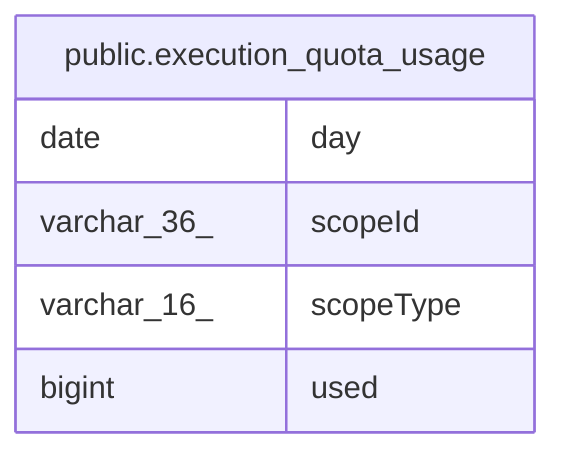

# public.execution_quota_usage

## Columns

| Name | Type | Default | Nullable | Children | Parents | Comment |
| ---- | ---- | ------- | -------- | -------- | ------- | ------- |
| day | date |  | false |  |  | UTC day the executions started on |
| scopeId | varchar(36) |  | false |  |  |  |
| scopeType | varchar(16) |  | false |  |  |  |
| used | bigint |  | false |  |  |  |

## Constraints

| Name | Type | Definition |
| ---- | ---- | ---------- |
| execution_quota_usage_day_not_null | n | NOT NULL day |
| execution_quota_usage_pkey | PRIMARY KEY | PRIMARY KEY ("scopeType", "scopeId", day) |
| execution_quota_usage_scopeId_not_null | n | NOT NULL "scopeId" |
| execution_quota_usage_scopeType_check | CHECK | CHECK ((("scopeType")::text = ANY ((ARRAY['workflow'::character varying, 'project'::character varying])::text[]))) |
| execution_quota_usage_scopeType_not_null | n | NOT NULL "scopeType" |
| execution_quota_usage_used_not_null | n | NOT NULL used |

## Indexes

| Name | Definition |
| ---- | ---------- |
| execution_quota_usage_pkey | CREATE UNIQUE INDEX execution_quota_usage_pkey ON public.execution_quota_usage USING btree ("scopeType", "scopeId", day) |

## Relations

---

> Generated by [tbls](https://github.com/k1LoW/tbls)
