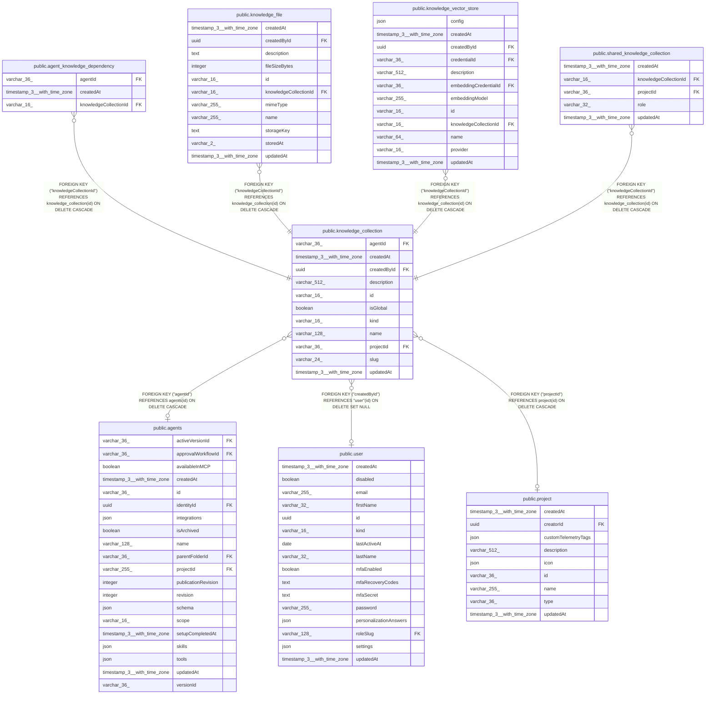

# public.knowledge_collection

## Columns

| Name | Type | Default | Nullable | Children | Parents | Comment |
| ---- | ---- | ------- | -------- | -------- | ------- | ------- |
| agentId | varchar(36) |  | true |  | [public.agents](public.agents.md) | Agent that owns a private collection. NULL for a shared collection |
| createdAt | timestamp(3) with time zone | CURRENT_TIMESTAMP(3) | false |  |  |  |
| createdById | uuid |  | true |  | [public.user](public.user.md) | Author. NULL after the author is deleted |
| description | varchar(512) |  | true |  |  | Tells the agent when to use the collection |
| id | varchar(16) |  | false | [public.agent_knowledge_dependency](public.agent_knowledge_dependency.md) [public.knowledge_file](public.knowledge_file.md) [public.knowledge_vector_store](public.knowledge_vector_store.md) [public.shared_knowledge_collection](public.shared_knowledge_collection.md) |  | Application-generated n8n nano ID |
| isGlobal | boolean | false | false |  |  | Every agent on the instance can use a global collection |
| kind | varchar(16) |  | false |  |  | 'shared' (belongs to a project) or 'agent' (the private collection of one agent) |
| name | varchar(128) |  | false |  |  | Name of the collection, unique in the project of a shared collection |
| projectId | varchar(36) |  | true |  | [public.project](public.project.md) | Home project of a shared collection. NULL for an agent collection |
| slug | varchar(24) |  | false |  |  | Tool-safe identifier, unique on the instance. Set at creation and never changed |
| updatedAt | timestamp(3) with time zone | CURRENT_TIMESTAMP(3) | false |  |  |  |

## Constraints

| Name | Type | Definition |
| ---- | ---- | ---------- |
| CHK_knowledge_collection_owner | CHECK | CHECK (((("agentId" IS NULL) <> ("projectId" IS NULL)) AND (((kind)::text = 'agent'::text) = ("agentId" IS NOT NULL)) AND (("agentId" IS NULL) OR ("isGlobal" = false)))) |
| FK_2db6cab650ebf156debd84c3772 | FOREIGN KEY | FOREIGN KEY ("agentId") REFERENCES agents(id) ON DELETE CASCADE |
| FK_3dbb6554cfa9ce504a94274c64f | FOREIGN KEY | FOREIGN KEY ("createdById") REFERENCES "user"(id) ON DELETE SET NULL |
| FK_d99632e9dc75614f710319df742 | FOREIGN KEY | FOREIGN KEY ("projectId") REFERENCES project(id) ON DELETE CASCADE |
| PK_6a44e34e2bfddaf1ca3f079748b | PRIMARY KEY | PRIMARY KEY (id) |
| knowledge_collection_createdAt_not_null | n | NOT NULL "createdAt" |
| knowledge_collection_id_not_null | n | NOT NULL id |
| knowledge_collection_isGlobal_not_null | n | NOT NULL "isGlobal" |
| knowledge_collection_kind_not_null | n | NOT NULL kind |
| knowledge_collection_name_not_null | n | NOT NULL name |
| knowledge_collection_slug_not_null | n | NOT NULL slug |
| knowledge_collection_updatedAt_not_null | n | NOT NULL "updatedAt" |

## Indexes

| Name | Definition |
| ---- | ---------- |
| IDX_2db6cab650ebf156debd84c377 | CREATE UNIQUE INDEX "IDX_2db6cab650ebf156debd84c377" ON public.knowledge_collection USING btree ("agentId") |
| IDX_7668e1c858cbe75167f74145df | CREATE UNIQUE INDEX "IDX_7668e1c858cbe75167f74145df" ON public.knowledge_collection USING btree ("projectId", name) |
| IDX_f99bb4c895c3203736ce2da3f4 | CREATE UNIQUE INDEX "IDX_f99bb4c895c3203736ce2da3f4" ON public.knowledge_collection USING btree (slug) |
| PK_6a44e34e2bfddaf1ca3f079748b | CREATE UNIQUE INDEX "PK_6a44e34e2bfddaf1ca3f079748b" ON public.knowledge_collection USING btree (id) |

## Relations

---

> Generated by [tbls](https://github.com/k1LoW/tbls)
