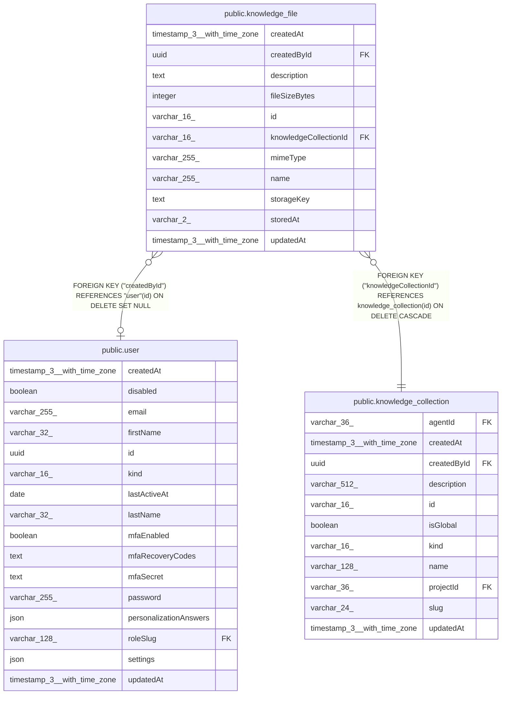

# public.knowledge_file

## Columns

| Name | Type | Default | Nullable | Children | Parents | Comment |
| ---- | ---- | ------- | -------- | -------- | ------- | ------- |
| createdAt | timestamp(3) with time zone | CURRENT_TIMESTAMP(3) | false |  |  |  |
| createdById | uuid |  | true |  | [public.user](public.user.md) | Author. NULL after the author is deleted |
| description | text |  | true |  |  |  |
| fileSizeBytes | integer |  | false |  |  | Uploaded file size in bytes |
| id | varchar(16) |  | false |  |  | Application-generated n8n nano ID |
| knowledgeCollectionId | varchar(16) |  | false |  | [public.knowledge_collection](public.knowledge_collection.md) | Collection that holds this uploaded file |
| mimeType | varchar(255) |  | false |  |  |  |
| name | varchar(255) |  | false |  |  |  |
| storageKey | text |  | false |  |  | Key addressing the bytes within storedAt: a binary_data.fileId for db, a byte-store key otherwise. Not a foreign key |
| storedAt | varchar(2) | 'db'::character varying | false |  |  | Where the file bytes live: 'db' (binary_data table), or a blob-storage backend ('fs', 's3', 'az') |
| updatedAt | timestamp(3) with time zone | CURRENT_TIMESTAMP(3) | false |  |  |  |

## Constraints

| Name | Type | Definition |
| ---- | ---- | ---------- |
| CHK_knowledge_file_storedAt | CHECK | CHECK ((("storedAt")::text = ANY ((ARRAY['db'::character varying, 'fs'::character varying, 's3'::character varying, 'az'::character varying])::text[]))) |
| FK_1a602cf1fc75e3dc7184f1dc67d | FOREIGN KEY | FOREIGN KEY ("knowledgeCollectionId") REFERENCES knowledge_collection(id) ON DELETE CASCADE |
| FK_ba192ee6fdf188abf6684dea64f | FOREIGN KEY | FOREIGN KEY ("createdById") REFERENCES "user"(id) ON DELETE SET NULL |
| PK_de80a3d739f042ff20bf79c3f5a | PRIMARY KEY | PRIMARY KEY (id) |
| knowledge_file_createdAt_not_null | n | NOT NULL "createdAt" |
| knowledge_file_fileSizeBytes_not_null | n | NOT NULL "fileSizeBytes" |
| knowledge_file_id_not_null | n | NOT NULL id |
| knowledge_file_knowledgeCollectionId_not_null | n | NOT NULL "knowledgeCollectionId" |
| knowledge_file_mimeType_not_null | n | NOT NULL "mimeType" |
| knowledge_file_name_not_null | n | NOT NULL name |
| knowledge_file_storageKey_not_null | n | NOT NULL "storageKey" |
| knowledge_file_storedAt_not_null | n | NOT NULL "storedAt" |
| knowledge_file_updatedAt_not_null | n | NOT NULL "updatedAt" |

## Indexes

| Name | Definition |
| ---- | ---------- |
| IDX_6a7161d655f5fd4eb2d4419b3d | CREATE UNIQUE INDEX "IDX_6a7161d655f5fd4eb2d4419b3d" ON public.knowledge_file USING btree ("knowledgeCollectionId", name) |
| IDX_a87d3bb786f06c0a677dc11fb5 | CREATE INDEX "IDX_a87d3bb786f06c0a677dc11fb5" ON public.knowledge_file USING btree ("knowledgeCollectionId", "createdAt") |
| PK_de80a3d739f042ff20bf79c3f5a | CREATE UNIQUE INDEX "PK_de80a3d739f042ff20bf79c3f5a" ON public.knowledge_file USING btree (id) |

## Relations

---

> Generated by [tbls](https://github.com/k1LoW/tbls)
