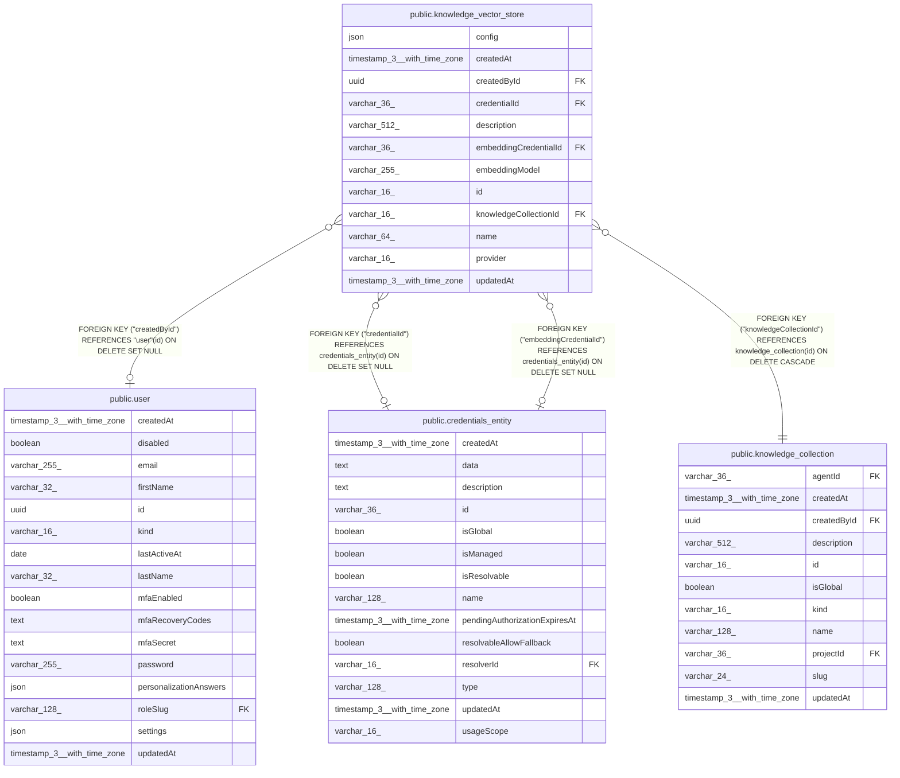

# public.knowledge_vector_store

## Columns

| Name | Type | Default | Nullable | Children | Parents | Comment |
| ---- | ---- | ------- | -------- | -------- | ------- | ------- |
| config | json |  | false |  |  | Provider settings, such as an index name, a namespace or a table name |
| createdAt | timestamp(3) with time zone | CURRENT_TIMESTAMP(3) | false |  |  |  |
| createdById | uuid |  | true |  | [public.user](public.user.md) | Author. NULL after the author is deleted |
| credentialId | varchar(36) |  | true |  | [public.credentials_entity](public.credentials_entity.md) | Credential of the store. NULL after the credential is deleted: the store is then unavailable |
| description | varchar(512) |  | false |  |  | Tells the agent when to search this store |
| embeddingCredentialId | varchar(36) |  | true |  | [public.credentials_entity](public.credentials_entity.md) | Credential of the embedding model. NULL after the credential is deleted: the store is then unavailable |
| embeddingModel | varchar(255) |  | false |  |  | Embedding model in 'provider/model-name' format |
| id | varchar(16) |  | false |  |  | Application-generated n8n nano ID |
| knowledgeCollectionId | varchar(16) |  | false |  | [public.knowledge_collection](public.knowledge_collection.md) | Collection that holds this vector store connection |
| name | varchar(64) |  | false |  |  | Part of the search tool name, so it is unique in its collection |
| provider | varchar(16) |  | false |  |  | Vector store provider, e.g. 'pinecone', 'supabase', 'qdrant' or 'postgres' |
| updatedAt | timestamp(3) with time zone | CURRENT_TIMESTAMP(3) | false |  |  |  |

## Constraints

| Name | Type | Definition |
| ---- | ---- | ---------- |
| FK_03f85fb38aac511330edcaaaec4 | FOREIGN KEY | FOREIGN KEY ("knowledgeCollectionId") REFERENCES knowledge_collection(id) ON DELETE CASCADE |
| FK_44cd963b5d5ded5431244b62762 | FOREIGN KEY | FOREIGN KEY ("createdById") REFERENCES "user"(id) ON DELETE SET NULL |
| FK_6ad2a7c060c7cebf550e45a3d71 | FOREIGN KEY | FOREIGN KEY ("embeddingCredentialId") REFERENCES credentials_entity(id) ON DELETE SET NULL |
| FK_caa9fe147a78ec1c820891937c2 | FOREIGN KEY | FOREIGN KEY ("credentialId") REFERENCES credentials_entity(id) ON DELETE SET NULL |
| PK_f00d730c4b9cdbe76ad96137308 | PRIMARY KEY | PRIMARY KEY (id) |
| knowledge_vector_store_config_not_null | n | NOT NULL config |
| knowledge_vector_store_createdAt_not_null | n | NOT NULL "createdAt" |
| knowledge_vector_store_description_not_null | n | NOT NULL description |
| knowledge_vector_store_embeddingModel_not_null | n | NOT NULL "embeddingModel" |
| knowledge_vector_store_id_not_null | n | NOT NULL id |
| knowledge_vector_store_knowledgeCollectionId_not_null | n | NOT NULL "knowledgeCollectionId" |
| knowledge_vector_store_name_not_null | n | NOT NULL name |
| knowledge_vector_store_provider_not_null | n | NOT NULL provider |
| knowledge_vector_store_updatedAt_not_null | n | NOT NULL "updatedAt" |

## Indexes

| Name | Definition |
| ---- | ---------- |
| IDX_29c253bcd6bb55be022ddffebf | CREATE UNIQUE INDEX "IDX_29c253bcd6bb55be022ddffebf" ON public.knowledge_vector_store USING btree ("knowledgeCollectionId", name) |
| IDX_6ad2a7c060c7cebf550e45a3d7 | CREATE INDEX "IDX_6ad2a7c060c7cebf550e45a3d7" ON public.knowledge_vector_store USING btree ("embeddingCredentialId") |
| IDX_caa9fe147a78ec1c820891937c | CREATE INDEX "IDX_caa9fe147a78ec1c820891937c" ON public.knowledge_vector_store USING btree ("credentialId") |
| PK_f00d730c4b9cdbe76ad96137308 | CREATE UNIQUE INDEX "PK_f00d730c4b9cdbe76ad96137308" ON public.knowledge_vector_store USING btree (id) |

## Relations

---

> Generated by [tbls](https://github.com/k1LoW/tbls)
