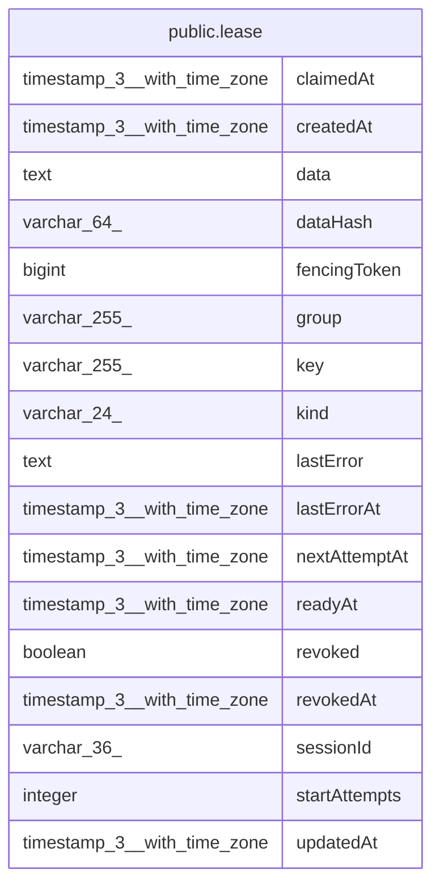

# public.lease

## Columns

| Name | Type | Default | Nullable | Children | Parents | Comment |
| ---- | ---- | ------- | -------- | -------- | ------- | ------- |
| claimedAt | timestamp(3) with time zone |  | true |  |  |  |
| createdAt | timestamp(3) with time zone | CURRENT_TIMESTAMP(3) | false |  |  |  |
| data | text |  | false |  |  |  |
| dataHash | varchar(64) |  | false |  |  |  |
| fencingToken | bigint | 0 | false |  |  |  |
| group | varchar(255) |  | true |  |  |  |
| key | varchar(255) |  | false |  |  |  |
| kind | varchar(24) |  | false |  |  |  |
| lastError | text |  | true |  |  |  |
| lastErrorAt | timestamp(3) with time zone |  | true |  |  |  |
| nextAttemptAt | timestamp(3) with time zone |  | true |  |  |  |
| readyAt | timestamp(3) with time zone |  | true |  |  |  |
| revoked | boolean | false | false |  |  |  |
| revokedAt | timestamp(3) with time zone |  | true |  |  |  |
| sessionId | varchar(36) |  | true |  |  |  |
| startAttempts | integer | 0 | false |  |  |  |
| updatedAt | timestamp(3) with time zone | CURRENT_TIMESTAMP(3) | false |  |  |  |

## Constraints

| Name | Type | Definition |
| ---- | ---- | ---------- |
| CHK_lease_fencingToken | CHECK | CHECK (("fencingToken" >= 0)) |
| CHK_lease_startAttempts | CHECK | CHECK (("startAttempts" >= 0)) |
| lease_createdAt_not_null | n | NOT NULL "createdAt" |
| lease_dataHash_not_null | n | NOT NULL "dataHash" |
| lease_data_not_null | n | NOT NULL data |
| lease_fencingToken_not_null | n | NOT NULL "fencingToken" |
| lease_key_not_null | n | NOT NULL key |
| lease_kind_not_null | n | NOT NULL kind |
| lease_pkey | PRIMARY KEY | PRIMARY KEY (kind, key) |
| lease_revoked_not_null | n | NOT NULL revoked |
| lease_startAttempts_not_null | n | NOT NULL "startAttempts" |
| lease_updatedAt_not_null | n | NOT NULL "updatedAt" |

## Indexes

| Name | Definition |
| ---- | ---------- |
| IDX_lease_kind_group | CREATE INDEX "IDX_lease_kind_group" ON public.lease USING btree (kind, "group") |
| IDX_lease_kind_sessionId | CREATE INDEX "IDX_lease_kind_sessionId" ON public.lease USING btree (kind, "sessionId") |
| lease_pkey | CREATE UNIQUE INDEX lease_pkey ON public.lease USING btree (kind, key) |

## Relations

---

> Generated by [tbls](https://github.com/k1LoW/tbls)
