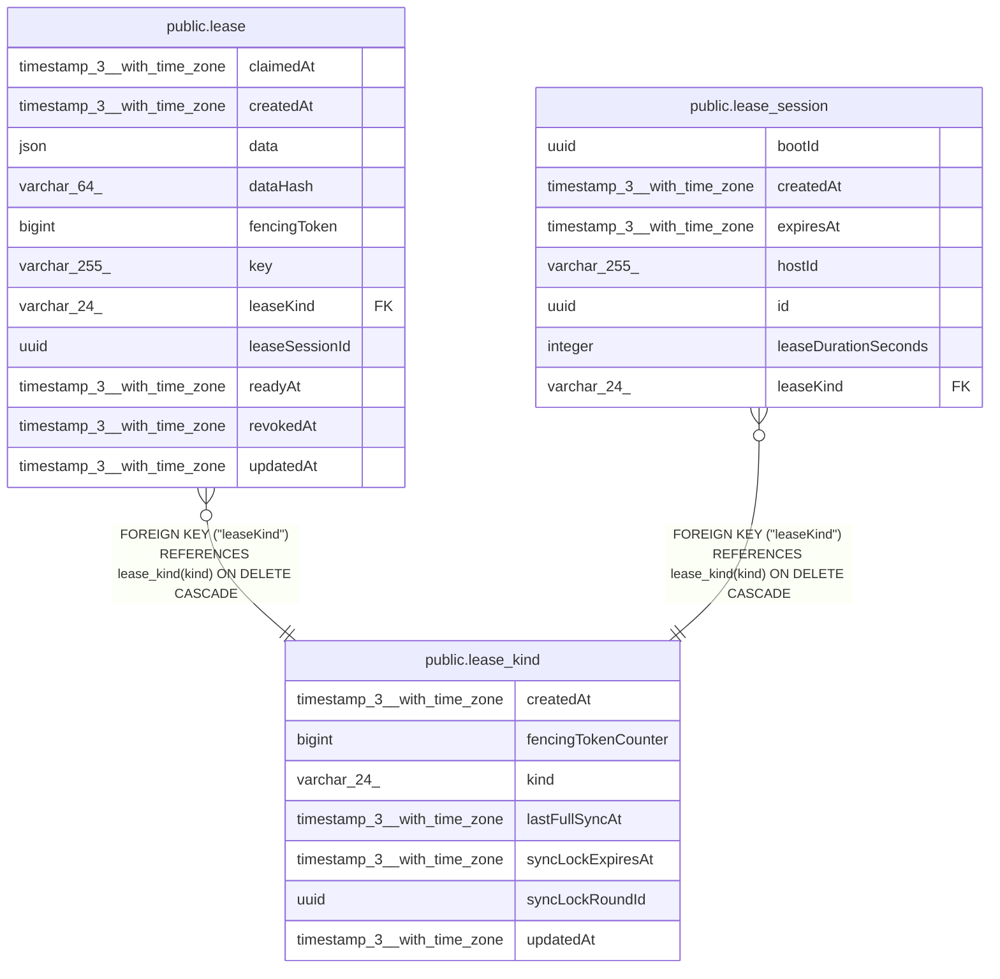

# public.lease_kind

## Columns

| Name | Type | Default | Nullable | Children | Parents | Comment |
| ---- | ---- | ------- | -------- | -------- | ------- | ------- |
| createdAt | timestamp(3) with time zone | CURRENT_TIMESTAMP(3) | false |  |  |  |
| fencingTokenCounter | bigint | 0 | false |  |  | The source of fencing tokens, never reset so that a recreated key gets a higher token |
| kind | varchar(24) |  | false | [public.lease](public.lease.md) [public.lease_session](public.lease_session.md) |  | The name of the lease kind |
| lastFullSyncAt | timestamp(3) with time zone |  | true |  |  | The time at which a process last claimed the periodic full sync |
| syncLockExpiresAt | timestamp(3) with time zone |  | true |  |  | The time at which the sync lock expires |
| syncLockRoundId | uuid |  | true |  |  | The sync round that holds the sync lock, or null when the lock is free |
| updatedAt | timestamp(3) with time zone | CURRENT_TIMESTAMP(3) | false |  |  |  |

## Constraints

| Name | Type | Definition |
| ---- | ---- | ---------- |
| CHK_lease_kind_fencingTokenCounter | CHECK | CHECK (("fencingTokenCounter" >= 0)) |
| PK_9e81b1f6095f0843f64c9554fe0 | PRIMARY KEY | PRIMARY KEY (kind) |
| lease_kind_createdAt_not_null | n | NOT NULL "createdAt" |
| lease_kind_fencingTokenCounter_not_null | n | NOT NULL "fencingTokenCounter" |
| lease_kind_kind_not_null | n | NOT NULL kind |
| lease_kind_updatedAt_not_null | n | NOT NULL "updatedAt" |

## Indexes

| Name | Definition |
| ---- | ---------- |
| PK_9e81b1f6095f0843f64c9554fe0 | CREATE UNIQUE INDEX "PK_9e81b1f6095f0843f64c9554fe0" ON public.lease_kind USING btree (kind) |

## Relations

---

> Generated by [tbls](https://github.com/k1LoW/tbls)
