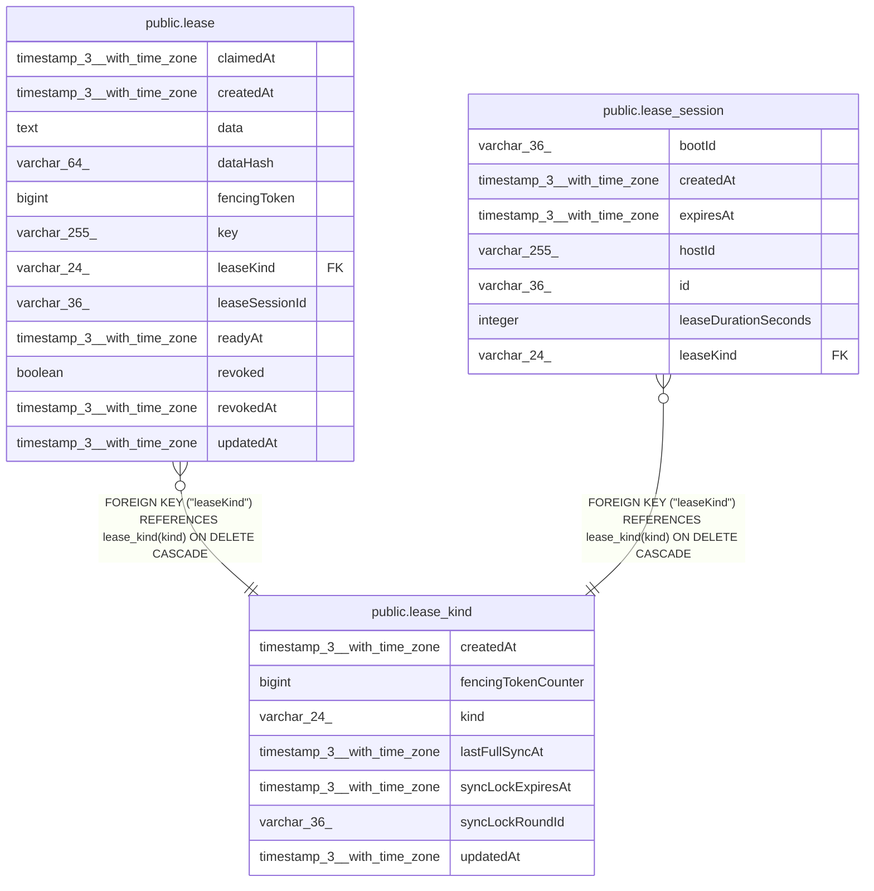

# public.lease_kind

## Columns

| Name | Type | Default | Nullable | Children | Parents | Comment |
| ---- | ---- | ------- | -------- | -------- | ------- | ------- |
| createdAt | timestamp(3) with time zone | CURRENT_TIMESTAMP(3) | false |  |  |  |
| fencingTokenCounter | bigint | 0 | false |  |  |  |
| kind | varchar(24) |  | false | [public.lease](public.lease.md) [public.lease_session](public.lease_session.md) |  |  |
| lastFullSyncAt | timestamp(3) with time zone |  | true |  |  |  |
| syncLockExpiresAt | timestamp(3) with time zone |  | true |  |  |  |
| syncLockRoundId | varchar(36) |  | true |  |  |  |
| updatedAt | timestamp(3) with time zone | CURRENT_TIMESTAMP(3) | false |  |  |  |

## Constraints

| Name | Type | Definition |
| ---- | ---- | ---------- |
| CHK_lease_kind_fencingTokenCounter | CHECK | CHECK (("fencingTokenCounter" >= 0)) |
| lease_kind_createdAt_not_null | n | NOT NULL "createdAt" |
| lease_kind_fencingTokenCounter_not_null | n | NOT NULL "fencingTokenCounter" |
| lease_kind_kind_not_null | n | NOT NULL kind |
| lease_kind_pkey | PRIMARY KEY | PRIMARY KEY (kind) |
| lease_kind_updatedAt_not_null | n | NOT NULL "updatedAt" |

## Indexes

| Name | Definition |
| ---- | ---------- |
| lease_kind_pkey | CREATE UNIQUE INDEX lease_kind_pkey ON public.lease_kind USING btree (kind) |

## Relations

---

> Generated by [tbls](https://github.com/k1LoW/tbls)
