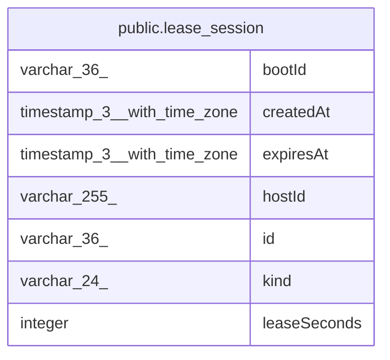

# public.lease_session

## Columns

| Name | Type | Default | Nullable | Children | Parents | Comment |
| ---- | ---- | ------- | -------- | -------- | ------- | ------- |
| bootId | varchar(36) |  | false |  |  |  |
| createdAt | timestamp(3) with time zone | CURRENT_TIMESTAMP(3) | false |  |  |  |
| expiresAt | timestamp(3) with time zone |  | false |  |  |  |
| hostId | varchar(255) |  | false |  |  |  |
| id | varchar(36) |  | false |  |  |  |
| kind | varchar(24) |  | false |  |  |  |
| leaseSeconds | integer |  | false |  |  |  |

## Constraints

| Name | Type | Definition |
| ---- | ---- | ---------- |
| lease_session_bootId_not_null | n | NOT NULL "bootId" |
| lease_session_createdAt_not_null | n | NOT NULL "createdAt" |
| lease_session_expiresAt_not_null | n | NOT NULL "expiresAt" |
| lease_session_hostId_not_null | n | NOT NULL "hostId" |
| lease_session_id_not_null | n | NOT NULL id |
| lease_session_kind_not_null | n | NOT NULL kind |
| lease_session_leaseSeconds_not_null | n | NOT NULL "leaseSeconds" |
| lease_session_pkey | PRIMARY KEY | PRIMARY KEY (id) |

## Indexes

| Name | Definition |
| ---- | ---------- |
| IDX_lease_session_kind_expiresAt | CREATE INDEX "IDX_lease_session_kind_expiresAt" ON public.lease_session USING btree (kind, "expiresAt") |
| lease_session_pkey | CREATE UNIQUE INDEX lease_session_pkey ON public.lease_session USING btree (id) |

## Relations

---

> Generated by [tbls](https://github.com/k1LoW/tbls)
