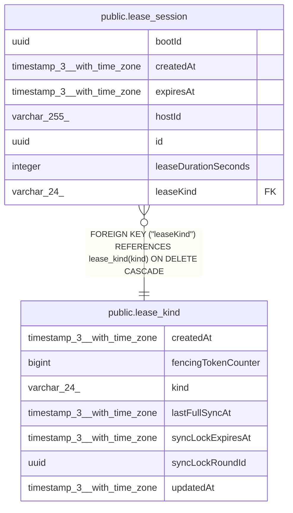

# public.lease_session

## Columns

| Name | Type | Default | Nullable | Children | Parents | Comment |
| ---- | ---- | ------- | -------- | -------- | ------- | ------- |
| bootId | uuid |  | false |  |  | A random ID made when the process starts |
| createdAt | timestamp(3) with time zone | CURRENT_TIMESTAMP(3) | false |  |  |  |
| expiresAt | timestamp(3) with time zone |  | false |  |  | The database time until which the session and all its leases are valid |
| hostId | varchar(255) |  | false |  |  | The hostId of the n8n instance that opened the session |
| id | uuid |  | false |  |  | The session ID, new for each session, also after a process loses a session |
| leaseDurationSeconds | integer |  | false |  |  | The lease length of the session, in seconds |
| leaseKind | varchar(24) |  | false |  | [public.lease_kind](public.lease_kind.md) |  |

## Constraints

| Name | Type | Definition |
| ---- | ---- | ---------- |
| FK_lease_session_leaseKind | FOREIGN KEY | FOREIGN KEY ("leaseKind") REFERENCES lease_kind(kind) ON DELETE CASCADE |
| PK_08bc589de90693c1d2dbe5b8db9 | PRIMARY KEY | PRIMARY KEY (id) |
| lease_session_bootId_not_null | n | NOT NULL "bootId" |
| lease_session_createdAt_not_null | n | NOT NULL "createdAt" |
| lease_session_expiresAt_not_null | n | NOT NULL "expiresAt" |
| lease_session_hostId_not_null | n | NOT NULL "hostId" |
| lease_session_id_not_null | n | NOT NULL id |
| lease_session_leaseDurationSeconds_not_null | n | NOT NULL "leaseDurationSeconds" |
| lease_session_leaseKind_not_null | n | NOT NULL "leaseKind" |

## Indexes

| Name | Definition |
| ---- | ---------- |
| IDX_lease_session_leaseKind_expiresAt | CREATE INDEX "IDX_lease_session_leaseKind_expiresAt" ON public.lease_session USING btree ("leaseKind", "expiresAt") |
| PK_08bc589de90693c1d2dbe5b8db9 | CREATE UNIQUE INDEX "PK_08bc589de90693c1d2dbe5b8db9" ON public.lease_session USING btree (id) |

## Relations

---

> Generated by [tbls](https://github.com/k1LoW/tbls)
