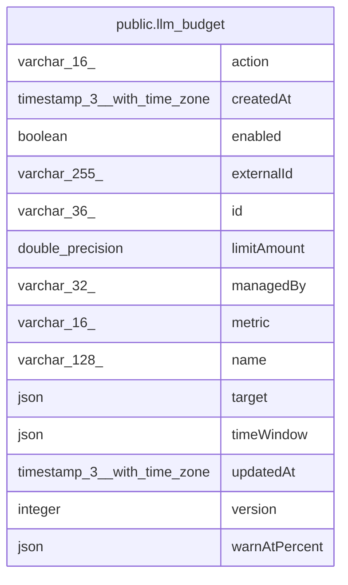

# public.llm_budget

## Columns

| Name | Type | Default | Nullable | Children | Parents | Comment |
| ---- | ---- | ------- | -------- | -------- | ------- | ------- |
| action | varchar(16) |  | false |  |  | block stops calls at the limit, warn only emits events |
| createdAt | timestamp(3) with time zone | CURRENT_TIMESTAMP(3) | false |  |  |  |
| enabled | boolean | true | false |  |  |  |
| externalId | varchar(255) |  | true |  |  | The ID of the budget in its managing system |
| id | varchar(36) |  | false |  |  |  |
| limitAmount | double precision |  | false |  |  |  |
| managedBy | varchar(32) |  | true |  |  | The system that owns the budget, for example agent. NULL for an admin budget |
| metric | varchar(16) |  | false |  |  | What the limit counts |
| name | varchar(128) |  | false |  |  |  |
| target | json |  | false |  |  | Dimension name to filter: { match: "all" } or { match: "ids", ids } |
| timeWindow | json |  | false |  |  | { kind: "rolling" \| "calendar", unit: "day" \| "week" \| "month" } |
| updatedAt | timestamp(3) with time zone | CURRENT_TIMESTAMP(3) | false |  |  |  |
| version | integer | 1 | false |  |  | Raised by one on each write, for optimistic concurrency |
| warnAtPercent | json |  | false |  |  |  |

## Constraints

| Name | Type | Definition |
| ---- | ---- | ---------- |
| CHK_llm_budget_action | CHECK | CHECK (((action)::text = ANY ((ARRAY['block'::character varying, 'warn'::character varying])::text[]))) |
| CHK_llm_budget_metric | CHECK | CHECK (((metric)::text = 'costUsd'::text)) |
| PK_99e76672b6a0b24bc8d6927fbbe | PRIMARY KEY | PRIMARY KEY (id) |
| llm_budget_action_not_null | n | NOT NULL action |
| llm_budget_createdAt_not_null | n | NOT NULL "createdAt" |
| llm_budget_enabled_not_null | n | NOT NULL enabled |
| llm_budget_id_not_null | n | NOT NULL id |
| llm_budget_limitAmount_not_null | n | NOT NULL "limitAmount" |
| llm_budget_metric_not_null | n | NOT NULL metric |
| llm_budget_name_not_null | n | NOT NULL name |
| llm_budget_target_not_null | n | NOT NULL target |
| llm_budget_timeWindow_not_null | n | NOT NULL "timeWindow" |
| llm_budget_updatedAt_not_null | n | NOT NULL "updatedAt" |
| llm_budget_version_not_null | n | NOT NULL version |
| llm_budget_warnAtPercent_not_null | n | NOT NULL "warnAtPercent" |

## Indexes

| Name | Definition |
| ---- | ---------- |
| PK_99e76672b6a0b24bc8d6927fbbe | CREATE UNIQUE INDEX "PK_99e76672b6a0b24bc8d6927fbbe" ON public.llm_budget USING btree (id) |

## Relations

---

> Generated by [tbls](https://github.com/k1LoW/tbls)
