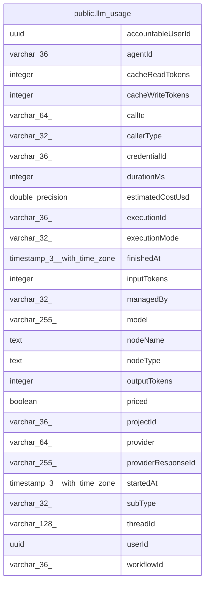

# public.llm_usage

## Columns

| Name | Type | Default | Nullable | Children | Parents | Comment |
| ---- | ---- | ------- | -------- | -------- | ------- | ------- |
| accountableUserId | uuid |  | true |  |  | The user that budgets count: userId, else the publisher of the workflow |
| agentId | varchar(36) |  | true |  |  |  |
| cacheReadTokens | integer | 0 | false |  |  |  |
| cacheWriteTokens | integer | 0 | false |  |  |  |
| callId | varchar(64) |  | false |  |  | Call identity: SHA-256 of provider, response ID, model and token counts, else a UUIDv7 |
| callerType | varchar(32) |  | false |  |  | What made the call: a workflow node, an agent, Instance AI or the builder |
| credentialId | varchar(36) |  | true |  |  |  |
| durationMs | integer |  | true |  |  |  |
| estimatedCostUsd | double precision |  | true |  |  | Estimated cost in USD; NULL when not priced |
| executionId | varchar(36) |  | true |  |  |  |
| executionMode | varchar(32) |  | true |  |  | Mode of the run that started the work, for example manual or trigger |
| finishedAt | timestamp(3) with time zone |  | false |  |  |  |
| inputTokens | integer | 0 | false |  |  |  |
| managedBy | varchar(32) |  | true |  |  | Set when n8n credits pay for the call instead of a credential |
| model | varchar(255) |  | false |  |  |  |
| nodeName | text |  | true |  |  |  |
| nodeType | text |  | true |  |  |  |
| outputTokens | integer | 0 | false |  |  |  |
| priced | boolean | false | false |  |  |  |
| projectId | varchar(36) |  | true |  |  |  |
| provider | varchar(64) |  | false |  |  |  |
| providerResponseId | varchar(255) |  | true |  |  |  |
| startedAt | timestamp(3) with time zone |  | true |  |  |  |
| subType | varchar(32) |  | true |  |  | How the call was captured: llm (an AI library) or http (a node HTTP request) |
| threadId | varchar(128) |  | true |  |  |  |
| userId | uuid |  | true |  |  |  |
| workflowId | varchar(36) |  | true |  |  |  |

## Constraints

| Name | Type | Definition |
| ---- | ---- | ---------- |
| CHK_llm_usage_callerType | CHECK | CHECK ((("callerType")::text = ANY ((ARRAY['node'::character varying, 'agent'::character varying, 'instance-ai'::character varying, 'workflow-builder'::character varying, 'unknown'::character varying])::text[]))) |
| CHK_llm_usage_managedBy | CHECK | CHECK ((("managedBy")::text = ANY ((ARRAY['aiGateway'::character varying, 'assistant'::character varying])::text[]))) |
| CHK_llm_usage_subType | CHECK | CHECK ((("subType")::text = ANY ((ARRAY['llm'::character varying, 'http'::character varying])::text[]))) |
| PK_cac2f69a2cb061fb47291fcd3f2 | PRIMARY KEY | PRIMARY KEY ("callId") |
| llm_usage_cacheReadTokens_not_null | n | NOT NULL "cacheReadTokens" |
| llm_usage_cacheWriteTokens_not_null | n | NOT NULL "cacheWriteTokens" |
| llm_usage_callId_not_null | n | NOT NULL "callId" |
| llm_usage_callerType_not_null | n | NOT NULL "callerType" |
| llm_usage_finishedAt_not_null | n | NOT NULL "finishedAt" |
| llm_usage_inputTokens_not_null | n | NOT NULL "inputTokens" |
| llm_usage_model_not_null | n | NOT NULL model |
| llm_usage_outputTokens_not_null | n | NOT NULL "outputTokens" |
| llm_usage_priced_not_null | n | NOT NULL priced |
| llm_usage_provider_not_null | n | NOT NULL provider |

## Indexes

| Name | Definition |
| ---- | ---------- |
| IDX_04b3411fd7d9955fca7d25e5df | CREATE INDEX "IDX_04b3411fd7d9955fca7d25e5df" ON public.llm_usage USING btree ("finishedAt") |
| IDX_llm_usage_callId | CREATE INDEX "IDX_llm_usage_callId" ON public.llm_usage USING btree ("callId") WHERE (priced = false) |
| PK_cac2f69a2cb061fb47291fcd3f2 | CREATE UNIQUE INDEX "PK_cac2f69a2cb061fb47291fcd3f2" ON public.llm_usage USING btree ("callId") |

## Relations

---

> Generated by [tbls](https://github.com/k1LoW/tbls)
