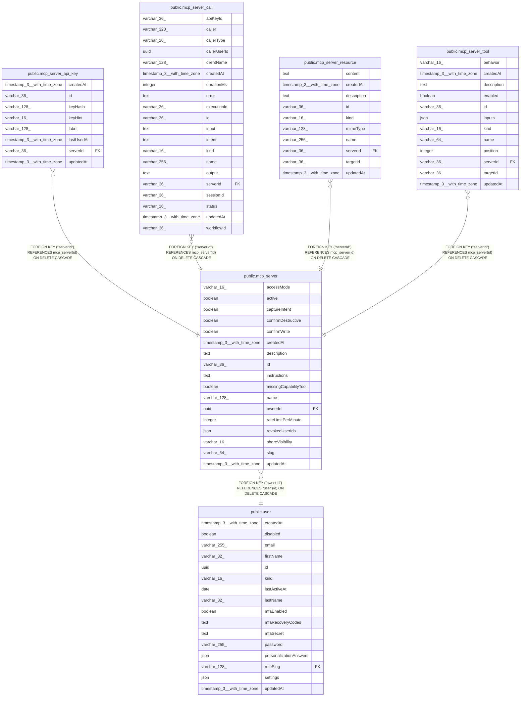

# public.mcp_server

## Columns

| Name | Type | Default | Nullable | Children | Parents | Comment |
| ---- | ---- | ------- | -------- | -------- | ------- | ------- |
| accessMode | varchar(16) | 'apiKey'::character varying | false |  |  |  |
| active | boolean | true | false |  |  |  |
| captureIntent | boolean | true | false |  |  |  |
| confirmDestructive | boolean | true | false |  |  |  |
| confirmWrite | boolean | false | false |  |  |  |
| createdAt | timestamp(3) with time zone | CURRENT_TIMESTAMP(3) | false |  |  |  |
| description | text |  | false |  |  |  |
| id | varchar(36) |  | false | [public.mcp_server_api_key](public.mcp_server_api_key.md) [public.mcp_server_call](public.mcp_server_call.md) [public.mcp_server_resource](public.mcp_server_resource.md) [public.mcp_server_tool](public.mcp_server_tool.md) |  |  |
| instructions | text |  | false |  |  |  |
| missingCapabilityTool | boolean | true | false |  |  |  |
| name | varchar(128) |  | false |  |  |  |
| ownerId | uuid |  | false |  | [public.user](public.user.md) |  |
| rateLimitPerMinute | integer | 60 | false |  |  |  |
| revokedUserIds | json |  | true |  |  |  |
| shareVisibility | varchar(16) | 'instance'::character varying | false |  |  |  |
| slug | varchar(64) |  | false |  |  |  |
| updatedAt | timestamp(3) with time zone | CURRENT_TIMESTAMP(3) | false |  |  |  |

## Constraints

| Name | Type | Definition |
| ---- | ---- | ---------- |
| FK_mcp_server_ownerId | FOREIGN KEY | FOREIGN KEY ("ownerId") REFERENCES "user"(id) ON DELETE CASCADE |
| PK_940f98ed91dd060f63e6fc5634e | PRIMARY KEY | PRIMARY KEY (id) |
| mcp_server_accessMode_not_null | n | NOT NULL "accessMode" |
| mcp_server_active_not_null | n | NOT NULL active |
| mcp_server_captureIntent_not_null | n | NOT NULL "captureIntent" |
| mcp_server_confirmDestructive_not_null | n | NOT NULL "confirmDestructive" |
| mcp_server_confirmWrite_not_null | n | NOT NULL "confirmWrite" |
| mcp_server_createdAt_not_null | n | NOT NULL "createdAt" |
| mcp_server_description_not_null | n | NOT NULL description |
| mcp_server_id_not_null | n | NOT NULL id |
| mcp_server_instructions_not_null | n | NOT NULL instructions |
| mcp_server_missingCapabilityTool_not_null | n | NOT NULL "missingCapabilityTool" |
| mcp_server_name_not_null | n | NOT NULL name |
| mcp_server_ownerId_not_null | n | NOT NULL "ownerId" |
| mcp_server_rateLimitPerMinute_not_null | n | NOT NULL "rateLimitPerMinute" |
| mcp_server_shareVisibility_not_null | n | NOT NULL "shareVisibility" |
| mcp_server_slug_not_null | n | NOT NULL slug |
| mcp_server_updatedAt_not_null | n | NOT NULL "updatedAt" |

## Indexes

| Name | Definition |
| ---- | ---------- |
| IDX_c70bcc8686212f76f1d03a9bba | CREATE UNIQUE INDEX "IDX_c70bcc8686212f76f1d03a9bba" ON public.mcp_server USING btree (slug) |
| PK_940f98ed91dd060f63e6fc5634e | CREATE UNIQUE INDEX "PK_940f98ed91dd060f63e6fc5634e" ON public.mcp_server USING btree (id) |

## Relations

---

> Generated by [tbls](https://github.com/k1LoW/tbls)
