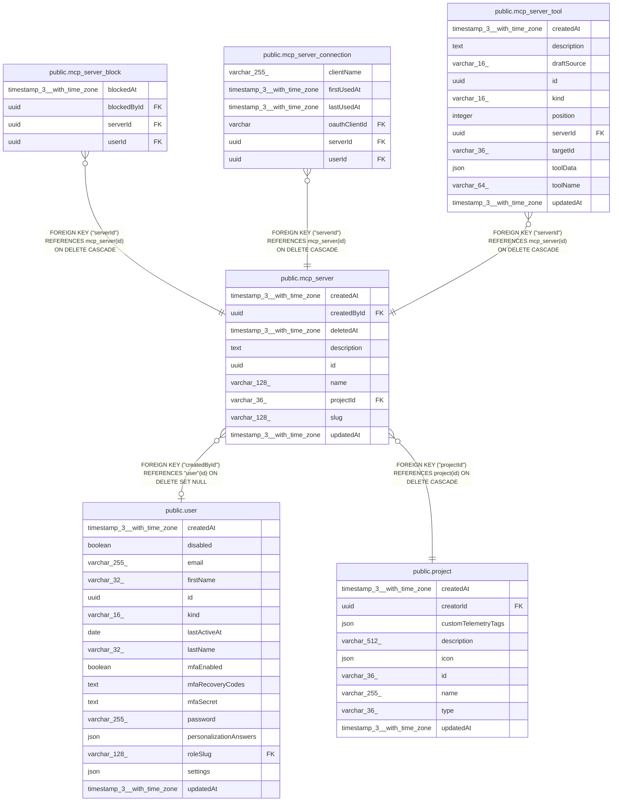

# public.mcp_server

## Columns

| Name | Type | Default | Nullable | Children | Parents | Comment |
| ---- | ---- | ------- | -------- | -------- | ------- | ------- |
| createdAt | timestamp(3) with time zone | CURRENT_TIMESTAMP(3) | false |  |  |  |
| createdById | uuid |  | true |  | [public.user](public.user.md) | Creator. NULL after the user is deleted |
| deletedAt | timestamp(3) with time zone |  | true |  |  | Soft delete. NULL for a server that is not deleted |
| description | text | ''::text | false |  |  | Clients get it as the MCP instructions |
| id | uuid |  | false | [public.mcp_server_block](public.mcp_server_block.md) [public.mcp_server_connection](public.mcp_server_connection.md) [public.mcp_server_tool](public.mcp_server_tool.md) |  | UUIDv7, made by the application |
| name | varchar(128) |  | false |  |  |  |
| projectId | varchar(36) |  | false |  | [public.project](public.project.md) |  |
| slug | varchar(128) |  | false |  |  | Path segment of the server URL. It never changes. A deleted server keeps it, until its project is deleted |
| updatedAt | timestamp(3) with time zone | CURRENT_TIMESTAMP(3) | false |  |  |  |

## Constraints

| Name | Type | Definition |
| ---- | ---- | ---------- |
| FK_6f64b29cefbc1d0aa5ae1ecc78c | FOREIGN KEY | FOREIGN KEY ("createdById") REFERENCES "user"(id) ON DELETE SET NULL |
| FK_dd85c7c51f3c8137aecb1cafd34 | FOREIGN KEY | FOREIGN KEY ("projectId") REFERENCES project(id) ON DELETE CASCADE |
| PK_940f98ed91dd060f63e6fc5634e | PRIMARY KEY | PRIMARY KEY (id) |
| mcp_server_createdAt_not_null | n | NOT NULL "createdAt" |
| mcp_server_description_not_null | n | NOT NULL description |
| mcp_server_id_not_null | n | NOT NULL id |
| mcp_server_name_not_null | n | NOT NULL name |
| mcp_server_projectId_not_null | n | NOT NULL "projectId" |
| mcp_server_slug_not_null | n | NOT NULL slug |
| mcp_server_updatedAt_not_null | n | NOT NULL "updatedAt" |

## Indexes

| Name | Definition |
| ---- | ---------- |
| IDX_6f64b29cefbc1d0aa5ae1ecc78 | CREATE INDEX "IDX_6f64b29cefbc1d0aa5ae1ecc78" ON public.mcp_server USING btree ("createdById") |
| IDX_c70bcc8686212f76f1d03a9bba | CREATE UNIQUE INDEX "IDX_c70bcc8686212f76f1d03a9bba" ON public.mcp_server USING btree (slug) |
| IDX_dd85c7c51f3c8137aecb1cafd3 | CREATE INDEX "IDX_dd85c7c51f3c8137aecb1cafd3" ON public.mcp_server USING btree ("projectId") |
| PK_940f98ed91dd060f63e6fc5634e | CREATE UNIQUE INDEX "PK_940f98ed91dd060f63e6fc5634e" ON public.mcp_server USING btree (id) |

## Relations

---

> Generated by [tbls](https://github.com/k1LoW/tbls)
