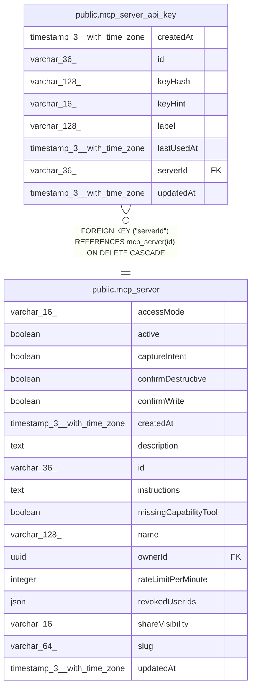

# public.mcp_server_api_key

## Columns

| Name | Type | Default | Nullable | Children | Parents | Comment |
| ---- | ---- | ------- | -------- | -------- | ------- | ------- |
| createdAt | timestamp(3) with time zone | CURRENT_TIMESTAMP(3) | false |  |  |  |
| id | varchar(36) |  | false |  |  |  |
| keyHash | varchar(128) |  | false |  |  |  |
| keyHint | varchar(16) |  | false |  |  |  |
| label | varchar(128) |  | false |  |  |  |
| lastUsedAt | timestamp(3) with time zone |  | true |  |  |  |
| serverId | varchar(36) |  | false |  | [public.mcp_server](public.mcp_server.md) |  |
| updatedAt | timestamp(3) with time zone | CURRENT_TIMESTAMP(3) | false |  |  |  |

## Constraints

| Name | Type | Definition |
| ---- | ---- | ---------- |
| FK_mcp_server_api_key_serverId | FOREIGN KEY | FOREIGN KEY ("serverId") REFERENCES mcp_server(id) ON DELETE CASCADE |
| PK_d818a68633abff4c3f21c38cbf1 | PRIMARY KEY | PRIMARY KEY (id) |
| mcp_server_api_key_createdAt_not_null | n | NOT NULL "createdAt" |
| mcp_server_api_key_id_not_null | n | NOT NULL id |
| mcp_server_api_key_keyHash_not_null | n | NOT NULL "keyHash" |
| mcp_server_api_key_keyHint_not_null | n | NOT NULL "keyHint" |
| mcp_server_api_key_label_not_null | n | NOT NULL label |
| mcp_server_api_key_serverId_not_null | n | NOT NULL "serverId" |
| mcp_server_api_key_updatedAt_not_null | n | NOT NULL "updatedAt" |

## Indexes

| Name | Definition |
| ---- | ---------- |
| IDX_7b9cf9633cd177e57ba22c740c | CREATE INDEX "IDX_7b9cf9633cd177e57ba22c740c" ON public.mcp_server_api_key USING btree ("serverId") |
| IDX_ddb59676b54a3976eb508a3231 | CREATE UNIQUE INDEX "IDX_ddb59676b54a3976eb508a3231" ON public.mcp_server_api_key USING btree ("keyHash") |
| PK_d818a68633abff4c3f21c38cbf1 | CREATE UNIQUE INDEX "PK_d818a68633abff4c3f21c38cbf1" ON public.mcp_server_api_key USING btree (id) |

## Relations

---

> Generated by [tbls](https://github.com/k1LoW/tbls)
