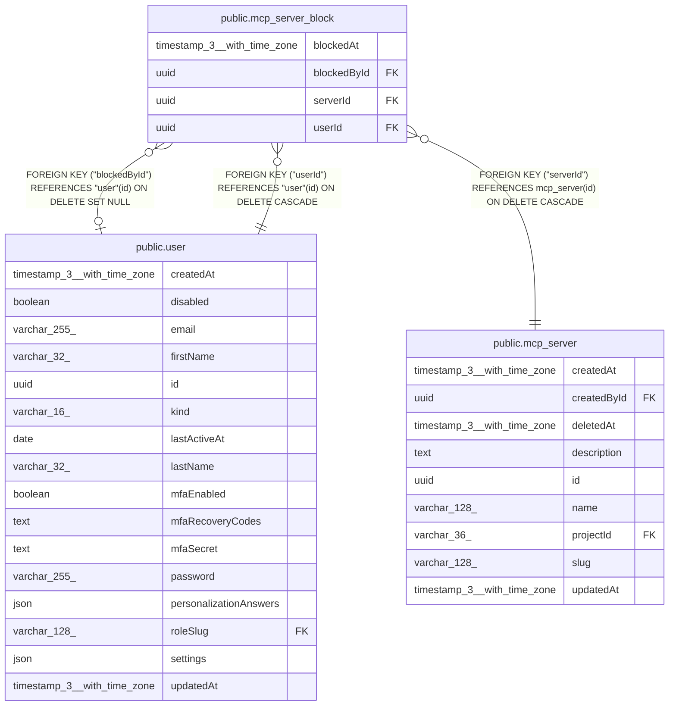

# public.mcp_server_block

## Columns

| Name | Type | Default | Nullable | Children | Parents | Comment |
| ---- | ---- | ------- | -------- | -------- | ------- | ------- |
| blockedAt | timestamp(3) with time zone | CURRENT_TIMESTAMP(3) | false |  |  |  |
| blockedById | uuid |  | true |  | [public.user](public.user.md) | Who blocked the person. NULL after the user is deleted |
| serverId | uuid |  | false |  | [public.mcp_server](public.mcp_server.md) |  |
| userId | uuid |  | false |  | [public.user](public.user.md) | The blocked person. The block applies to all clients |

## Constraints

| Name | Type | Definition |
| ---- | ---- | ---------- |
| FK_319813a1818266a1f46efbd5c70 | FOREIGN KEY | FOREIGN KEY ("userId") REFERENCES "user"(id) ON DELETE CASCADE |
| FK_3d365ab7009dc331429a1a55049 | FOREIGN KEY | FOREIGN KEY ("serverId") REFERENCES mcp_server(id) ON DELETE CASCADE |
| FK_707fcb57b18801980b8774f31f6 | FOREIGN KEY | FOREIGN KEY ("blockedById") REFERENCES "user"(id) ON DELETE SET NULL |
| PK_4c99af40cdadca36886d43893f4 | PRIMARY KEY | PRIMARY KEY ("serverId", "userId") |
| mcp_server_block_blockedAt_not_null | n | NOT NULL "blockedAt" |
| mcp_server_block_serverId_not_null | n | NOT NULL "serverId" |
| mcp_server_block_userId_not_null | n | NOT NULL "userId" |

## Indexes

| Name | Definition |
| ---- | ---------- |
| IDX_319813a1818266a1f46efbd5c7 | CREATE INDEX "IDX_319813a1818266a1f46efbd5c7" ON public.mcp_server_block USING btree ("userId") |
| IDX_707fcb57b18801980b8774f31f | CREATE INDEX "IDX_707fcb57b18801980b8774f31f" ON public.mcp_server_block USING btree ("blockedById") |
| PK_4c99af40cdadca36886d43893f4 | CREATE UNIQUE INDEX "PK_4c99af40cdadca36886d43893f4" ON public.mcp_server_block USING btree ("serverId", "userId") |

## Relations

---

> Generated by [tbls](https://github.com/k1LoW/tbls)
