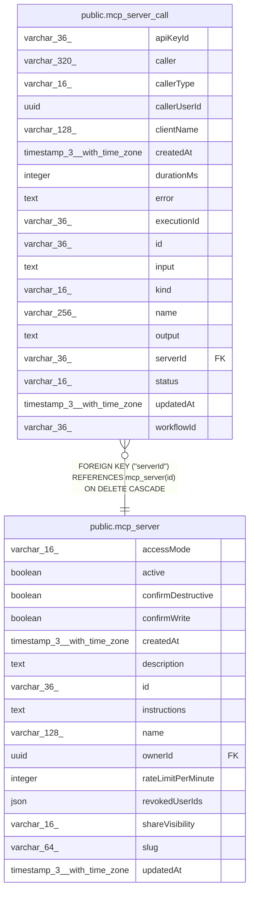

# public.mcp_server_call

## Columns

| Name | Type | Default | Nullable | Children | Parents | Comment |
| ---- | ---- | ------- | -------- | -------- | ------- | ------- |
| apiKeyId | varchar(36) |  | true |  |  |  |
| caller | varchar(320) |  | false |  |  |  |
| callerType | varchar(16) |  | false |  |  |  |
| callerUserId | uuid |  | true |  |  |  |
| clientName | varchar(128) |  | true |  |  |  |
| createdAt | timestamp(3) with time zone | CURRENT_TIMESTAMP(3) | false |  |  |  |
| durationMs | integer |  | true |  |  |  |
| error | text |  | true |  |  |  |
| executionId | varchar(36) |  | true |  |  |  |
| id | varchar(36) |  | false |  |  |  |
| input | text |  | true |  |  |  |
| kind | varchar(16) |  | false |  |  |  |
| name | varchar(256) |  | false |  |  |  |
| output | text |  | true |  |  |  |
| serverId | varchar(36) |  | false |  | [public.mcp_server](public.mcp_server.md) |  |
| status | varchar(16) |  | false |  |  |  |
| updatedAt | timestamp(3) with time zone | CURRENT_TIMESTAMP(3) | false |  |  |  |
| workflowId | varchar(36) |  | true |  |  |  |

## Constraints

| Name | Type | Definition |
| ---- | ---- | ---------- |
| FK_mcp_server_call_serverId | FOREIGN KEY | FOREIGN KEY ("serverId") REFERENCES mcp_server(id) ON DELETE CASCADE |
| PK_814ab5e47d0eac6c5d6fe7a12b2 | PRIMARY KEY | PRIMARY KEY (id) |
| mcp_server_call_callerType_not_null | n | NOT NULL "callerType" |
| mcp_server_call_caller_not_null | n | NOT NULL caller |
| mcp_server_call_createdAt_not_null | n | NOT NULL "createdAt" |
| mcp_server_call_id_not_null | n | NOT NULL id |
| mcp_server_call_kind_not_null | n | NOT NULL kind |
| mcp_server_call_name_not_null | n | NOT NULL name |
| mcp_server_call_serverId_not_null | n | NOT NULL "serverId" |
| mcp_server_call_status_not_null | n | NOT NULL status |
| mcp_server_call_updatedAt_not_null | n | NOT NULL "updatedAt" |

## Indexes

| Name | Definition |
| ---- | ---------- |
| IDX_177be25753b3cd36e4c5e6f8a0 | CREATE INDEX "IDX_177be25753b3cd36e4c5e6f8a0" ON public.mcp_server_call USING btree ("serverId", "createdAt") |
| PK_814ab5e47d0eac6c5d6fe7a12b2 | CREATE UNIQUE INDEX "PK_814ab5e47d0eac6c5d6fe7a12b2" ON public.mcp_server_call USING btree (id) |

## Relations

---

> Generated by [tbls](https://github.com/k1LoW/tbls)
