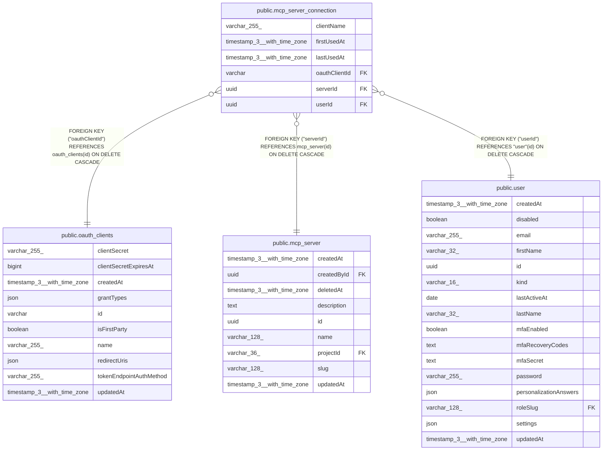

# public.mcp_server_connection

## Columns

| Name | Type | Default | Nullable | Children | Parents | Comment |
| ---- | ---- | ------- | -------- | -------- | ------- | ------- |
| clientName | varchar(255) |  | false |  |  | Name from the OAuth client registration, e.g. "Claude Code" |
| firstUsedAt | timestamp(3) with time zone | CURRENT_TIMESTAMP(3) | false |  |  |  |
| lastUsedAt | timestamp(3) with time zone | CURRENT_TIMESTAMP(3) | false |  |  | Updated at most one time each minute |
| oauthClientId | varchar |  | false |  | [public.oauth_clients](public.oauth_clients.md) |  |
| serverId | uuid |  | false |  | [public.mcp_server](public.mcp_server.md) |  |
| userId | uuid |  | false |  | [public.user](public.user.md) |  |

## Constraints

| Name | Type | Definition |
| ---- | ---- | ---------- |
| FK_285ef9ea4a8408da7a473bd8add | FOREIGN KEY | FOREIGN KEY ("oauthClientId") REFERENCES oauth_clients(id) ON DELETE CASCADE |
| FK_44cbc3141b2934c93bf2e5192b7 | FOREIGN KEY | FOREIGN KEY ("serverId") REFERENCES mcp_server(id) ON DELETE CASCADE |
| FK_d0ffd17b8b5e4ad17f21d8414b0 | FOREIGN KEY | FOREIGN KEY ("userId") REFERENCES "user"(id) ON DELETE CASCADE |
| PK_4f814cb136c3380893f1a417ed3 | PRIMARY KEY | PRIMARY KEY ("serverId", "userId", "oauthClientId") |
| mcp_server_connection_clientName_not_null | n | NOT NULL "clientName" |
| mcp_server_connection_firstUsedAt_not_null | n | NOT NULL "firstUsedAt" |
| mcp_server_connection_lastUsedAt_not_null | n | NOT NULL "lastUsedAt" |
| mcp_server_connection_oauthClientId_not_null | n | NOT NULL "oauthClientId" |
| mcp_server_connection_serverId_not_null | n | NOT NULL "serverId" |
| mcp_server_connection_userId_not_null | n | NOT NULL "userId" |

## Indexes

| Name | Definition |
| ---- | ---------- |
| IDX_285ef9ea4a8408da7a473bd8ad | CREATE INDEX "IDX_285ef9ea4a8408da7a473bd8ad" ON public.mcp_server_connection USING btree ("oauthClientId") |
| IDX_d0ffd17b8b5e4ad17f21d8414b | CREATE INDEX "IDX_d0ffd17b8b5e4ad17f21d8414b" ON public.mcp_server_connection USING btree ("userId") |
| PK_4f814cb136c3380893f1a417ed3 | CREATE UNIQUE INDEX "PK_4f814cb136c3380893f1a417ed3" ON public.mcp_server_connection USING btree ("serverId", "userId", "oauthClientId") |

## Relations

---

> Generated by [tbls](https://github.com/k1LoW/tbls)
