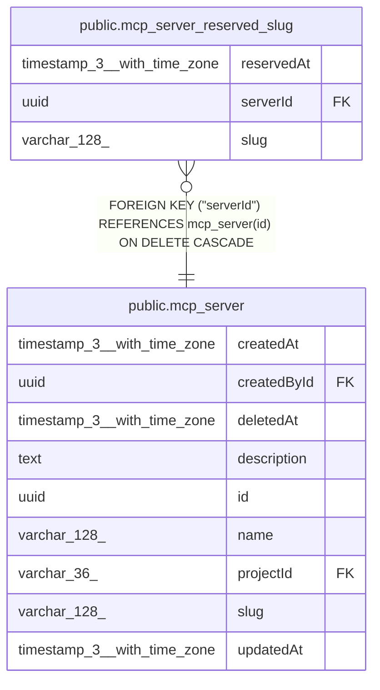

# public.mcp_server_reserved_slug

## Columns

| Name | Type | Default | Nullable | Children | Parents | Comment |
| ---- | ---- | ------- | -------- | -------- | ------- | ------- |
| reservedAt | timestamp(3) with time zone | CURRENT_TIMESTAMP(3) | false |  |  |  |
| serverId | uuid |  | false |  | [public.mcp_server](public.mcp_server.md) | Server that used this slug before |
| slug | varchar(128) |  | false |  |  | Old URL slug of a server. Stays reserved until its project is deleted |

## Constraints

| Name | Type | Definition |
| ---- | ---- | ---------- |
| FK_48f49acd341981bf2beb0ba813a | FOREIGN KEY | FOREIGN KEY ("serverId") REFERENCES mcp_server(id) ON DELETE CASCADE |
| PK_091dd99228bb35297351a60ee33 | PRIMARY KEY | PRIMARY KEY (slug) |
| mcp_server_reserved_slug_reservedAt_not_null | n | NOT NULL "reservedAt" |
| mcp_server_reserved_slug_serverId_not_null | n | NOT NULL "serverId" |
| mcp_server_reserved_slug_slug_not_null | n | NOT NULL slug |

## Indexes

| Name | Definition |
| ---- | ---------- |
| IDX_48f49acd341981bf2beb0ba813 | CREATE INDEX "IDX_48f49acd341981bf2beb0ba813" ON public.mcp_server_reserved_slug USING btree ("serverId") |
| PK_091dd99228bb35297351a60ee33 | CREATE UNIQUE INDEX "PK_091dd99228bb35297351a60ee33" ON public.mcp_server_reserved_slug USING btree (slug) |

## Relations

---

> Generated by [tbls](https://github.com/k1LoW/tbls)
