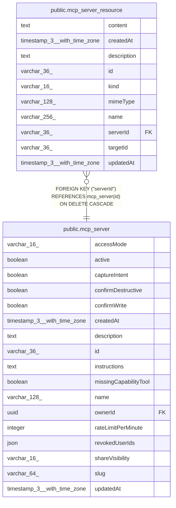

# public.mcp_server_resource

## Columns

| Name | Type | Default | Nullable | Children | Parents | Comment |
| ---- | ---- | ------- | -------- | -------- | ------- | ------- |
| content | text |  | true |  |  |  |
| createdAt | timestamp(3) with time zone | CURRENT_TIMESTAMP(3) | false |  |  |  |
| description | text |  | false |  |  |  |
| id | varchar(36) |  | false |  |  |  |
| kind | varchar(16) |  | false |  |  |  |
| mimeType | varchar(128) | 'text/plain'::character varying | false |  |  |  |
| name | varchar(256) |  | false |  |  |  |
| serverId | varchar(36) |  | false |  | [public.mcp_server](public.mcp_server.md) |  |
| targetId | varchar(36) |  | true |  |  |  |
| updatedAt | timestamp(3) with time zone | CURRENT_TIMESTAMP(3) | false |  |  |  |

## Constraints

| Name | Type | Definition |
| ---- | ---- | ---------- |
| FK_mcp_server_resource_serverId | FOREIGN KEY | FOREIGN KEY ("serverId") REFERENCES mcp_server(id) ON DELETE CASCADE |
| PK_47ea8933653fdb3014416669832 | PRIMARY KEY | PRIMARY KEY (id) |
| mcp_server_resource_createdAt_not_null | n | NOT NULL "createdAt" |
| mcp_server_resource_description_not_null | n | NOT NULL description |
| mcp_server_resource_id_not_null | n | NOT NULL id |
| mcp_server_resource_kind_not_null | n | NOT NULL kind |
| mcp_server_resource_mimeType_not_null | n | NOT NULL "mimeType" |
| mcp_server_resource_name_not_null | n | NOT NULL name |
| mcp_server_resource_serverId_not_null | n | NOT NULL "serverId" |
| mcp_server_resource_updatedAt_not_null | n | NOT NULL "updatedAt" |

## Indexes

| Name | Definition |
| ---- | ---------- |
| IDX_bd381d0f1ef8b0c1d75bc261cf | CREATE INDEX "IDX_bd381d0f1ef8b0c1d75bc261cf" ON public.mcp_server_resource USING btree ("serverId") |
| PK_47ea8933653fdb3014416669832 | CREATE UNIQUE INDEX "PK_47ea8933653fdb3014416669832" ON public.mcp_server_resource USING btree (id) |

## Relations

---

> Generated by [tbls](https://github.com/k1LoW/tbls)
