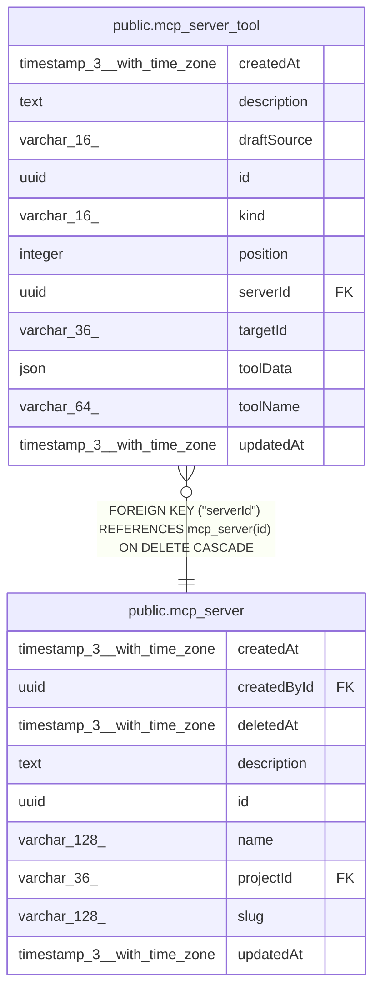

# public.mcp_server_tool

## Columns

| Name | Type | Default | Nullable | Children | Parents | Comment |
| ---- | ---- | ------- | -------- | -------- | ------- | ------- |
| createdAt | timestamp(3) with time zone | CURRENT_TIMESTAMP(3) | false |  |  |  |
| description | text | ''::text | false |  |  |  |
| draftSource | varchar(16) | 'defaults'::character varying | false |  |  | Who wrote the tool text: an AI draft, the defaults of the target, or the builder |
| id | uuid |  | false |  |  | UUIDv7, made by the application |
| kind | varchar(16) |  | false |  |  | What the tool runs: a workflow, a node, an agent, or a skill |
| position | integer | 0 | false |  |  | Order of the tool in the server |
| serverId | uuid |  | false |  | [public.mcp_server](public.mcp_server.md) |  |
| targetId | varchar(36) |  | true |  |  | ID of the workflow, agent, or skill. NULL for a node tool |
| toolData | json |  | true |  |  | Fixed input values of a workflow tool, or the node definition of a node tool. NULL when the tool has none |
| toolName | varchar(64) |  | false |  |  | Name that clients see. Unique in the server |
| updatedAt | timestamp(3) with time zone | CURRENT_TIMESTAMP(3) | false |  |  |  |

## Constraints

| Name | Type | Definition |
| ---- | ---- | ---------- |
| CHK_mcp_server_tool_draftSource | CHECK | CHECK ((("draftSource")::text = ANY ((ARRAY['ai'::character varying, 'defaults'::character varying, 'edited'::character varying])::text[]))) |
| CHK_mcp_server_tool_kind | CHECK | CHECK (((kind)::text = ANY ((ARRAY['workflow'::character varying, 'node'::character varying, 'agent'::character varying, 'skill'::character varying])::text[]))) |
| FK_7b01d158967aa247f8d3b3b89dd | FOREIGN KEY | FOREIGN KEY ("serverId") REFERENCES mcp_server(id) ON DELETE CASCADE |
| PK_2b0bacf1aff9c11c7e7a1fdf0e0 | PRIMARY KEY | PRIMARY KEY (id) |
| mcp_server_tool_createdAt_not_null | n | NOT NULL "createdAt" |
| mcp_server_tool_description_not_null | n | NOT NULL description |
| mcp_server_tool_draftSource_not_null | n | NOT NULL "draftSource" |
| mcp_server_tool_id_not_null | n | NOT NULL id |
| mcp_server_tool_kind_not_null | n | NOT NULL kind |
| mcp_server_tool_position_not_null | n | NOT NULL "position" |
| mcp_server_tool_serverId_not_null | n | NOT NULL "serverId" |
| mcp_server_tool_toolName_not_null | n | NOT NULL "toolName" |
| mcp_server_tool_updatedAt_not_null | n | NOT NULL "updatedAt" |

## Indexes

| Name | Definition |
| ---- | ---------- |
| IDX_d8f9b66a9b644c56d021f90395 | CREATE UNIQUE INDEX "IDX_d8f9b66a9b644c56d021f90395" ON public.mcp_server_tool USING btree ("serverId", "toolName") |
| PK_2b0bacf1aff9c11c7e7a1fdf0e0 | CREATE UNIQUE INDEX "PK_2b0bacf1aff9c11c7e7a1fdf0e0" ON public.mcp_server_tool USING btree (id) |

## Relations

---

> Generated by [tbls](https://github.com/k1LoW/tbls)
