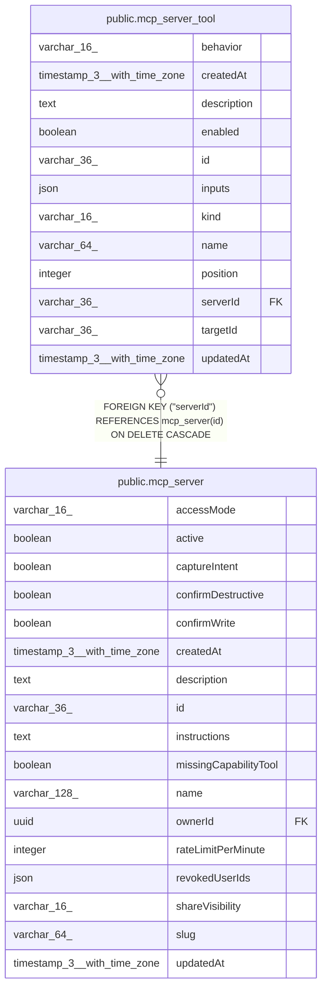

# public.mcp_server_tool

## Columns

| Name | Type | Default | Nullable | Children | Parents | Comment |
| ---- | ---- | ------- | -------- | -------- | ------- | ------- |
| behavior | varchar(16) | 'read'::character varying | false |  |  |  |
| createdAt | timestamp(3) with time zone | CURRENT_TIMESTAMP(3) | false |  |  |  |
| description | text |  | true |  |  |  |
| enabled | boolean | true | false |  |  |  |
| id | varchar(36) |  | false |  |  |  |
| inputs | json |  | true |  |  |  |
| kind | varchar(16) |  | false |  |  |  |
| name | varchar(64) |  | true |  |  |  |
| position | integer | 0 | false |  |  |  |
| serverId | varchar(36) |  | false |  | [public.mcp_server](public.mcp_server.md) |  |
| targetId | varchar(36) |  | false |  |  |  |
| updatedAt | timestamp(3) with time zone | CURRENT_TIMESTAMP(3) | false |  |  |  |

## Constraints

| Name | Type | Definition |
| ---- | ---- | ---------- |
| FK_mcp_server_tool_serverId | FOREIGN KEY | FOREIGN KEY ("serverId") REFERENCES mcp_server(id) ON DELETE CASCADE |
| PK_2b0bacf1aff9c11c7e7a1fdf0e0 | PRIMARY KEY | PRIMARY KEY (id) |
| mcp_server_tool_behavior_not_null | n | NOT NULL behavior |
| mcp_server_tool_createdAt_not_null | n | NOT NULL "createdAt" |
| mcp_server_tool_enabled_not_null | n | NOT NULL enabled |
| mcp_server_tool_id_not_null | n | NOT NULL id |
| mcp_server_tool_kind_not_null | n | NOT NULL kind |
| mcp_server_tool_position_not_null | n | NOT NULL "position" |
| mcp_server_tool_serverId_not_null | n | NOT NULL "serverId" |
| mcp_server_tool_targetId_not_null | n | NOT NULL "targetId" |
| mcp_server_tool_updatedAt_not_null | n | NOT NULL "updatedAt" |

## Indexes

| Name | Definition |
| ---- | ---------- |
| IDX_7b01d158967aa247f8d3b3b89d | CREATE INDEX "IDX_7b01d158967aa247f8d3b3b89d" ON public.mcp_server_tool USING btree ("serverId") |
| PK_2b0bacf1aff9c11c7e7a1fdf0e0 | CREATE UNIQUE INDEX "PK_2b0bacf1aff9c11c7e7a1fdf0e0" ON public.mcp_server_tool USING btree (id) |

## Relations

---

> Generated by [tbls](https://github.com/k1LoW/tbls)
