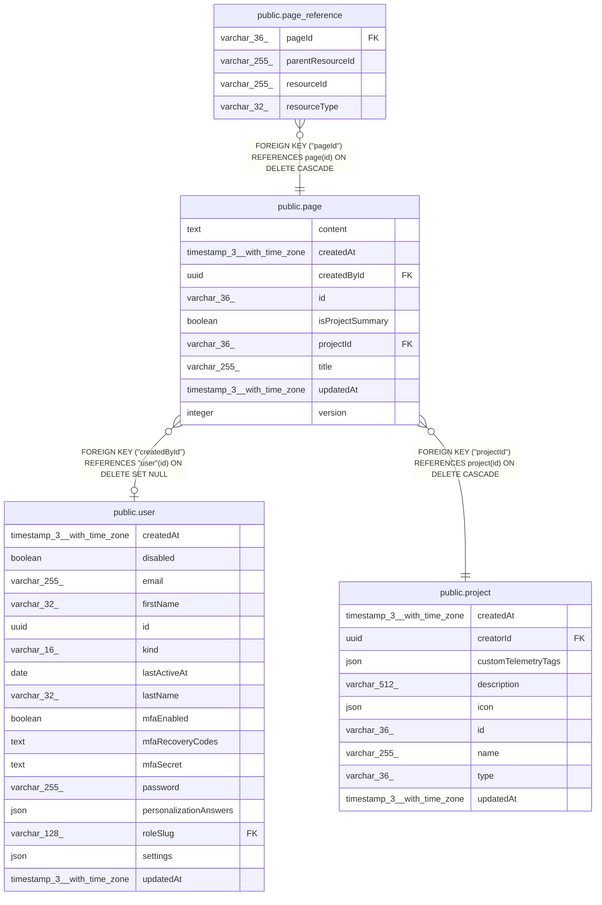

# public.page

## Columns

| Name | Type | Default | Nullable | Children | Parents | Comment |
| ---- | ---- | ------- | -------- | -------- | ------- | ------- |
| content | text | ''::text | false |  |  | Markdown. A link to an editor path is a reference to an n8n resource |
| createdAt | timestamp(3) with time zone | CURRENT_TIMESTAMP(3) | false |  |  |  |
| createdById | uuid |  | true |  | [public.user](public.user.md) | Author. NULL after the author is deleted |
| id | varchar(36) |  | false | [public.page_reference](public.page_reference.md) |  |  |
| isProjectSummary | boolean | false | false |  |  | True for the page that sums up its project. At most one for each project |
| projectId | varchar(36) |  | false |  | [public.project](public.project.md) |  |
| title | varchar(255) |  | false |  |  |  |
| updatedAt | timestamp(3) with time zone | CURRENT_TIMESTAMP(3) | false |  |  |  |
| version | integer | 1 | false |  |  | Grows by one on each saved change. Detects edits of a stale copy |

## Constraints

| Name | Type | Definition |
| ---- | ---- | ---------- |
| FK_2d80076945d659dc90bbd11865a | FOREIGN KEY | FOREIGN KEY ("projectId") REFERENCES project(id) ON DELETE CASCADE |
| FK_5021d47dea711cebdc2b8b32327 | FOREIGN KEY | FOREIGN KEY ("createdById") REFERENCES "user"(id) ON DELETE SET NULL |
| PK_742f4117e065c5b6ad21b37ba1f | PRIMARY KEY | PRIMARY KEY (id) |
| page_content_not_null | n | NOT NULL content |
| page_createdAt_not_null | n | NOT NULL "createdAt" |
| page_id_not_null | n | NOT NULL id |
| page_isProjectSummary_not_null | n | NOT NULL "isProjectSummary" |
| page_projectId_not_null | n | NOT NULL "projectId" |
| page_title_not_null | n | NOT NULL title |
| page_updatedAt_not_null | n | NOT NULL "updatedAt" |
| page_version_not_null | n | NOT NULL version |

## Indexes

| Name | Definition |
| ---- | ---------- |
| IDX_2d80076945d659dc90bbd11865 | CREATE INDEX "IDX_2d80076945d659dc90bbd11865" ON public.page USING btree ("projectId") |
| PK_742f4117e065c5b6ad21b37ba1f | CREATE UNIQUE INDEX "PK_742f4117e065c5b6ad21b37ba1f" ON public.page USING btree (id) |

## Relations

---

> Generated by [tbls](https://github.com/k1LoW/tbls)
