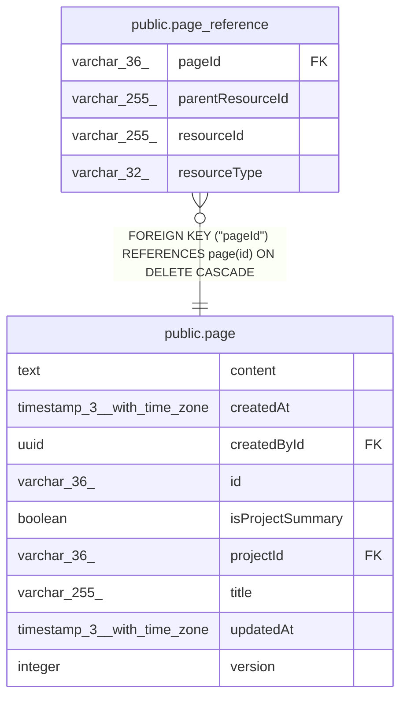

# public.page_reference

## Columns

| Name | Type | Default | Nullable | Children | Parents | Comment |
| ---- | ---- | ------- | -------- | -------- | ------- | ------- |
| pageId | varchar(36) |  | false |  | [public.page](public.page.md) |  |
| parentResourceId | varchar(255) |  | true |  |  | Workflow ID when resourceType is node. NULL for the other types |
| resourceId | varchar(255) |  | false |  |  | ID of the linked resource. Derived from the page content, so no FK |
| resourceType | varchar(32) |  | false |  |  | Kind of the n8n resource that the page content links to |

## Constraints

| Name | Type | Definition |
| ---- | ---- | ---------- |
| CHK_page_reference_resourceType | CHECK | CHECK ((("resourceType")::text = ANY ((ARRAY['workflow'::character varying, 'node'::character varying, 'page'::character varying, 'credential'::character varying, 'dataTable'::character varying])::text[]))) |
| FK_615bcbf6620b1cffa1dcfcebed8 | FOREIGN KEY | FOREIGN KEY ("pageId") REFERENCES page(id) ON DELETE CASCADE |
| PK_f5aeed3e3c08e59082897918aaa | PRIMARY KEY | PRIMARY KEY ("pageId", "resourceType", "resourceId") |
| page_reference_pageId_not_null | n | NOT NULL "pageId" |
| page_reference_resourceId_not_null | n | NOT NULL "resourceId" |
| page_reference_resourceType_not_null | n | NOT NULL "resourceType" |

## Indexes

| Name | Definition |
| ---- | ---------- |
| IDX_7a19a989b40f9fda7193b3dbc5 | CREATE INDEX "IDX_7a19a989b40f9fda7193b3dbc5" ON public.page_reference USING btree ("resourceType", "resourceId") |
| IDX_ac8ac0cf97d54a70983cd2b628 | CREATE INDEX "IDX_ac8ac0cf97d54a70983cd2b628" ON public.page_reference USING btree ("parentResourceId") |
| PK_f5aeed3e3c08e59082897918aaa | CREATE UNIQUE INDEX "PK_f5aeed3e3c08e59082897918aaa" ON public.page_reference USING btree ("pageId", "resourceType", "resourceId") |

## Relations

---

> Generated by [tbls](https://github.com/k1LoW/tbls)
