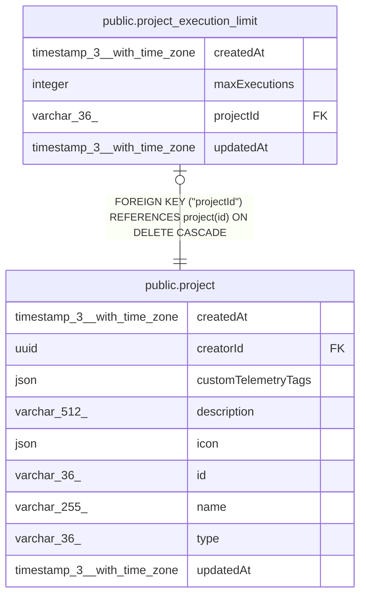

# public.project_execution_limit

## Columns

| Name | Type | Default | Nullable | Children | Parents | Comment |
| ---- | ---- | ------- | -------- | -------- | ------- | ------- |
| createdAt | timestamp(3) with time zone | CURRENT_TIMESTAMP(3) | false |  |  |  |
| maxExecutions | integer |  | false |  |  |  |
| projectId | varchar(36) |  | false |  | [public.project](public.project.md) |  |
| updatedAt | timestamp(3) with time zone | CURRENT_TIMESTAMP(3) | false |  |  |  |

## Constraints

| Name | Type | Definition |
| ---- | ---- | ---------- |
| CHK_project_execution_limit_max_executions_positive | CHECK | CHECK (("maxExecutions" > 0)) |
| FK_project_execution_limit_projectId | FOREIGN KEY | FOREIGN KEY ("projectId") REFERENCES project(id) ON DELETE CASCADE |
| PK_972bccb57c4e2dca3242a574cfe | PRIMARY KEY | PRIMARY KEY ("projectId") |
| project_execution_limit_createdAt_not_null | n | NOT NULL "createdAt" |
| project_execution_limit_maxExecutions_not_null | n | NOT NULL "maxExecutions" |
| project_execution_limit_projectId_not_null | n | NOT NULL "projectId" |
| project_execution_limit_updatedAt_not_null | n | NOT NULL "updatedAt" |

## Indexes

| Name | Definition |
| ---- | ---------- |
| PK_972bccb57c4e2dca3242a574cfe | CREATE UNIQUE INDEX "PK_972bccb57c4e2dca3242a574cfe" ON public.project_execution_limit USING btree ("projectId") |

## Relations

---

> Generated by [tbls](https://github.com/k1LoW/tbls)
