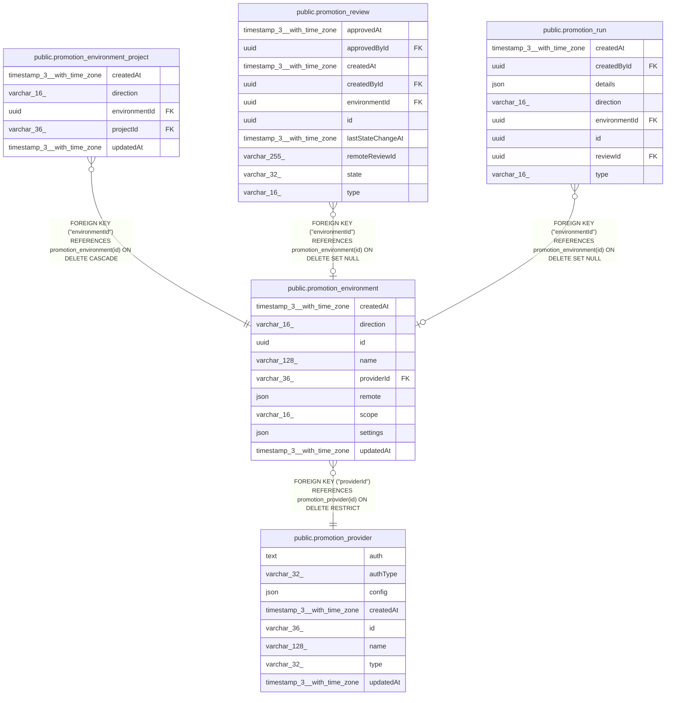

# public.promotion_environment

## Columns

| Name | Type | Default | Nullable | Children | Parents | Comment |
| ---- | ---- | ------- | -------- | -------- | ------- | ------- |
| createdAt | timestamp(3) with time zone | CURRENT_TIMESTAMP(3) | false |  |  |  |
| direction | varchar(16) |  | false |  |  | PromotionDirection enum: "apply", "promote". Cannot change after creation. |
| id | uuid |  | false | [public.promotion_environment_project](public.promotion_environment_project.md) [public.promotion_review](public.promotion_review.md) [public.promotion_run](public.promotion_run.md) |  | Also the name of the local checkout directory. |
| name | varchar(128) |  | false |  |  |  |
| providerId | varchar(36) |  | false |  | [public.promotion_provider](public.promotion_provider.md) | The provider whose credentials this environment uses. |
| remote | json |  | false |  |  | Where to push and pull. The provider type picks the shape: plain Git stores remoteUrl, a Git host stores repositoryPath. Has its own schemaVersion. |
| scope | varchar(16) |  | false |  |  | PromotionEnvironmentScope enum: "instance", "projects". Cannot change after creation. |
| settings | json |  | false |  |  | Settings of one direction. direction picks the shape: apply stores branchName, promote stores baseBranchName and createBranchOnPromotion. Has its own schemaVersion. Validated in code. |
| updatedAt | timestamp(3) with time zone | CURRENT_TIMESTAMP(3) | false |  |  |  |

## Constraints

| Name | Type | Definition |
| ---- | ---- | ---------- |
| CHK_promotion_environment_direction | CHECK | CHECK (((direction)::text = ANY ((ARRAY['apply'::character varying, 'promote'::character varying])::text[]))) |
| CHK_promotion_environment_scope | CHECK | CHECK (((scope)::text = ANY ((ARRAY['instance'::character varying, 'projects'::character varying])::text[]))) |
| FK_promotion_environment_providerId | FOREIGN KEY | FOREIGN KEY ("providerId") REFERENCES promotion_provider(id) ON DELETE RESTRICT |
| PK_740c935ab8d2563fe8cb61c7b3b | PRIMARY KEY | PRIMARY KEY (id) |
| promotion_environment_createdAt_not_null | n | NOT NULL "createdAt" |
| promotion_environment_direction_not_null | n | NOT NULL direction |
| promotion_environment_id_not_null | n | NOT NULL id |
| promotion_environment_name_not_null | n | NOT NULL name |
| promotion_environment_providerId_not_null | n | NOT NULL "providerId" |
| promotion_environment_remote_not_null | n | NOT NULL remote |
| promotion_environment_scope_not_null | n | NOT NULL scope |
| promotion_environment_settings_not_null | n | NOT NULL settings |
| promotion_environment_updatedAt_not_null | n | NOT NULL "updatedAt" |

## Indexes

| Name | Definition |
| ---- | ---------- |
| IDX_5246e9ee176a2e10dc9977e521 | CREATE INDEX "IDX_5246e9ee176a2e10dc9977e521" ON public.promotion_environment USING btree ("providerId") |
| IDX_promotion_environment_direction | CREATE UNIQUE INDEX "IDX_promotion_environment_direction" ON public.promotion_environment USING btree (direction) WHERE ((scope)::text = 'instance'::text) |
| PK_740c935ab8d2563fe8cb61c7b3b | CREATE UNIQUE INDEX "PK_740c935ab8d2563fe8cb61c7b3b" ON public.promotion_environment USING btree (id) |

## Relations

---

> Generated by [tbls](https://github.com/k1LoW/tbls)
