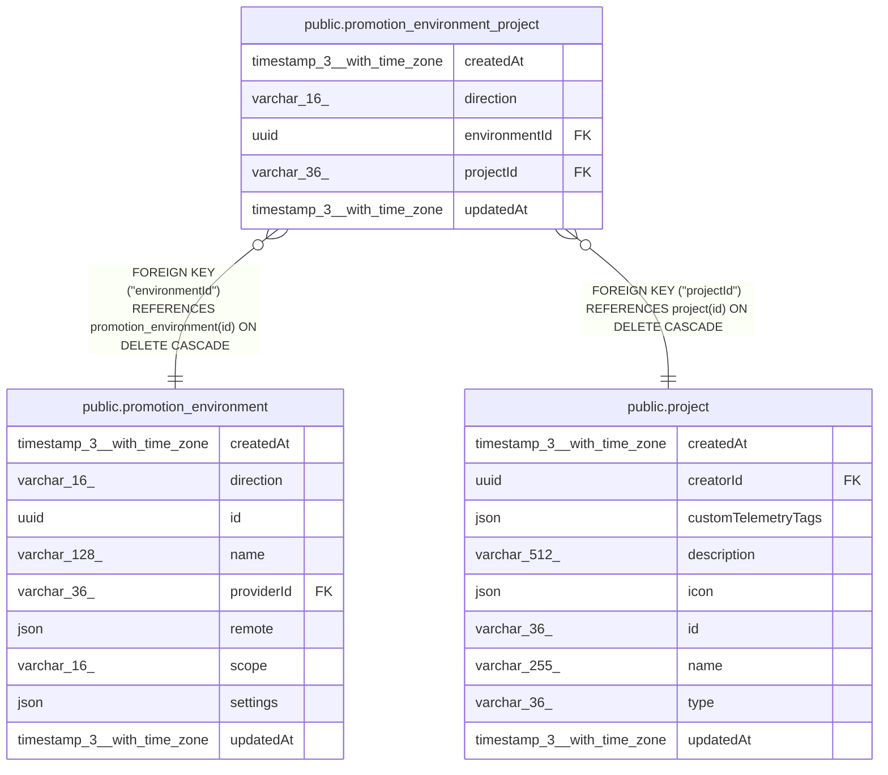

# public.promotion_environment_project

## Columns

| Name | Type | Default | Nullable | Children | Parents | Comment |
| ---- | ---- | ------- | -------- | -------- | ------- | ------- |
| createdAt | timestamp(3) with time zone | CURRENT_TIMESTAMP(3) | false |  |  |  |
| direction | varchar(16) |  | false |  |  | PromotionDirection enum: "apply", "promote". The direction of the environment. |
| environmentId | uuid |  | false |  | [public.promotion_environment](public.promotion_environment.md) |  |
| projectId | varchar(36) |  | false |  | [public.project](public.project.md) |  |
| updatedAt | timestamp(3) with time zone | CURRENT_TIMESTAMP(3) | false |  |  |  |

## Constraints

| Name | Type | Definition |
| ---- | ---- | ---------- |
| CHK_promotion_environment_project_direction | CHECK | CHECK (((direction)::text = ANY ((ARRAY['apply'::character varying, 'promote'::character varying])::text[]))) |
| FK_promotion_environment_project_environmentId | FOREIGN KEY | FOREIGN KEY ("environmentId") REFERENCES promotion_environment(id) ON DELETE CASCADE |
| FK_promotion_environment_project_projectId | FOREIGN KEY | FOREIGN KEY ("projectId") REFERENCES project(id) ON DELETE CASCADE |
| PK_b24efcd0701a03db59013dbafc8 | PRIMARY KEY | PRIMARY KEY ("projectId", direction) |
| promotion_environment_project_createdAt_not_null | n | NOT NULL "createdAt" |
| promotion_environment_project_direction_not_null | n | NOT NULL direction |
| promotion_environment_project_environmentId_not_null | n | NOT NULL "environmentId" |
| promotion_environment_project_projectId_not_null | n | NOT NULL "projectId" |
| promotion_environment_project_updatedAt_not_null | n | NOT NULL "updatedAt" |

## Indexes

| Name | Definition |
| ---- | ---------- |
| IDX_7e9db6a9fc5e58a6ed613387aa | CREATE INDEX "IDX_7e9db6a9fc5e58a6ed613387aa" ON public.promotion_environment_project USING btree ("environmentId") |
| PK_b24efcd0701a03db59013dbafc8 | CREATE UNIQUE INDEX "PK_b24efcd0701a03db59013dbafc8" ON public.promotion_environment_project USING btree ("projectId", direction) |

## Relations

---

> Generated by [tbls](https://github.com/k1LoW/tbls)
