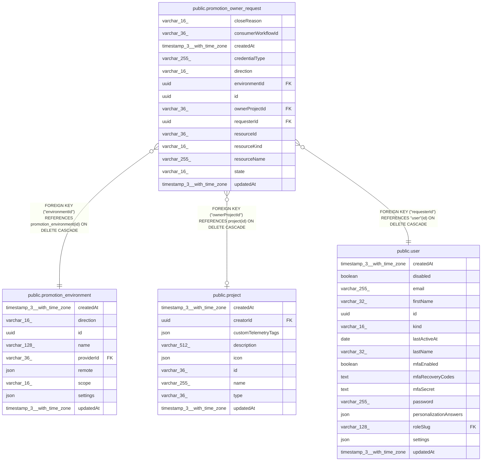

# public.promotion_owner_request

## Columns

| Name | Type | Default | Nullable | Children | Parents | Comment |
| ---- | ---- | ------- | -------- | -------- | ------- | ------- |
| closeReason | varchar(16) |  | true |  |  | "dismissed": a recipient closed it. "satisfied": the resource reached the branch or the destination. NULL while open. |
| consumerWorkflowId | varchar(36) |  | false |  |  | The workflow of the requester that references the resource. Not shown to a recipient. |
| createdAt | timestamp(3) with time zone | CURRENT_TIMESTAMP(3) | false |  |  |  |
| credentialType | varchar(255) |  | true |  |  | The credential type that the node of the requester holds. NULL for a workflow. |
| direction | varchar(16) |  | false |  |  | PromotionDirection enum: "promote", "apply". Copied from the environment. The request offers this operation to the owner. |
| environmentId | uuid |  | false |  | [public.promotion_environment](public.promotion_environment.md) | The promotion environment of the operation that the requester ran. |
| id | uuid |  | false |  |  |  |
| ownerProjectId | varchar(36) |  | true |  | [public.project](public.project.md) | The project that owns the resource. NULL when the project is not on this instance: the instance admins receive the request. |
| requesterId | uuid |  | false |  | [public.user](public.user.md) | The user who asked. |
| resourceId | varchar(36) |  | false |  |  | The id of the requested resource. |
| resourceKind | varchar(16) |  | false |  |  | The kind of the requested resource: "credential", "workflow". |
| resourceName | varchar(255) |  | false |  |  |  |
| state | varchar(16) | 'open'::character varying | false |  |  | "open" or "closed". A closed request never opens again. |
| updatedAt | timestamp(3) with time zone | CURRENT_TIMESTAMP(3) | false |  |  |  |

## Constraints

| Name | Type | Definition |
| ---- | ---- | ---------- |
| CHK_promotion_owner_request_closeReason | CHECK | CHECK ((("closeReason")::text = ANY ((ARRAY['dismissed'::character varying, 'satisfied'::character varying])::text[]))) |
| CHK_promotion_owner_request_direction | CHECK | CHECK (((direction)::text = ANY ((ARRAY['promote'::character varying, 'apply'::character varying])::text[]))) |
| CHK_promotion_owner_request_resourceKind | CHECK | CHECK ((("resourceKind")::text = ANY ((ARRAY['credential'::character varying, 'workflow'::character varying])::text[]))) |
| CHK_promotion_owner_request_state | CHECK | CHECK (((state)::text = ANY ((ARRAY['open'::character varying, 'closed'::character varying])::text[]))) |
| FK_promotion_owner_request_environmentId | FOREIGN KEY | FOREIGN KEY ("environmentId") REFERENCES promotion_environment(id) ON DELETE CASCADE |
| FK_promotion_owner_request_ownerProjectId | FOREIGN KEY | FOREIGN KEY ("ownerProjectId") REFERENCES project(id) ON DELETE CASCADE |
| FK_promotion_owner_request_requesterId | FOREIGN KEY | FOREIGN KEY ("requesterId") REFERENCES "user"(id) ON DELETE CASCADE |
| PK_beb9723c545eab412cd603d761b | PRIMARY KEY | PRIMARY KEY (id) |
| promotion_owner_request_consumerWorkflowId_not_null | n | NOT NULL "consumerWorkflowId" |
| promotion_owner_request_createdAt_not_null | n | NOT NULL "createdAt" |
| promotion_owner_request_direction_not_null | n | NOT NULL direction |
| promotion_owner_request_environmentId_not_null | n | NOT NULL "environmentId" |
| promotion_owner_request_id_not_null | n | NOT NULL id |
| promotion_owner_request_requesterId_not_null | n | NOT NULL "requesterId" |
| promotion_owner_request_resourceId_not_null | n | NOT NULL "resourceId" |
| promotion_owner_request_resourceKind_not_null | n | NOT NULL "resourceKind" |
| promotion_owner_request_resourceName_not_null | n | NOT NULL "resourceName" |
| promotion_owner_request_state_not_null | n | NOT NULL state |
| promotion_owner_request_updatedAt_not_null | n | NOT NULL "updatedAt" |

## Indexes

| Name | Definition |
| ---- | ---------- |
| IDX_4b92d3c927d91c510ebf2daff4 | CREATE INDEX "IDX_4b92d3c927d91c510ebf2daff4" ON public.promotion_owner_request USING btree ("ownerProjectId") |
| IDX_56bec58607289a17a053099bd1 | CREATE INDEX "IDX_56bec58607289a17a053099bd1" ON public.promotion_owner_request USING btree (state, "updatedAt") |
| IDX_8ce2788e640422dd0751517c42 | CREATE INDEX "IDX_8ce2788e640422dd0751517c42" ON public.promotion_owner_request USING btree ("environmentId") |
| IDX_promotion_owner_request_requesterId_environmentId_direction | CREATE UNIQUE INDEX "IDX_promotion_owner_request_requesterId_environmentId_direction" ON public.promotion_owner_request USING btree ("requesterId", "environmentId", direction, "resourceKind", "resourceId") WHERE ((state)::text = 'open'::text) |
| PK_beb9723c545eab412cd603d761b | CREATE UNIQUE INDEX "PK_beb9723c545eab412cd603d761b" ON public.promotion_owner_request USING btree (id) |

## Relations

---

> Generated by [tbls](https://github.com/k1LoW/tbls)
