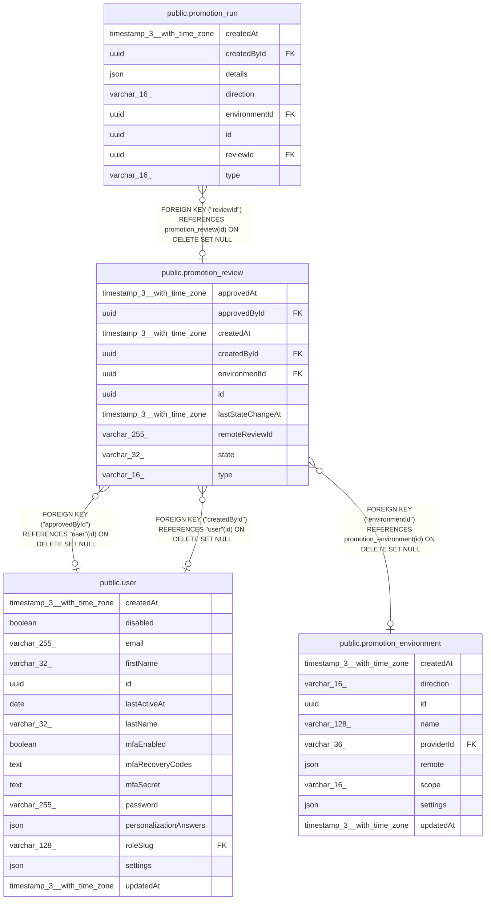

# public.promotion_review

## Columns

| Name | Type | Default | Nullable | Children | Parents | Comment |
| ---- | ---- | ------- | -------- | -------- | ------- | ------- |
| approvedAt | timestamp(3) with time zone |  | true |  |  | When the n8n user approved the review. |
| approvedById | uuid |  | true |  | [public.user](public.user.md) | The one n8n user who approved the review in n8n. NULL until then. n8n does not copy an approver from the host. |
| createdAt | timestamp(3) with time zone | CURRENT_TIMESTAMP(3) | false |  |  |  |
| createdById | uuid |  | true |  | [public.user](public.user.md) | The n8n user whose Promote opened this review. NULL after that user is deleted. |
| environmentId | uuid |  | true |  | [public.promotion_environment](public.promotion_environment.md) | The environment that remoteReviewId resolves through. NULL after the environment is deleted. |
| id | uuid |  | false | [public.promotion_run](public.promotion_run.md) |  |  |
| lastStateChangeAt | timestamp(3) with time zone |  | true |  |  | Time of the latest state change. Covers every transition, including changes_requested and a reopened review. NULL until the first change. |
| remoteReviewId | varchar(255) |  | true |  |  | Host reference for type. GitLab stores "\<projectId\>!\<iid\>". NULL when the review lives in n8n. |
| state | varchar(32) | 'open'::character varying | false |  |  | PromotionReviewState enum: "open", "changes_requested", "merged", "closed". "merged" and "closed" are terminal. |
| type | varchar(16) |  | false |  |  | PromotionReviewType enum: "gitlab". |

## Constraints

| Name | Type | Definition |
| ---- | ---- | ---------- |
| CHK_promotion_review_state | CHECK | CHECK (((state)::text = ANY ((ARRAY['open'::character varying, 'changes_requested'::character varying, 'merged'::character varying, 'closed'::character varying])::text[]))) |
| CHK_promotion_review_type | CHECK | CHECK (((type)::text = 'gitlab'::text)) |
| FK_promotion_review_approvedById | FOREIGN KEY | FOREIGN KEY ("approvedById") REFERENCES "user"(id) ON DELETE SET NULL |
| FK_promotion_review_createdById | FOREIGN KEY | FOREIGN KEY ("createdById") REFERENCES "user"(id) ON DELETE SET NULL |
| FK_promotion_review_environmentId | FOREIGN KEY | FOREIGN KEY ("environmentId") REFERENCES promotion_environment(id) ON DELETE SET NULL |
| PK_fe93e2f1add228dc14d3330c8e5 | PRIMARY KEY | PRIMARY KEY (id) |
| promotion_review_createdAt_not_null | n | NOT NULL "createdAt" |
| promotion_review_id_not_null | n | NOT NULL id |
| promotion_review_state_not_null | n | NOT NULL state |
| promotion_review_type_not_null | n | NOT NULL type |

## Indexes

| Name | Definition |
| ---- | ---------- |
| IDX_5fe8a74722bbd043487ab35a97 | CREATE INDEX "IDX_5fe8a74722bbd043487ab35a97" ON public.promotion_review USING btree ("environmentId") |
| IDX_82d6930410e9e6c7d04c515079 | CREATE INDEX "IDX_82d6930410e9e6c7d04c515079" ON public.promotion_review USING btree (state, "createdAt") |
| IDX_promotion_review_environmentId_remoteReviewId | CREATE UNIQUE INDEX "IDX_promotion_review_environmentId_remoteReviewId" ON public.promotion_review USING btree ("environmentId", "remoteReviewId") WHERE ("remoteReviewId" IS NOT NULL) |
| PK_fe93e2f1add228dc14d3330c8e5 | CREATE UNIQUE INDEX "PK_fe93e2f1add228dc14d3330c8e5" ON public.promotion_review USING btree (id) |

## Relations

---

> Generated by [tbls](https://github.com/k1LoW/tbls)
