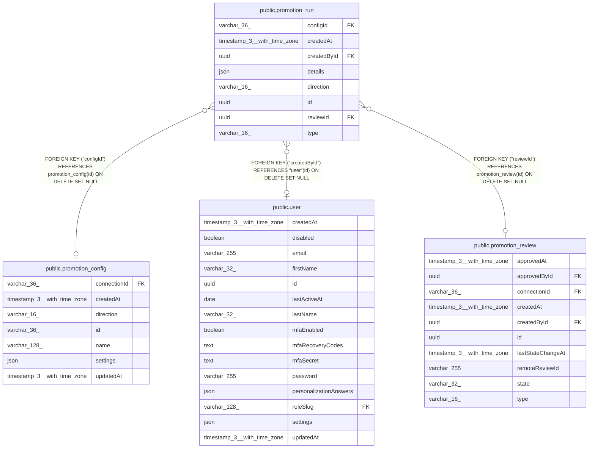

# public.promotion_run

## Columns

| Name | Type | Default | Nullable | Children | Parents | Comment |
| ---- | ---- | ------- | -------- | -------- | ------- | ------- |
| configId | varchar(36) |  | true |  | [public.promotion_config](public.promotion_config.md) | The config this run used. NULL after the config is deleted. |
| createdAt | timestamp(3) with time zone | CURRENT_TIMESTAMP(3) | false |  |  |  |
| createdById | uuid |  | true |  | [public.user](public.user.md) | The user who ran Promote or Apply. |
| details | json |  | true |  |  | Payload for type. A git run stores schemaVersion, branchName and commitSha. NULL when the type has no details. |
| direction | varchar(16) |  | false |  |  | PromotionDirection enum: "promote" pushes to the remote, "apply" imports from it. Copied from the config when the run is written. |
| id | uuid |  | false |  |  |  |
| reviewId | uuid |  | true |  | [public.promotion_review](public.promotion_review.md) | The review this run belongs to. NULL when the push has no review. Not unique: an amend adds another run. |
| type | varchar(16) |  | false |  |  | PromotionRunType enum: "git". Git covers GitHub, GitLab and plain Git. |

## Constraints

| Name | Type | Definition |
| ---- | ---- | ---------- |
| CHK_promotion_run_direction | CHECK | CHECK (((direction)::text = ANY ((ARRAY['promote'::character varying, 'apply'::character varying])::text[]))) |
| CHK_promotion_run_type | CHECK | CHECK (((type)::text = 'git'::text)) |
| FK_promotion_run_configId | FOREIGN KEY | FOREIGN KEY ("configId") REFERENCES promotion_config(id) ON DELETE SET NULL |
| FK_promotion_run_createdById | FOREIGN KEY | FOREIGN KEY ("createdById") REFERENCES "user"(id) ON DELETE SET NULL |
| FK_promotion_run_reviewId | FOREIGN KEY | FOREIGN KEY ("reviewId") REFERENCES promotion_review(id) ON DELETE SET NULL |
| PK_f5b941d810bf2eb7a5f8327f446 | PRIMARY KEY | PRIMARY KEY (id) |
| promotion_run_createdAt_not_null | n | NOT NULL "createdAt" |
| promotion_run_direction_not_null | n | NOT NULL direction |
| promotion_run_id_not_null | n | NOT NULL id |
| promotion_run_type_not_null | n | NOT NULL type |

## Indexes

| Name | Definition |
| ---- | ---------- |
| IDX_5c00951cc85ac1bc6f120b1e69 | CREATE INDEX "IDX_5c00951cc85ac1bc6f120b1e69" ON public.promotion_run USING btree ("configId") |
| IDX_b24c3e6b803dc496c8702f12ab | CREATE INDEX "IDX_b24c3e6b803dc496c8702f12ab" ON public.promotion_run USING btree ("reviewId") |
| PK_f5b941d810bf2eb7a5f8327f446 | CREATE UNIQUE INDEX "PK_f5b941d810bf2eb7a5f8327f446" ON public.promotion_run USING btree (id) |

## Relations

---

> Generated by [tbls](https://github.com/k1LoW/tbls)
