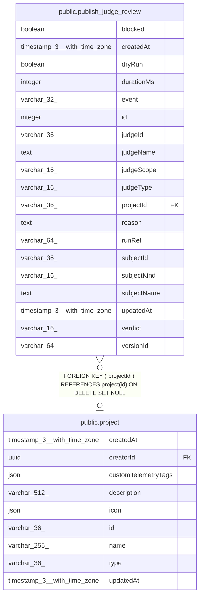

# public.publish_judge_review

## Columns

| Name | Type | Default | Nullable | Children | Parents | Comment |
| ---- | ---- | ------- | -------- | -------- | ------- | ------- |
| blocked | boolean | false | false |  |  | The review stopped the publish or the save |
| createdAt | timestamp(3) with time zone | CURRENT_TIMESTAMP(3) | false |  |  |  |
| dryRun | boolean | false | false |  |  | The judge only recorded its verdict and blocked nothing |
| durationMs | integer |  | false |  |  |  |
| event | varchar(32) |  | false |  |  | What the builder did when the review ran |
| id | integer |  | false |  |  |  |
| judgeId | varchar(36) |  | false |  |  | Id of the judge workflow or agent. No FK: the history outlives the judge |
| judgeName | text |  | false |  |  |  |
| judgeScope | varchar(16) |  | false |  |  | Whether the instance judge or the project judge ran |
| judgeType | varchar(16) |  | false |  |  | Whether the judge is a workflow or an agent |
| projectId | varchar(36) |  | true |  | [public.project](public.project.md) | Project of the reviewed item |
| reason | text |  | true |  |  | Reason that the judge gave to the builder |
| runRef | varchar(64) |  | true |  |  | Execution id of a workflow judge run, or session id of an agent judge run |
| subjectId | varchar(36) |  | true |  |  | Id of the reviewed workflow or agent. Null for one that is not saved yet. No FK: the history outlives the item |
| subjectKind | varchar(16) |  | false |  |  | Whether the reviewed item is a workflow or an agent |
| subjectName | text |  | false |  |  |  |
| updatedAt | timestamp(3) with time zone | CURRENT_TIMESTAMP(3) | false |  |  |  |
| verdict | varchar(16) |  | false |  |  | What the judge answered. noAnswer means it failed or timed out |
| versionId | varchar(64) |  | false |  |  | Version id for a publish. Hash of the content for a save |

## Constraints

| Name | Type | Definition |
| ---- | ---- | ---------- |
| CHK_publish_judge_review_event | CHECK | CHECK (((event)::text = ANY ((ARRAY['workflowPublish'::character varying, 'workflowSave'::character varying, 'agentPublish'::character varying, 'agentSave'::character varying])::text[]))) |
| CHK_publish_judge_review_judgeScope | CHECK | CHECK ((("judgeScope")::text = ANY ((ARRAY['instance'::character varying, 'project'::character varying])::text[]))) |
| CHK_publish_judge_review_judgeType | CHECK | CHECK ((("judgeType")::text = ANY ((ARRAY['workflow'::character varying, 'agent'::character varying])::text[]))) |
| CHK_publish_judge_review_subjectKind | CHECK | CHECK ((("subjectKind")::text = ANY ((ARRAY['workflow'::character varying, 'agent'::character varying])::text[]))) |
| CHK_publish_judge_review_verdict | CHECK | CHECK (((verdict)::text = ANY ((ARRAY['allowed'::character varying, 'refused'::character varying, 'noAnswer'::character varying])::text[]))) |
| FK_7f69aca01a59aa32ed17cb893b2 | FOREIGN KEY | FOREIGN KEY ("projectId") REFERENCES project(id) ON DELETE SET NULL |
| PK_d2989bf4994210f0b9eec499453 | PRIMARY KEY | PRIMARY KEY (id) |
| publish_judge_review_blocked_not_null | n | NOT NULL blocked |
| publish_judge_review_createdAt_not_null | n | NOT NULL "createdAt" |
| publish_judge_review_dryRun_not_null | n | NOT NULL "dryRun" |
| publish_judge_review_durationMs_not_null | n | NOT NULL "durationMs" |
| publish_judge_review_event_not_null | n | NOT NULL event |
| publish_judge_review_id_not_null | n | NOT NULL id |
| publish_judge_review_judgeId_not_null | n | NOT NULL "judgeId" |
| publish_judge_review_judgeName_not_null | n | NOT NULL "judgeName" |
| publish_judge_review_judgeScope_not_null | n | NOT NULL "judgeScope" |
| publish_judge_review_judgeType_not_null | n | NOT NULL "judgeType" |
| publish_judge_review_subjectKind_not_null | n | NOT NULL "subjectKind" |
| publish_judge_review_subjectName_not_null | n | NOT NULL "subjectName" |
| publish_judge_review_updatedAt_not_null | n | NOT NULL "updatedAt" |
| publish_judge_review_verdict_not_null | n | NOT NULL verdict |
| publish_judge_review_versionId_not_null | n | NOT NULL "versionId" |

## Indexes

| Name | Definition |
| ---- | ---------- |
| IDX_6f21b1e565bbea512374527c1b | CREATE INDEX "IDX_6f21b1e565bbea512374527c1b" ON public.publish_judge_review USING btree ("createdAt") |
| PK_d2989bf4994210f0b9eec499453 | CREATE UNIQUE INDEX "PK_d2989bf4994210f0b9eec499453" ON public.publish_judge_review USING btree (id) |

## Relations

---

> Generated by [tbls](https://github.com/k1LoW/tbls)
