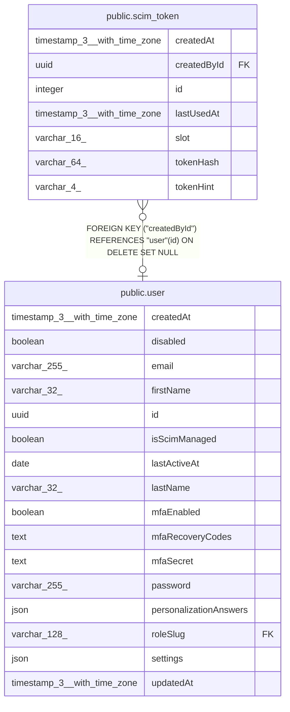

# public.scim_token

## Columns

| Name | Type | Default | Nullable | Children | Parents | Comment |
| ---- | ---- | ------- | -------- | -------- | ------- | ------- |
| createdAt | timestamp(3) with time zone | CURRENT_TIMESTAMP(3) | false |  |  |  |
| createdById | uuid |  | true |  | [public.user](public.user.md) | User who generated the token. NULL after that user is deleted |
| id | integer |  | false |  |  |  |
| lastUsedAt | timestamp(3) with time zone |  | true |  |  | Time of the last SCIM request that the token authenticated |
| slot | varchar(16) | 'instance'::character varying | false |  |  | Always instance. The unique index on it allows one SCIM token for the instance |
| tokenHash | varchar(64) |  | false |  |  | Hex SHA-256 hash of the signed JWT that the identity provider sends as its bearer token |
| tokenHint | varchar(4) |  | false |  |  | Last four characters of the token, so that admins can identify it |

## Constraints

| Name | Type | Definition |
| ---- | ---- | ---------- |
| CHK_scim_token_slot | CHECK | CHECK (((slot)::text = 'instance'::text)) |
| FK_scim_token_createdById | FOREIGN KEY | FOREIGN KEY ("createdById") REFERENCES "user"(id) ON DELETE SET NULL |
| PK_a5715b8446ee4a9cc6c0f19054d | PRIMARY KEY | PRIMARY KEY (id) |
| scim_token_createdAt_not_null | n | NOT NULL "createdAt" |
| scim_token_id_not_null | n | NOT NULL id |
| scim_token_slot_not_null | n | NOT NULL slot |
| scim_token_tokenHash_not_null | n | NOT NULL "tokenHash" |
| scim_token_tokenHint_not_null | n | NOT NULL "tokenHint" |

## Indexes

| Name | Definition |
| ---- | ---------- |
| IDX_ed7fc072bfa05d0fb605da572a | CREATE UNIQUE INDEX "IDX_ed7fc072bfa05d0fb605da572a" ON public.scim_token USING btree (slot) |
| PK_a5715b8446ee4a9cc6c0f19054d | CREATE UNIQUE INDEX "PK_a5715b8446ee4a9cc6c0f19054d" ON public.scim_token USING btree (id) |

## Relations

---

> Generated by [tbls](https://github.com/k1LoW/tbls)
