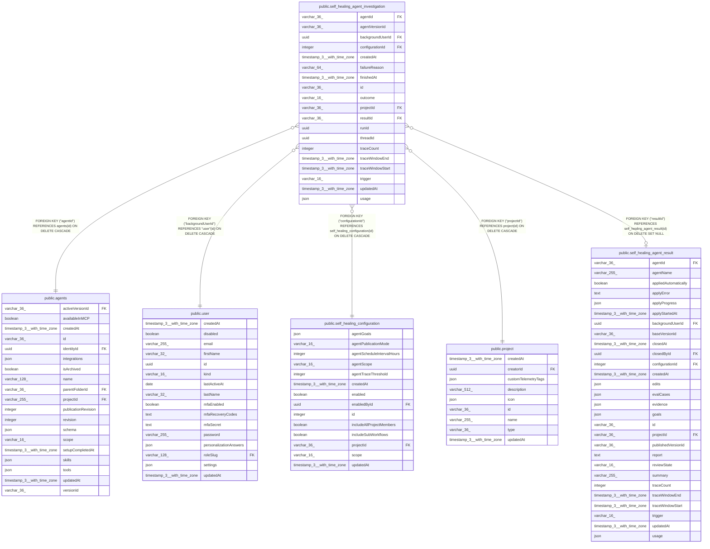

# public.self_healing_agent_investigation

## Columns

| Name | Type | Default | Nullable | Children | Parents | Comment |
| ---- | ---- | ------- | -------- | -------- | ------- | ------- |
| agentId | varchar(36) |  | false |  | [public.agents](public.agents.md) | Investigated agent |
| agentVersionId | varchar(36) |  | false |  |  | Published agent version at admission |
| backgroundUserId | uuid |  | false |  | [public.user](public.user.md) | User who enabled the investigation |
| configurationId | integer |  | false |  | [public.self_healing_configuration](public.self_healing_configuration.md) |  |
| createdAt | timestamp(3) with time zone | CURRENT_TIMESTAMP(3) | false |  |  |  |
| failureReason | varchar(64) |  | true |  |  | Internal reason code of a failed outcome |
| finishedAt | timestamp(3) with time zone |  | true |  |  | When the investigation released its agent claim |
| id | varchar(36) |  | false |  |  |  |
| outcome | varchar(16) |  | true |  |  | Null while the investigation runs |
| projectId | varchar(36) |  | false |  | [public.project](public.project.md) | Project of the agent |
| resultId | varchar(36) |  | true |  | [public.self_healing_agent_result](public.self_healing_agent_result.md) | Proposal saved by the investigation |
| runId | uuid |  | false |  |  | Assistant run ID; technical status stays in run events |
| threadId | uuid |  | false |  |  | Private Assistant thread ID; retained after deletion |
| traceCount | integer | 0 | false |  |  | Production traces in the window at admission |
| traceWindowEnd | timestamp(3) with time zone |  | false |  |  | Inclusive end of the production trace window |
| traceWindowStart | timestamp(3) with time zone |  | true |  |  | Exclusive start of the production trace window; null means no lower limit |
| trigger | varchar(16) |  | false |  |  | What started the investigation; both means schedule and trace count |
| updatedAt | timestamp(3) with time zone | CURRENT_TIMESTAMP(3) | false |  |  |  |
| usage | json |  | true |  |  | Cost of the investigation; null until it finishes |

## Constraints

| Name | Type | Definition |
| ---- | ---- | ---------- |
| CHK_self_healing_agent_investigation_outcome | CHECK | CHECK (((outcome)::text = ANY ((ARRAY['proposal'::character varying, 'no_change'::character varying, 'failed'::character varying])::text[]))) |
| CHK_self_healing_agent_investigation_trigger | CHECK | CHECK (((trigger)::text = ANY ((ARRAY['schedule'::character varying, 'traces'::character varying, 'both'::character varying, 'manual'::character varying])::text[]))) |
| FK_35b4b57ac83d3a248b0e5e374d9 | FOREIGN KEY | FOREIGN KEY ("backgroundUserId") REFERENCES "user"(id) ON DELETE CASCADE |
| FK_39adf98543c36288a3dd6607023 | FOREIGN KEY | FOREIGN KEY ("projectId") REFERENCES project(id) ON DELETE CASCADE |
| FK_482b558ea3a6b55381dd09df0b2 | FOREIGN KEY | FOREIGN KEY ("agentId") REFERENCES agents(id) ON DELETE CASCADE |
| FK_d77ea2fc50ba1e5a7a9c61f0d8a | FOREIGN KEY | FOREIGN KEY ("resultId") REFERENCES self_healing_agent_result(id) ON DELETE SET NULL |
| FK_f2116e85bbc7264d3bfaa2bdc03 | FOREIGN KEY | FOREIGN KEY ("configurationId") REFERENCES self_healing_configuration(id) ON DELETE CASCADE |
| PK_fc64f5cbd0ca7ef019ccc214dc0 | PRIMARY KEY | PRIMARY KEY (id) |
| self_healing_agent_investigation_agentId_not_null | n | NOT NULL "agentId" |
| self_healing_agent_investigation_agentVersionId_not_null | n | NOT NULL "agentVersionId" |
| self_healing_agent_investigation_backgroundUserId_not_null | n | NOT NULL "backgroundUserId" |
| self_healing_agent_investigation_configurationId_not_null | n | NOT NULL "configurationId" |
| self_healing_agent_investigation_createdAt_not_null | n | NOT NULL "createdAt" |
| self_healing_agent_investigation_id_not_null | n | NOT NULL id |
| self_healing_agent_investigation_projectId_not_null | n | NOT NULL "projectId" |
| self_healing_agent_investigation_runId_not_null | n | NOT NULL "runId" |
| self_healing_agent_investigation_threadId_not_null | n | NOT NULL "threadId" |
| self_healing_agent_investigation_traceCount_not_null | n | NOT NULL "traceCount" |
| self_healing_agent_investigation_traceWindowEnd_not_null | n | NOT NULL "traceWindowEnd" |
| self_healing_agent_investigation_trigger_not_null | n | NOT NULL trigger |
| self_healing_agent_investigation_updatedAt_not_null | n | NOT NULL "updatedAt" |

## Indexes

| Name | Definition |
| ---- | ---------- |
| IDX_0c4e8b5a7ebbe012c5539efb09 | CREATE INDEX "IDX_0c4e8b5a7ebbe012c5539efb09" ON public.self_healing_agent_investigation USING btree ("agentId", "createdAt") |
| IDX_35b4b57ac83d3a248b0e5e374d | CREATE INDEX "IDX_35b4b57ac83d3a248b0e5e374d" ON public.self_healing_agent_investigation USING btree ("backgroundUserId") |
| IDX_39adf98543c36288a3dd660702 | CREATE INDEX "IDX_39adf98543c36288a3dd660702" ON public.self_healing_agent_investigation USING btree ("projectId") |
| IDX_d3669e4317d614069db9b66fe3 | CREATE INDEX "IDX_d3669e4317d614069db9b66fe3" ON public.self_healing_agent_investigation USING btree ("configurationId", "createdAt") |
| IDX_d77ea2fc50ba1e5a7a9c61f0d8 | CREATE INDEX "IDX_d77ea2fc50ba1e5a7a9c61f0d8" ON public.self_healing_agent_investigation USING btree ("resultId") |
| IDX_self_healing_agent_investigation_agentId | CREATE UNIQUE INDEX "IDX_self_healing_agent_investigation_agentId" ON public.self_healing_agent_investigation USING btree ("agentId") WHERE ("finishedAt" IS NULL) |
| PK_fc64f5cbd0ca7ef019ccc214dc0 | CREATE UNIQUE INDEX "PK_fc64f5cbd0ca7ef019ccc214dc0" ON public.self_healing_agent_investigation USING btree (id) |

## Relations

---

> Generated by [tbls](https://github.com/k1LoW/tbls)
