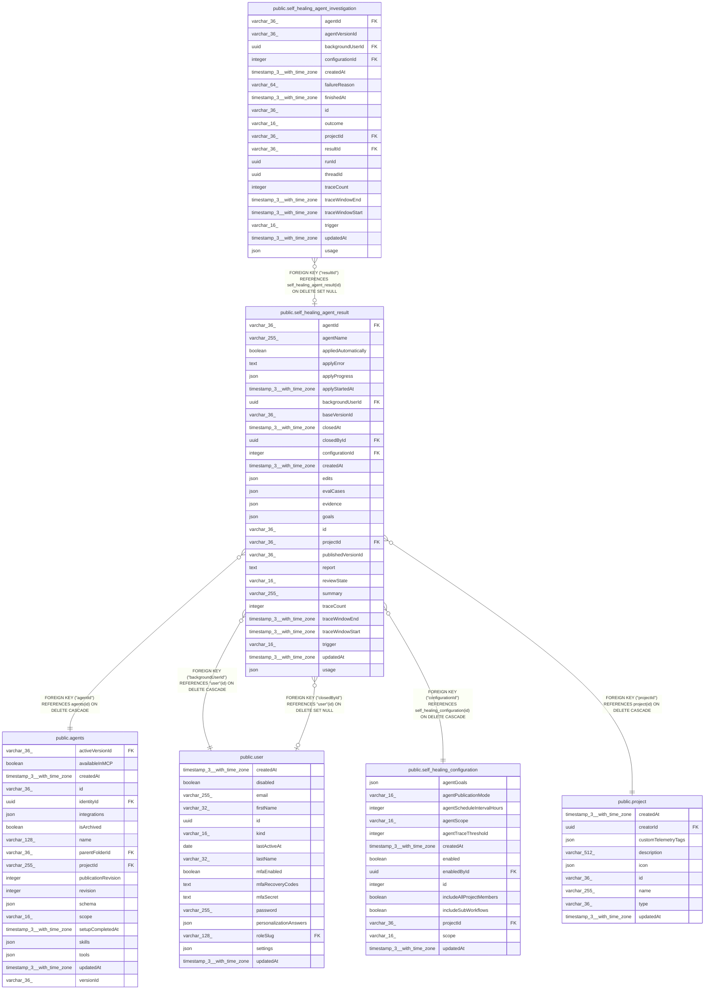

# public.self_healing_agent_result

## Columns

| Name | Type | Default | Nullable | Children | Parents | Comment |
| ---- | ---- | ------- | -------- | -------- | ------- | ------- |
| agentId | varchar(36) |  | false |  | [public.agents](public.agents.md) | Investigated agent |
| agentName | varchar(255) |  | false |  |  | Agent name when the proposal was saved |
| appliedAutomatically | boolean | false | false |  |  | True when the publish-everything mode applied the proposal |
| applyError | text |  | true |  |  | Why the last apply did not finish |
| applyProgress | json |  | false |  |  | Parts of the proposal that are applied; a retry does the remaining parts |
| applyStartedAt | timestamp(3) with time zone |  | true |  |  | Claim of an apply in progress |
| backgroundUserId | uuid |  | false |  | [public.user](public.user.md) | User who enabled the investigation |
| baseVersionId | varchar(36) |  | false |  |  | Published agent version that the investigation read and tested |
| closedAt | timestamp(3) with time zone |  | true |  |  |  |
| closedById | uuid |  | true |  | [public.user](public.user.md) | Reviewer who closed the proposal |
| configurationId | integer |  | false |  | [public.self_healing_configuration](public.self_healing_configuration.md) |  |
| createdAt | timestamp(3) with time zone | CURRENT_TIMESTAMP(3) | false |  |  |  |
| edits | json |  | false |  |  | Tested agent edits with before and after values |
| evalCases | json |  | false |  |  | Eval cases that the proposal adds or updates |
| evidence | json |  | true |  |  | Stored test results of the published and the proposed version |
| goals | json |  | false |  |  | What the investigation tried to improve; quality first, then optional cost and latency |
| id | varchar(36) |  | false | [public.self_healing_agent_investigation](public.self_healing_agent_investigation.md) |  |  |
| projectId | varchar(36) |  | false |  | [public.project](public.project.md) | Project of the agent |
| publishedVersionId | varchar(36) |  | true |  |  | Agent version that the apply published |
| report | text |  | false |  |  | Saved Markdown report |
| reviewState | varchar(16) | 'open'::character varying | false |  |  | Review decision; open proposals wait in the Inbox |
| summary | varchar(255) |  | false |  |  | Short title, at most 80 characters |
| traceCount | integer | 0 | false |  |  | Production traces in the window at admission |
| traceWindowEnd | timestamp(3) with time zone |  | false |  |  | Inclusive end of the production trace window |
| traceWindowStart | timestamp(3) with time zone |  | true |  |  | Exclusive start of the production trace window; null means no lower limit |
| trigger | varchar(16) |  | false |  |  | What started the investigation; both means schedule and trace count |
| updatedAt | timestamp(3) with time zone | CURRENT_TIMESTAMP(3) | false |  |  |  |
| usage | json |  | false |  |  | Recorded runtime and accounting usage; null measurements mean unknown |

## Constraints

| Name | Type | Definition |
| ---- | ---- | ---------- |
| CHK_self_healing_agent_result_reviewState | CHECK | CHECK ((("reviewState")::text = ANY ((ARRAY['open'::character varying, 'applied'::character varying, 'outdated'::character varying, 'dismissed'::character varying])::text[]))) |
| CHK_self_healing_agent_result_trigger | CHECK | CHECK (((trigger)::text = ANY ((ARRAY['schedule'::character varying, 'traces'::character varying, 'both'::character varying, 'manual'::character varying])::text[]))) |
| FK_1548a1c44ceaf9cc2b1e1ccd5af | FOREIGN KEY | FOREIGN KEY ("projectId") REFERENCES project(id) ON DELETE CASCADE |
| FK_53b5e9151f953021e746f4e5d91 | FOREIGN KEY | FOREIGN KEY ("configurationId") REFERENCES self_healing_configuration(id) ON DELETE CASCADE |
| FK_64ded86a7cdfd7b86b6ba4c62c6 | FOREIGN KEY | FOREIGN KEY ("closedById") REFERENCES "user"(id) ON DELETE SET NULL |
| FK_8d89ad7268d4383f5ae0cba8f2c | FOREIGN KEY | FOREIGN KEY ("agentId") REFERENCES agents(id) ON DELETE CASCADE |
| FK_fd2e9d187a0a5656c275757f5b8 | FOREIGN KEY | FOREIGN KEY ("backgroundUserId") REFERENCES "user"(id) ON DELETE CASCADE |
| PK_33722751d41524b37318557a44c | PRIMARY KEY | PRIMARY KEY (id) |
| self_healing_agent_result_agentId_not_null | n | NOT NULL "agentId" |
| self_healing_agent_result_agentName_not_null | n | NOT NULL "agentName" |
| self_healing_agent_result_appliedAutomatically_not_null | n | NOT NULL "appliedAutomatically" |
| self_healing_agent_result_applyProgress_not_null | n | NOT NULL "applyProgress" |
| self_healing_agent_result_backgroundUserId_not_null | n | NOT NULL "backgroundUserId" |
| self_healing_agent_result_baseVersionId_not_null | n | NOT NULL "baseVersionId" |
| self_healing_agent_result_configurationId_not_null | n | NOT NULL "configurationId" |
| self_healing_agent_result_createdAt_not_null | n | NOT NULL "createdAt" |
| self_healing_agent_result_edits_not_null | n | NOT NULL edits |
| self_healing_agent_result_evalCases_not_null | n | NOT NULL "evalCases" |
| self_healing_agent_result_goals_not_null | n | NOT NULL goals |
| self_healing_agent_result_id_not_null | n | NOT NULL id |
| self_healing_agent_result_projectId_not_null | n | NOT NULL "projectId" |
| self_healing_agent_result_report_not_null | n | NOT NULL report |
| self_healing_agent_result_reviewState_not_null | n | NOT NULL "reviewState" |
| self_healing_agent_result_summary_not_null | n | NOT NULL summary |
| self_healing_agent_result_traceCount_not_null | n | NOT NULL "traceCount" |
| self_healing_agent_result_traceWindowEnd_not_null | n | NOT NULL "traceWindowEnd" |
| self_healing_agent_result_trigger_not_null | n | NOT NULL trigger |
| self_healing_agent_result_updatedAt_not_null | n | NOT NULL "updatedAt" |
| self_healing_agent_result_usage_not_null | n | NOT NULL usage |

## Indexes

| Name | Definition |
| ---- | ---------- |
| IDX_123f0219a77a572fbf899ed189 | CREATE INDEX "IDX_123f0219a77a572fbf899ed189" ON public.self_healing_agent_result USING btree ("configurationId", "updatedAt") |
| IDX_64ded86a7cdfd7b86b6ba4c62c | CREATE INDEX "IDX_64ded86a7cdfd7b86b6ba4c62c" ON public.self_healing_agent_result USING btree ("closedById") |
| IDX_75e15c67d53fd37fbd4148b3e3 | CREATE INDEX "IDX_75e15c67d53fd37fbd4148b3e3" ON public.self_healing_agent_result USING btree ("agentId", "reviewState") |
| IDX_ea8248e3f1c5237fc641737150 | CREATE INDEX "IDX_ea8248e3f1c5237fc641737150" ON public.self_healing_agent_result USING btree ("projectId", "reviewState") |
| IDX_fd2e9d187a0a5656c275757f5b | CREATE INDEX "IDX_fd2e9d187a0a5656c275757f5b" ON public.self_healing_agent_result USING btree ("backgroundUserId") |
| PK_33722751d41524b37318557a44c | CREATE UNIQUE INDEX "PK_33722751d41524b37318557a44c" ON public.self_healing_agent_result USING btree (id) |

## Relations

---

> Generated by [tbls](https://github.com/k1LoW/tbls)
