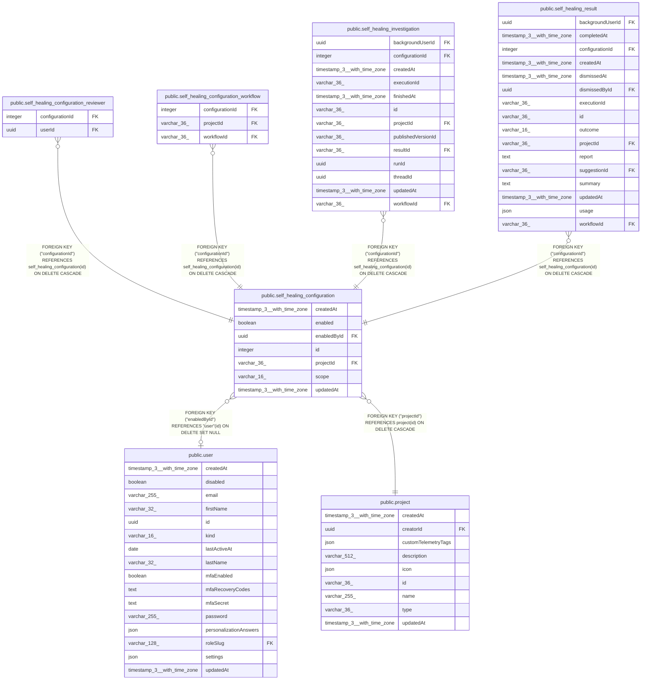

# public.self_healing_configuration

## Columns

| Name | Type | Default | Nullable | Children | Parents | Comment |
| ---- | ---- | ------- | -------- | -------- | ------- | ------- |
| createdAt | timestamp(3) with time zone | CURRENT_TIMESTAMP(3) | false |  |  |  |
| enabled | boolean | false | false |  |  |  |
| enabledById | uuid |  | true |  | [public.user](public.user.md) | User whose access authorizes future investigations |
| id | integer |  | false | [public.self_healing_configuration_reviewer](public.self_healing_configuration_reviewer.md) [public.self_healing_configuration_workflow](public.self_healing_configuration_workflow.md) [public.self_healing_investigation](public.self_healing_investigation.md) [public.self_healing_result](public.self_healing_result.md) |  |  |
| projectId | varchar(36) |  | false |  | [public.project](public.project.md) |  |
| scope | varchar(16) |  | false |  |  | All project workflows or explicit selections |
| updatedAt | timestamp(3) with time zone | CURRENT_TIMESTAMP(3) | false |  |  |  |

## Constraints

| Name | Type | Definition |
| ---- | ---- | ---------- |
| CHK_self_healing_configuration_scope | CHECK | CHECK (((scope)::text = ANY ((ARRAY['all'::character varying, 'selected'::character varying])::text[]))) |
| FK_0a8f9425ffdc01cce5876bc6247 | FOREIGN KEY | FOREIGN KEY ("projectId") REFERENCES project(id) ON DELETE CASCADE |
| FK_2b04620d7af4060ba89412123ea | FOREIGN KEY | FOREIGN KEY ("enabledById") REFERENCES "user"(id) ON DELETE SET NULL |
| PK_ffe1ae2a729e3035ddbdc5f22b6 | PRIMARY KEY | PRIMARY KEY (id) |
| self_healing_configuration_createdAt_not_null | n | NOT NULL "createdAt" |
| self_healing_configuration_enabled_not_null | n | NOT NULL enabled |
| self_healing_configuration_id_not_null | n | NOT NULL id |
| self_healing_configuration_projectId_not_null | n | NOT NULL "projectId" |
| self_healing_configuration_scope_not_null | n | NOT NULL scope |
| self_healing_configuration_updatedAt_not_null | n | NOT NULL "updatedAt" |

## Indexes

| Name | Definition |
| ---- | ---------- |
| IDX_0a8f9425ffdc01cce5876bc624 | CREATE INDEX "IDX_0a8f9425ffdc01cce5876bc624" ON public.self_healing_configuration USING btree ("projectId") |
| IDX_2b04620d7af4060ba89412123e | CREATE INDEX "IDX_2b04620d7af4060ba89412123e" ON public.self_healing_configuration USING btree ("enabledById") |
| IDX_self_healing_configuration_projectId | CREATE UNIQUE INDEX "IDX_self_healing_configuration_projectId" ON public.self_healing_configuration USING btree ("projectId") WHERE ((scope)::text = 'all'::text) |
| PK_ffe1ae2a729e3035ddbdc5f22b6 | CREATE UNIQUE INDEX "PK_ffe1ae2a729e3035ddbdc5f22b6" ON public.self_healing_configuration USING btree (id) |

## Relations

---

> Generated by [tbls](https://github.com/k1LoW/tbls)
