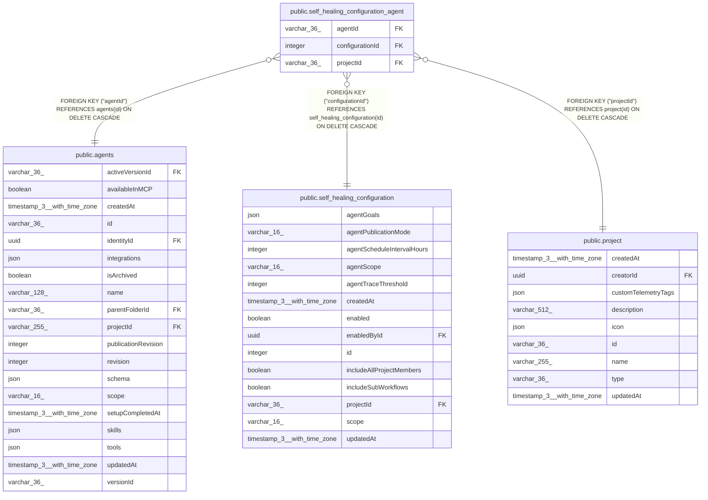

# public.self_healing_configuration_agent

## Columns

| Name | Type | Default | Nullable | Children | Parents | Comment |
| ---- | ---- | ------- | -------- | -------- | ------- | ------- |
| agentId | varchar(36) |  | false |  | [public.agents](public.agents.md) |  |
| configurationId | integer |  | false |  | [public.self_healing_configuration](public.self_healing_configuration.md) |  |
| projectId | varchar(36) |  | false |  | [public.project](public.project.md) | Enforces disjoint selections within a project |

## Constraints

| Name | Type | Definition |
| ---- | ---- | ---------- |
| FK_3e2e714456f9f0d42967eacc18d | FOREIGN KEY | FOREIGN KEY ("configurationId") REFERENCES self_healing_configuration(id) ON DELETE CASCADE |
| FK_72974a6df948f4cdb7f6d21ddb0 | FOREIGN KEY | FOREIGN KEY ("projectId") REFERENCES project(id) ON DELETE CASCADE |
| FK_95785fecd5e12c4af15bfaa49cf | FOREIGN KEY | FOREIGN KEY ("agentId") REFERENCES agents(id) ON DELETE CASCADE |
| PK_419def42f03601d7f42e8bb06a2 | PRIMARY KEY | PRIMARY KEY ("configurationId", "agentId") |
| self_healing_configuration_agent_agentId_not_null | n | NOT NULL "agentId" |
| self_healing_configuration_agent_configurationId_not_null | n | NOT NULL "configurationId" |
| self_healing_configuration_agent_projectId_not_null | n | NOT NULL "projectId" |

## Indexes

| Name | Definition |
| ---- | ---------- |
| IDX_761e991dafae6fa18ea79a5f25 | CREATE UNIQUE INDEX "IDX_761e991dafae6fa18ea79a5f25" ON public.self_healing_configuration_agent USING btree ("projectId", "agentId") |
| IDX_95785fecd5e12c4af15bfaa49c | CREATE INDEX "IDX_95785fecd5e12c4af15bfaa49c" ON public.self_healing_configuration_agent USING btree ("agentId") |
| PK_419def42f03601d7f42e8bb06a2 | CREATE UNIQUE INDEX "PK_419def42f03601d7f42e8bb06a2" ON public.self_healing_configuration_agent USING btree ("configurationId", "agentId") |

## Relations

---

> Generated by [tbls](https://github.com/k1LoW/tbls)
