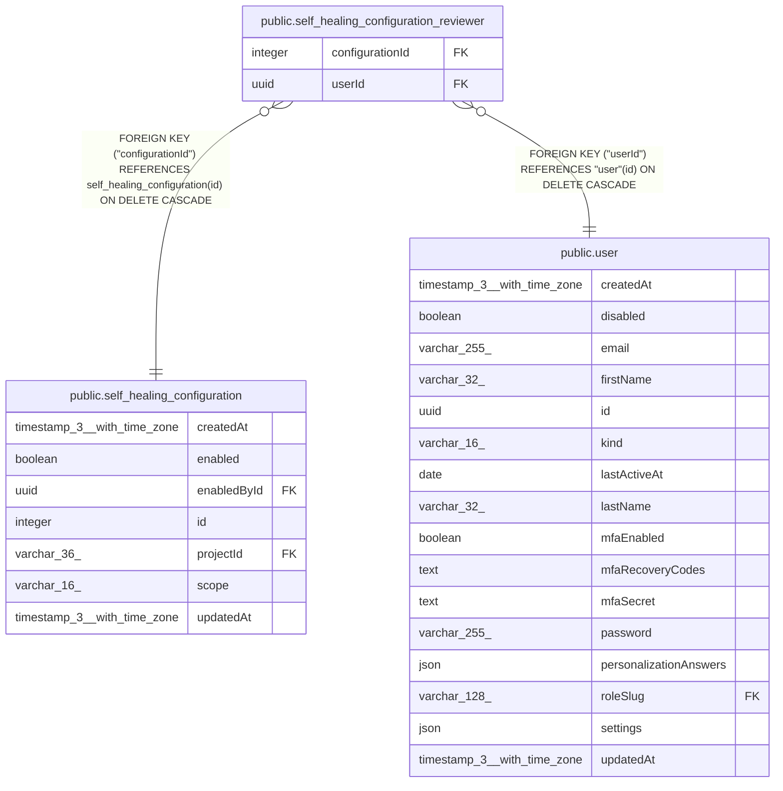

# public.self_healing_configuration_reviewer

## Columns

| Name | Type | Default | Nullable | Children | Parents | Comment |
| ---- | ---- | ------- | -------- | -------- | ------- | ------- |
| configurationId | integer |  | false |  | [public.self_healing_configuration](public.self_healing_configuration.md) |  |
| userId | uuid |  | false |  | [public.user](public.user.md) |  |

## Constraints

| Name | Type | Definition |
| ---- | ---- | ---------- |
| FK_75fdd60d4d2a7d8129107853a51 | FOREIGN KEY | FOREIGN KEY ("configurationId") REFERENCES self_healing_configuration(id) ON DELETE CASCADE |
| FK_e87386774ef62c6aac38fd3e99b | FOREIGN KEY | FOREIGN KEY ("userId") REFERENCES "user"(id) ON DELETE CASCADE |
| PK_c986489025d4299c71802ee4b86 | PRIMARY KEY | PRIMARY KEY ("configurationId", "userId") |
| self_healing_configuration_reviewer_configurationId_not_null | n | NOT NULL "configurationId" |
| self_healing_configuration_reviewer_userId_not_null | n | NOT NULL "userId" |

## Indexes

| Name | Definition |
| ---- | ---------- |
| IDX_e87386774ef62c6aac38fd3e99 | CREATE INDEX "IDX_e87386774ef62c6aac38fd3e99" ON public.self_healing_configuration_reviewer USING btree ("userId") |
| PK_c986489025d4299c71802ee4b86 | CREATE UNIQUE INDEX "PK_c986489025d4299c71802ee4b86" ON public.self_healing_configuration_reviewer USING btree ("configurationId", "userId") |

## Relations

---

> Generated by [tbls](https://github.com/k1LoW/tbls)
