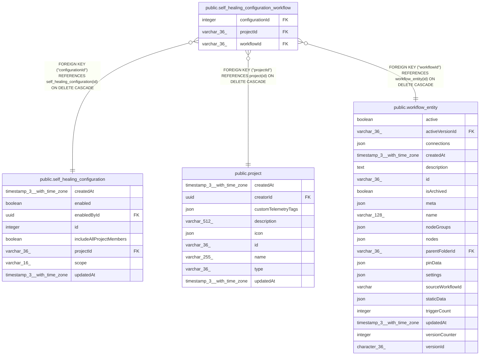

# public.self_healing_configuration_workflow

## Columns

| Name | Type | Default | Nullable | Children | Parents | Comment |
| ---- | ---- | ------- | -------- | -------- | ------- | ------- |
| configurationId | integer |  | false |  | [public.self_healing_configuration](public.self_healing_configuration.md) |  |
| projectId | varchar(36) |  | false |  | [public.project](public.project.md) | Enforces disjoint selections within a project |
| workflowId | varchar(36) |  | false |  | [public.workflow_entity](public.workflow_entity.md) |  |

## Constraints

| Name | Type | Definition |
| ---- | ---- | ---------- |
| FK_1892b567be91ed445357f104043 | FOREIGN KEY | FOREIGN KEY ("projectId") REFERENCES project(id) ON DELETE CASCADE |
| FK_355ef48520a7881610954fed7be | FOREIGN KEY | FOREIGN KEY ("configurationId") REFERENCES self_healing_configuration(id) ON DELETE CASCADE |
| FK_bfd82d710c4ea7de5c38a64dd76 | FOREIGN KEY | FOREIGN KEY ("workflowId") REFERENCES workflow_entity(id) ON DELETE CASCADE |
| PK_4e321fd18a7352bced022188f93 | PRIMARY KEY | PRIMARY KEY ("configurationId", "workflowId") |
| self_healing_configuration_workflow_configurationId_not_null | n | NOT NULL "configurationId" |
| self_healing_configuration_workflow_projectId_not_null | n | NOT NULL "projectId" |
| self_healing_configuration_workflow_workflowId_not_null | n | NOT NULL "workflowId" |

## Indexes

| Name | Definition |
| ---- | ---------- |
| IDX_271ca62ab23c15694161fbfe70 | CREATE UNIQUE INDEX "IDX_271ca62ab23c15694161fbfe70" ON public.self_healing_configuration_workflow USING btree ("projectId", "workflowId") |
| IDX_bfd82d710c4ea7de5c38a64dd7 | CREATE INDEX "IDX_bfd82d710c4ea7de5c38a64dd7" ON public.self_healing_configuration_workflow USING btree ("workflowId") |
| PK_4e321fd18a7352bced022188f93 | CREATE UNIQUE INDEX "PK_4e321fd18a7352bced022188f93" ON public.self_healing_configuration_workflow USING btree ("configurationId", "workflowId") |

## Relations

---

> Generated by [tbls](https://github.com/k1LoW/tbls)
