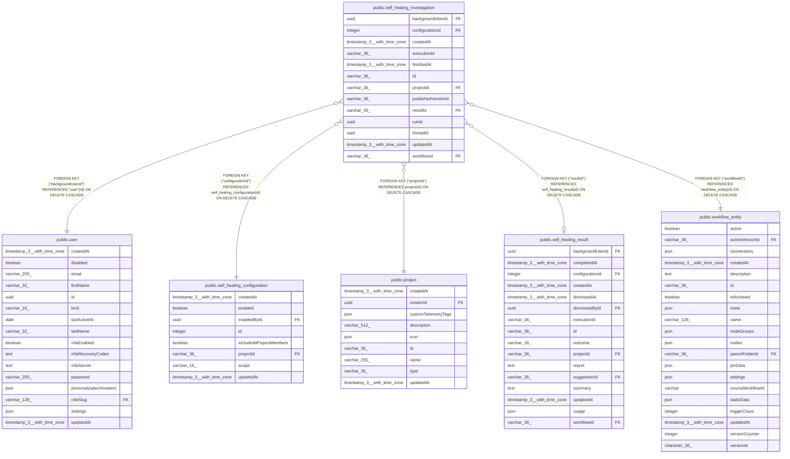

# public.self_healing_investigation

## Columns

| Name | Type | Default | Nullable | Children | Parents | Comment |
| ---- | ---- | ------- | -------- | -------- | ------- | ------- |
| backgroundUserId | uuid |  | false |  | [public.user](public.user.md) | User who enabled the investigation |
| configurationId | integer |  | false |  | [public.self_healing_configuration](public.self_healing_configuration.md) |  |
| createdAt | timestamp(3) with time zone | CURRENT_TIMESTAMP(3) | false |  |  |  |
| executionId | varchar(36) |  | false |  |  | Original execution reference retained after pruning; supports both execution engines |
| finishedAt | timestamp(3) with time zone |  | true |  |  | When the investigation released its workflow claim |
| id | varchar(36) |  | false |  |  |  |
| projectId | varchar(36) |  | false |  | [public.project](public.project.md) | Workflow owner project at admission |
| publishedVersionId | varchar(36) |  | false |  |  | Published workflow version checked at admission |
| resultId | varchar(36) |  | true |  | [public.self_healing_result](public.self_healing_result.md) | Result saved by atomic investigation completion |
| runId | uuid |  | false |  |  | Assistant run ID; technical status stays in run events |
| threadId | uuid |  | false |  |  | Private Assistant thread ID; retained after deletion |
| updatedAt | timestamp(3) with time zone | CURRENT_TIMESTAMP(3) | false |  |  |  |
| workflowId | varchar(36) |  | false |  | [public.workflow_entity](public.workflow_entity.md) | Investigated workflow |

## Constraints

| Name | Type | Definition |
| ---- | ---- | ---------- |
| FK_24923f35caa34c1f264576a7914 | FOREIGN KEY | FOREIGN KEY ("backgroundUserId") REFERENCES "user"(id) ON DELETE CASCADE |
| FK_39a928c9ea7b7afce4bdd1c6dae | FOREIGN KEY | FOREIGN KEY ("resultId") REFERENCES self_healing_result(id) ON DELETE CASCADE |
| FK_7fa67c33c27bcc5d745c75a7eab | FOREIGN KEY | FOREIGN KEY ("workflowId") REFERENCES workflow_entity(id) ON DELETE CASCADE |
| FK_eb5b7d44599bd9a34f02f071b23 | FOREIGN KEY | FOREIGN KEY ("projectId") REFERENCES project(id) ON DELETE CASCADE |
| FK_self_healing_investigation_configuration | FOREIGN KEY | FOREIGN KEY ("configurationId") REFERENCES self_healing_configuration(id) ON DELETE CASCADE |
| PK_735895e1c137cd827884cfa843a | PRIMARY KEY | PRIMARY KEY (id) |
| self_healing_investigation_backgroundUserId_not_null | n | NOT NULL "backgroundUserId" |
| self_healing_investigation_configurationId_not_null | n | NOT NULL "configurationId" |
| self_healing_investigation_createdAt_not_null | n | NOT NULL "createdAt" |
| self_healing_investigation_executionId_not_null | n | NOT NULL "executionId" |
| self_healing_investigation_id_not_null | n | NOT NULL id |
| self_healing_investigation_projectId_not_null | n | NOT NULL "projectId" |
| self_healing_investigation_publishedVersionId_not_null | n | NOT NULL "publishedVersionId" |
| self_healing_investigation_runId_not_null | n | NOT NULL "runId" |
| self_healing_investigation_threadId_not_null | n | NOT NULL "threadId" |
| self_healing_investigation_updatedAt_not_null | n | NOT NULL "updatedAt" |
| self_healing_investigation_workflowId_not_null | n | NOT NULL "workflowId" |

## Indexes

| Name | Definition |
| ---- | ---------- |
| IDX_24923f35caa34c1f264576a791 | CREATE INDEX "IDX_24923f35caa34c1f264576a791" ON public.self_healing_investigation USING btree ("backgroundUserId") |
| IDX_bfdc789961ad0537486e0e2d29 | CREATE UNIQUE INDEX "IDX_bfdc789961ad0537486e0e2d29" ON public.self_healing_investigation USING btree ("workflowId", "executionId") |
| IDX_eb5b7d44599bd9a34f02f071b2 | CREATE INDEX "IDX_eb5b7d44599bd9a34f02f071b2" ON public.self_healing_investigation USING btree ("projectId") |
| IDX_self_healing_investigation_configurationId | CREATE INDEX "IDX_self_healing_investigation_configurationId" ON public.self_healing_investigation USING btree ("configurationId") |
| IDX_self_healing_investigation_resultId | CREATE UNIQUE INDEX "IDX_self_healing_investigation_resultId" ON public.self_healing_investigation USING btree ("resultId") WHERE ("resultId" IS NOT NULL) |
| IDX_self_healing_investigation_workflowId | CREATE UNIQUE INDEX "IDX_self_healing_investigation_workflowId" ON public.self_healing_investigation USING btree ("workflowId") WHERE ("finishedAt" IS NULL) |
| PK_735895e1c137cd827884cfa843a | CREATE UNIQUE INDEX "PK_735895e1c137cd827884cfa843a" ON public.self_healing_investigation USING btree (id) |

## Relations

---

> Generated by [tbls](https://github.com/k1LoW/tbls)
