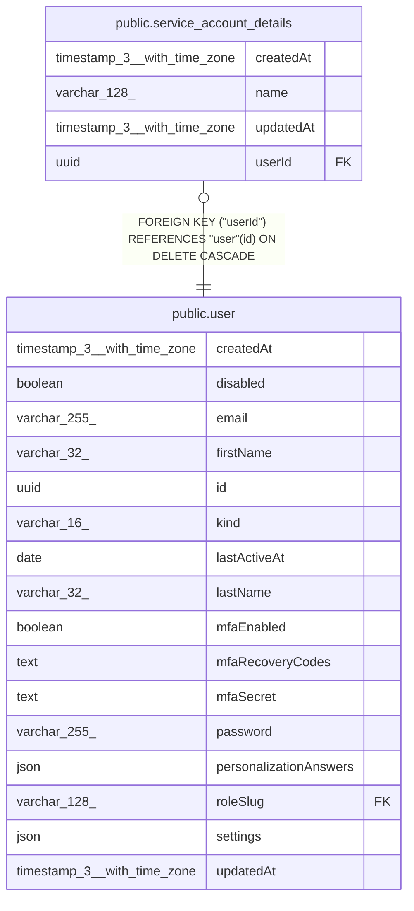

# public.service_account_details

## Columns

| Name | Type | Default | Nullable | Children | Parents | Comment |
| ---- | ---- | ------- | -------- | -------- | ------- | ------- |
| createdAt | timestamp(3) with time zone | CURRENT_TIMESTAMP(3) | false |  |  |  |
| name | varchar(128) |  | false |  |  | Display name of the service account |
| updatedAt | timestamp(3) with time zone | CURRENT_TIMESTAMP(3) | false |  |  |  |
| userId | uuid |  | false |  | [public.user](public.user.md) | ID of the service account in the user table |

## Constraints

| Name | Type | Definition |
| ---- | ---- | ---------- |
| FK_service_account_details_userId | FOREIGN KEY | FOREIGN KEY ("userId") REFERENCES "user"(id) ON DELETE CASCADE |
| PK_77005c3f2e094b2bd756d1f2ee0 | PRIMARY KEY | PRIMARY KEY ("userId") |
| service_account_details_createdAt_not_null | n | NOT NULL "createdAt" |
| service_account_details_name_not_null | n | NOT NULL name |
| service_account_details_updatedAt_not_null | n | NOT NULL "updatedAt" |
| service_account_details_userId_not_null | n | NOT NULL "userId" |

## Indexes

| Name | Definition |
| ---- | ---------- |
| PK_77005c3f2e094b2bd756d1f2ee0 | CREATE UNIQUE INDEX "PK_77005c3f2e094b2bd756d1f2ee0" ON public.service_account_details USING btree ("userId") |

## Relations

---

> Generated by [tbls](https://github.com/k1LoW/tbls)
