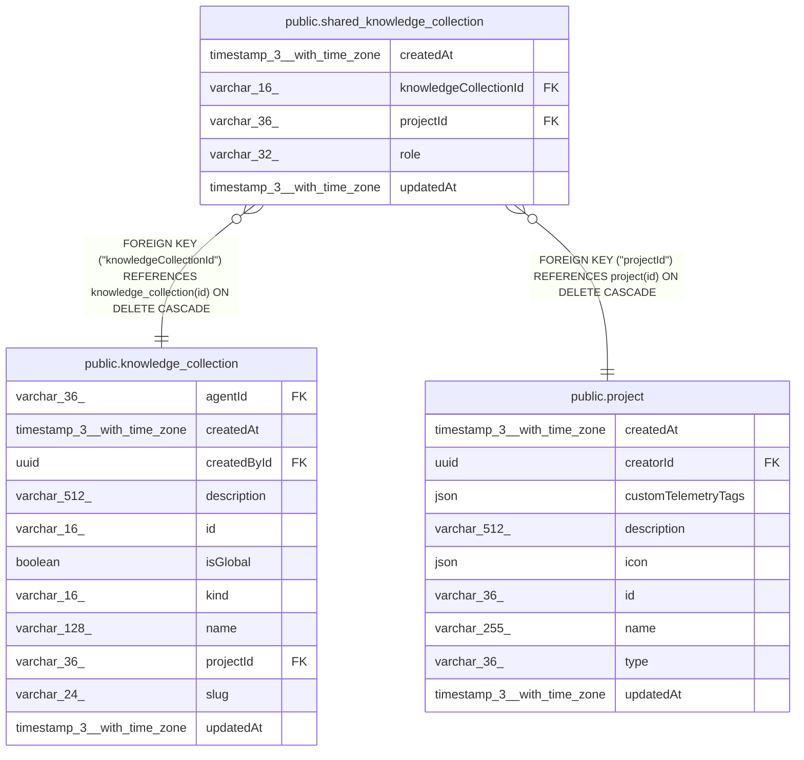

# public.shared_knowledge_collection

## Columns

| Name | Type | Default | Nullable | Children | Parents | Comment |
| ---- | ---- | ------- | -------- | -------- | ------- | ------- |
| createdAt | timestamp(3) with time zone | CURRENT_TIMESTAMP(3) | false |  |  |  |
| knowledgeCollectionId | varchar(16) |  | false |  | [public.knowledge_collection](public.knowledge_collection.md) |  |
| projectId | varchar(36) |  | false |  | [public.project](public.project.md) |  |
| role | varchar(32) |  | false |  |  | 'knowledgeCollection:owner' (the home project, as in knowledge_collection.projectId) or 'knowledgeCollection:user' |
| updatedAt | timestamp(3) with time zone | CURRENT_TIMESTAMP(3) | false |  |  |  |

## Constraints

| Name | Type | Definition |
| ---- | ---- | ---------- |
| FK_453e7baab9b2d4f7a02569cca80 | FOREIGN KEY | FOREIGN KEY ("knowledgeCollectionId") REFERENCES knowledge_collection(id) ON DELETE CASCADE |
| FK_86b015e85d35453e6a5d653c41c | FOREIGN KEY | FOREIGN KEY ("projectId") REFERENCES project(id) ON DELETE CASCADE |
| PK_0f0451e44af79cf826fdddf9ae8 | PRIMARY KEY | PRIMARY KEY ("knowledgeCollectionId", "projectId") |
| shared_knowledge_collection_createdAt_not_null | n | NOT NULL "createdAt" |
| shared_knowledge_collection_knowledgeCollectionId_not_null | n | NOT NULL "knowledgeCollectionId" |
| shared_knowledge_collection_projectId_not_null | n | NOT NULL "projectId" |
| shared_knowledge_collection_role_not_null | n | NOT NULL role |
| shared_knowledge_collection_updatedAt_not_null | n | NOT NULL "updatedAt" |

## Indexes

| Name | Definition |
| ---- | ---------- |
| IDX_86b015e85d35453e6a5d653c41 | CREATE INDEX "IDX_86b015e85d35453e6a5d653c41" ON public.shared_knowledge_collection USING btree ("projectId") |
| IDX_shared_knowledge_collection_owner | CREATE UNIQUE INDEX "IDX_shared_knowledge_collection_owner" ON public.shared_knowledge_collection USING btree ("knowledgeCollectionId") WHERE ((role)::text = 'knowledgeCollection:owner'::text) |
| PK_0f0451e44af79cf826fdddf9ae8 | CREATE UNIQUE INDEX "PK_0f0451e44af79cf826fdddf9ae8" ON public.shared_knowledge_collection USING btree ("knowledgeCollectionId", "projectId") |

## Relations

---

> Generated by [tbls](https://github.com/k1LoW/tbls)
